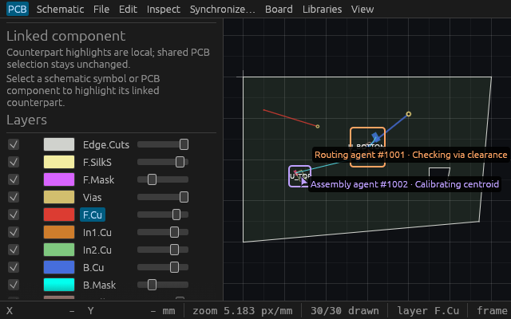
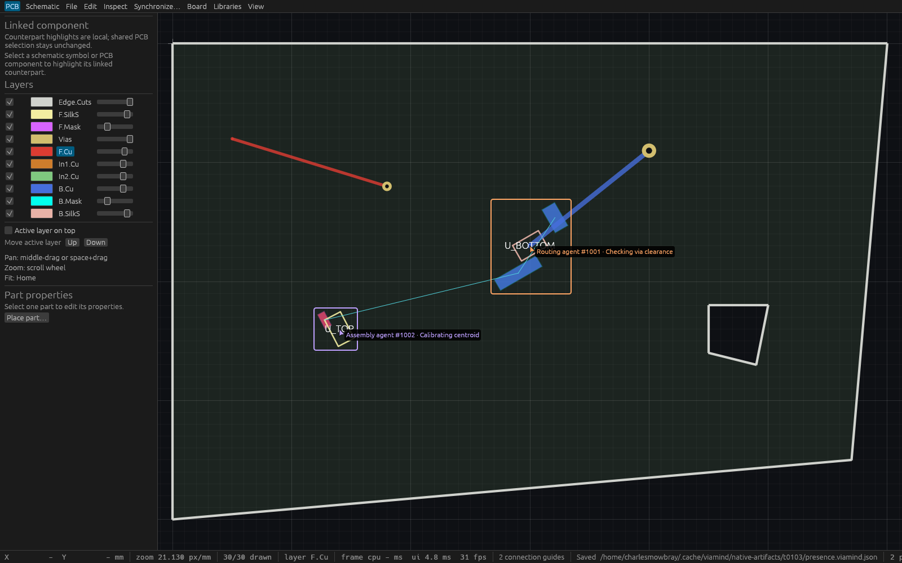

# Agent attention on the PCB

Agents can explicitly show a cursor, selected board objects and a short working
label through MCP. The PCB canvas draws each participant in a connection-based
color, with a name and numeric connection suffix. These markers describe
attention; they do not reserve objects or change the human's selection.

1. Call `get_session_state` for the current project ID and cursor stream ID.
2. Call `set_agent_presence` with `expected_project`, `expected_stream`, an
   integer-Nm `cursor: {x, y}`, `selection` and `working_on`.
3. Renew by calling the same tool before its 30-second lease expires, or call
   `clear_agent_presence` with the project/stream guards to remove your marker.
4. `query_agent_presence` takes `{}` and returns current context, markers and
   remaining lease milliseconds. Queries and drawing never renew a lease.

Only the initialized MCP connection owns its marker. Client names are display
text, and neither names nor tool arguments can impersonate another connection.
At most 32 markers are retained. A new participant at capacity receives an error;
existing participants can renew or clear. Disconnecting does not immediately
remove a marker: it expires after its last successful update.

Cursor coordinates are bounded to ±10,000 mm on each axis. Selection accepts up
to 64 distinct existing PCB part/track/via IDs. `working_on` must be trimmed and
control-free, with at most 80 characters and 256 UTF-8 bytes. Names are sanitized
and bounded separately. Invalid updates preserve the previous marker. New/Open,
including reopening the same project UUID, changes the stream and invalidates
old markers and guards. Ordinary edits and undo retain current attention; deleted
selected objects are hidden from observations and drawing.

Visible selected geometry uses the existing cached selection bounds as colored
rectangles. Cursor labels wrap and are clipped to the PCB canvas. The overlay
has no input target and does not move the camera. It requests repaint while
leases exist; this is not a frame-rate guarantee. Read-only startup agents can
query attention, while both presence writers are unavailable. Human editing
continues in that mode.

This increment covers explicit PCB attention. Schematic markers, automatic
intent inference and following another agent's camera remain future work.

## Linux verification

The [public-source specification](specs/agent-pcb-presence.md) was independently
approved before implementation. The initial complete Linux run at
`49863aa093eb892cac9af08611f487a03b2da763` passed formatting, strict workspace
all-target Clippy, **718 workspace tests, 0 failures, 1 ignored**, and the
workspace/native inspection build. It also passed six focused tests. An initial
compile attempt's four schemars integer literal type errors are retained in the
evidence and were fixed before runtime verification.

Independent review then identified that lease time must be sampled after both
locks are acquired. Corrected combined source
`a1a3df58797bd9898d13e0c2f2360dc2de244b0e`, based on merged assembly main
`f568574e3c62f0fdbf2e3ef4ce26caf466203f1e`, passed formatting, strict workspace
all-target Clippy, **seven focused tests**, and the workspace/native build. The
clock regression asserts that both locks are held when the clock is sampled and
that a lease is absent exactly at its deadline. Real egui input also verifies
that human edit/undo works while both markers remain visible.

Actual production PID **1788610**, HTTP port **7927**, passed **40 transport
checks** with two identical client names, strict forged-owner refusal, invalid
input atomicity, exact scalar bounds, 32 leases, refusal of a 33rd without peer
eviction, renewal at capacity, current cursor provenance, complete session/status
and native-byte preservation. Fresh actual stdio processes verify live presence,
same-UUID reopen/New invalidation, stale guard refusal, and read-only discovery
and direct-call refusal. Actual catalog discovery found **88 tools**, and the
existing isolated agent workflow passed **18 checks**.

Separate native WGPU inspection hosts seeded two trusted engine markers before
launch. Compact PID **1789559** captured **640×400**; wide PID **1790165** captured
**1600×1000**. Each checked the complete session and native bytes on every active
UI callback, fsynced new opaque RGB pixels from an actual eframe Screenshot event,
and self-closed after 11 callbacks. Lossless PNG encoding verified exact RGB
readback. Both images were viewed and show readable distinct labels and selected
bounds. These seeded renderer captures and synthetic egui input are separate
from the real production transport evidence. No OS-input, presented-frame or
frame-cadence claim is made.

See [master source/binary/artifact hashes](verification/t0103/master.json),
[production checks](verification/t0103/production-proof.json),
[executed probe](verification/t0103/presence-smoke.py),
[combined Linux log](verification/t0103/refresh.log), and
[initial complete Linux log](verification/t0103/full-retry1.log).
The executable copies and native P6 sources are retained in the master's named
home-cache locations. Probe outputs must be NEW directories against an owned
scratch desktop. Final independent review and exact PR-head CI are required
before merge; historical evidence keeps its original source identities.
