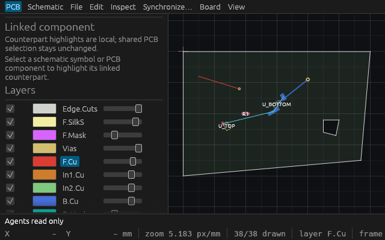

# Startup agent read-only mode: Linux verification

The public behavior specification is [agent-read-only-mode.md](specs/agent-read-only-mode.md).
The durable evidence inventory is [t0099/master.json](verification/t0099/master.json).

## Production admission

Retained source `a286d380cff8b90bf1a236997e36bb5aa3b581e7`, based on
`f7d73811f5229ff77712014628861f19d6beea4f`, passed formatting, strict
workspace/all-target Clippy, seven focused regressions, **671 workspace tests**
(zero failed, one ignored), workspace build and the native inspection build.
Thirteen Python tooling tests, actual discovery of 81 live tools, canonical
reference drift verification and the original 18-step agent workflow passed.
Build source inputs and hashes are retained separately from later integration.
The published verification tag `verification/t0099/native-source` retains the
exact native host source and its production-source ancestor across rebases;
GitHub resolves the original production commit. This tag is source retention,
with no release workflow or artifact publication.

The unchanged production application was launched through Cua Driver with
`--agent-read-only --open` on the owned scratch native fixture, HTTP port 7925.
Its executable and `/proc/1556102/exe` had the same SHA-256; the socket was owned
by that PID. Two independent HTTP sessions and a fresh restricted stdio process
passed **45 checks**:

- Actual live discovery is compared with restricted discovery. Every hidden
  tool is called directly using forged human/admin names and mode/read-only
  hints; the protocol rejects it before dispatch.
- All four SVG/PNG views remove `path` from discovery and refuse string, null,
  boolean and object path arguments. Actual path-free rendering still succeeds,
  including PNG image content.
- DRC, queries, event observation and automatic DRC status remain admitted.
- Full session, native bytes, document status and destination absence remain
  unchanged; the two HTTP clients observe exactly the same complete state.
- Stdio and HTTP expose the same restricted definitions and initialization
  instructions disclose the process policy.

Reproduce against an owned production desktop opening the supplied scratch file:

```sh
python3 docs/verification/t0099-read-only-smoke.py \
  --binary /absolute/path/to/viamind \
  --project /absolute/path/to/owned-scratch.viamind.json \
  --repo . --endpoint http://127.0.0.1:7925/mcp \
  --output /absolute/path/to/NEW-proof-directory
```

The probe observes the desktop and attempts blocked operations. It does not
perform a human edit. Run it only against the owned scratch document it names.

## Human editing and native pixels

The actual 640×400 egui regression opens **Edit → Place test resistor**, verifies
the new part and dirty state, uses keyboard undo and verifies exact project
restoration. It also checks the schematic mode label, unavailable MCP endpoint
label and unchanged default-live helpers. Real two-client HTTP tests observe
trusted human engine edits, undo and redo while all agent writes remain blocked.

The native inspection host in
`crates/ui-egui/examples/t0099_inspection.rs` runs actual local egui menu placement,
Ctrl+Z and Ctrl+Shift+Z, then carries that production app state into a fixed
640×400 native WGPU window. The actual framebuffer visibly shows **Agents read
only** and the added resistor. Full `SessionSnapshot` and protected native bytes
are asserted before and after production UI passes. The capture is opaque P6 RGB,
losslessly encoded to PNG with exact decoded RGB verification. Eleven UI passes
are recorded; they are not a presentation/cadence measurement.

Inspection-only source `cacdb1f` corrects one-time capture guard ordering: after
capture/report fsync, the host checks its captured state before production
dirty-document close confirmation can cancel the close. Formatting, strict
example Clippy and example build passed. Native PID 1561380 closed itself after
the proof; no running-process hash is claimed for that exited host.



A separate fresh Cua snapshot of exact production PID/window returned readable
board pixels and the same mode label. AT-SPI was unavailable, so its partial
window tree is discovery evidence; no semantic widget-state or native input
claim depends on it.

## Limits and integration

This is a process-wide startup policy. It does not add per-client authentication,
dynamic mode switching, approval ghosts or an operating-system sandbox. The
application's default live registry remains unchanged; new tools default to
blocked until explicitly audited as observations. Human editing continues to use
the shared engine.

Later merged feature observations and final combined catalog/build/CI evidence
are recorded separately when integrated. Historical full-gate and native hashes
retain their actual source identity.
