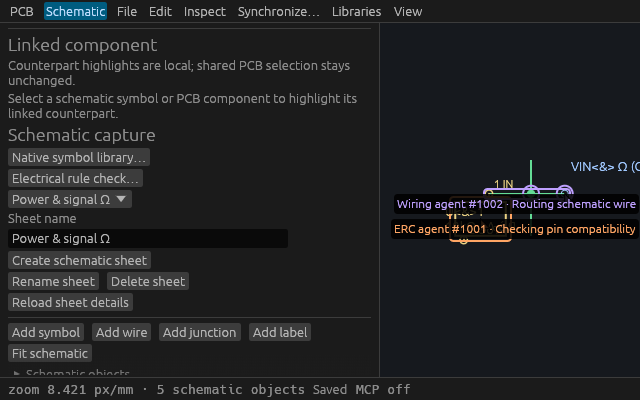
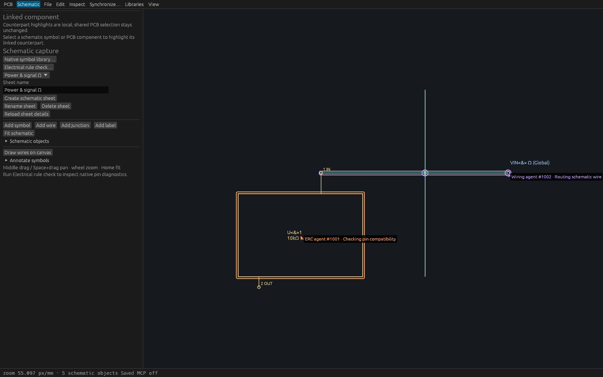

# Explicit schematic agent attention

T-0105 extends the existing three attention tools to one explicitly selected native schematic sheet. Omit `surface` for the existing PCB behavior, or send `"surface":{"kind":"schematic","sheet":"<existing-sheet-UUID>"}`. Query returns that surface only for schematic markers; legacy PCB responses keep their shape.

An initialized MCP connection owns one marker across PCB and all sheets. A successful update switches its surface and renews its30second lease; query never renews. All surfaces share the same32participant capacity. Names and working text are presentation only; the numeric owner comes from trusted transport context. A client cannot select or clear a peer by claiming its name/connection.

Use the current project UUID and stream UUID from `get_session_state`; ordinary edits do not stale these guards. Select at most64 distinct symbols, wires, junctions or labels belonging to the identified sheet. Nested pins, other sheets, PCB objects, unknown IDs and sheet IDs refuse atomically. An existing empty sheet accepts an empty selection and cursor. Strict surface decoding rejects null, unknown fields/kinds, missing sheet, and a PCB surface containing a sheet field.

Deleting an object filters it from observation; undo can expose its still-stored selected ID again. Deleting a sheet prunes the entire marker on the next attention query/update; undo does not recreate that pruned lease. New/Open/reopen invalidates all old-stream attention. Presence operations leave project, command history, human selection, dirty/native state and local editing drafts unchanged. Startup agent read-only mode admits query and excludes both writers.

## Desktop behavior

Only PCB markers draw in PCB view. Only markers for the currently displayed sheet draw in schematic view. Both use the existing view camera and clipped, noninteractive colored cursor/name/working label. Selected symbol highlights enclose the transformed rectangular body, wires enclose endpoints, and junction/label anchor rings identify selected points. This does not assert bounds for symbol pin text or label text. Empty-sheet cursors render without sheet content. The overlay borrows already displayed schematic content and performs bounded identity lookups; it does not take an additional schematic clone. Repaint is requested after250ms while markers exist; no frame-rate claim follows.

## Verification

See the public [behavior spec](specs/schematic-agent-presence.md). Production transport, native inspection and local synthetic egui input have separate provenance. Native inspection seeds two bounded trusted engine markers before launch; its self-closing WGPU Screenshot evidence does not imply OS input or transport ownership. Actual initialized HTTP/stdio and read-only checks establish transport behavior. Actual egui UI checks independently cover view/sheet filtering, exact odd-Nm transformed bounds, empty-sheet attention and human shared edit/undo.

Full Linux gates, exact executable/artifact hashes and final combined catalog/CI evidence are recorded in the accompanying verification master. Broader automatic agent intent, shared cameras, agent document branches and hierarchy import remain separate story work.

## Recorded production and native evidence

[Verification master](verification/t0105/master.json) identifies full source `f349f3ac7be4b0c8343260b2f7c0e3a9bb4426ff`, base `3c52571`, retained production SHA256 `aab2e9a93d616bf4f01f1e11070f0dbc14c0e70f8978dfc2731f67849f23d153` and actual desktop PID1916991/HTTP7936. [55 actual production checks](verification/t0105/production-proof.json) cover same-name ownership, strict schematic selection/surface refusal without lease renewal, empty-sheet switching, legacy PCB shape,32-lease capacity, stream invalidation and actual live/read-only stdio. Project/history/status/native bytes remain unchanged. The portable [production probe](verification/t0105/production-probe.py) takes an owned endpoint, unique retained binary, copied combined fixture and NEW output directory.

[Full Linux log](verification/t0105/linux-full.log) records744 tests/0failed/1ignored, formatting, strict workspace/all-target Clippy and workspace/example build. Actual discovery/drift88-tool checks,18 isolated workflows and13 tooling unit tests pass. The independent connectivity agent reviewed final product/spec source before evidence publication. Latest-base combined gate and exact-head CI remain merge requirements.

Both native hosts close themselves after11 UI callbacks, assert full SessionSnapshot and native bytes every callback, and fsync NEW opaque P6 capture/report files. The committed PNGs were losslessly converted and every decoded RGB byte independently compared with the original captures; exact dimensions/PIDs/hashes are in the master. Compact existing geometry/pin text can be clipped by the canvas; both attention labels are readable. Cua's actual-production snapshot is degraded metadata only and carries no checked-state claim.

To reproduce, build/retain the exact source and run `schematic_presence_inspection` with a copy of the committed combined fixture, NEW PPM path, NEW report path, and optional fourth argument `wide`. This host seeds engine attention explicitly and uses the real production ViamindApp/native WGPU renderer. The production HTTP/stdio probe and actual local egui input tests remain separate proofs.
