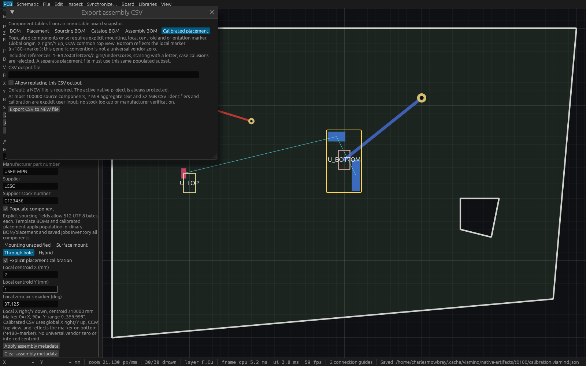

# Calibrated assembly placement verification

T-0100 implements explicitly entered mounting, component-local centroid and a generic top-view zero marker. This is not manufacturer rotation calibration, automatic centroid inference, or vendor acceptance. See [behavior and bounds](calibrated-assembly-placement.md) and the independently approved [public-source spec](specs/assembly-placement-calibration.md).

## Actual production application

The successful report is [t0100-production-report.json](verification/t0100-production-report.json): **30 checks, passed=true**. It was produced by the corrected portable [probe](verification/t0100-calibration-smoke.py), including an initialized MCP stdio handshake before native save/open. The retained executable is `/home/charlesmowbray/.cache/viamind/native-artifacts/t0100/production-verified`, SHA256 `7d4791fde97ff2954f83a7ffaf4c66ef8440f62e15b6c22cde1bfca23479557b`, compiled from `c33f0e8def8ce2c8df75db6d7febbc4e8bc6273b` on merged named-net-rule base `b845cb7`. That historical source predates the unrelated later editor and read-only-mode integrations. It was launched as the actual desktop application, PID1678620, HTTP port7926. Both its on-disk and live `/proc/1678620/exe` hashes matched. The independent inspection host below is a separate process.

The [asymmetric native fixture](../fixtures/assembly/calibration.viamind.json) has SHA256 `d39095a29c4a0539c4ff90bd06a64832e721f1a5c4d1b489b3db59ed5c60a711`. Top component origin(10,20)mm, rotation90°, local centroid(2,1)mm and marker37.125° produce (11,-18)mm/127.125°. Bottom origin(30,17)mm with the same local values produces (31,-19)mm/232.875°. The probe derives these with separate Python vector math and parses CSV independently, including Unicode, comma and quotes. A subsequent non-cardinal edit is independently checked too.

Two initialized HTTP clients and a display-free CLI produce identical bytes. The successful run covers metadata queries, complete stale-Part/cursor guards, invalid/partial metadata, population and included counts, collision, explicit overwrite, each process's active-native protection, native9 save/open and undo. Five older CSV formats, absent-new-field canonical native7 bytes and ten existing saved-job payloads are compared against retained earlier production executable SHA256 `3695983063d742030706b2796fe13d6cc800b746a0bdaaaca68abfad4825739a`. Existing job profiles refuse the extra calibrated output. Read-only exports/refusals preserve the entire SessionSnapshot and document status; three later peer edits followed by undo restore the original project/native status while the cursor honestly advances from sequence0 to6.

### Historical harness failures

The successful report above supersedes two explicitly retained failed attempts:

- [Wrong-path attempt](verification/t0100-historical-wrong-path-report.json):12 checks passed, then the harness asked a separate CLI opened on fixtureA to overwrite actual desktop-nativeB. Explicit overwrite was permitted for that CLI's unrelated destination. The owned isolated nativeB temporarily contained CSV; it was immediately atomically restored byte-for-byte from the known fixture. The [restoration report](verification/t0100-harness-restoration.json) records exact hashes and unchanged desktop full session/status. The corrected test targets the CLI's own opened source and separately checks the desktop's native path through its own MCP host.
- [Uninitialized-stdio attempt](verification/t0100-historical-uninitialized-stdio-report.json):13 checks passed, then a naive EOF invocation attempted save before MCP initialization. The corrected probe performs the real bounded stdio initialize/session/clean-exit sequence. This was a harness error, not a native-save application failure.

Neither failed report is counted as a successful run.

## Linux gates and integration

The original complete four-gate run on `c33f0e8` passed formatting, strict all-target workspace Clippy, **708 workspace tests /0 failed /1 ignored**, and workspace build. Its retained log is `~/.cache/viamind/native-artifacts/t0100/full-c33f0e8.log`.

A subsequent editor-base integration at `604659f28e97461097279fcd9ea676c66626dbe9` passed the same strict lint/build and17 focused model/engine/UI/MCP tests. Its actual complete-application85-tool reference generation and18 isolated workflow checks are retained as [historical catalog](verification/t0100-pre-read-only-catalog.json) and [historical workflow](verification/t0100-pre-read-only-workflow.json). The log `combined-and-inspection.log` then stops at an external inspection-only compilation error: its synthetic MouseWheel required the current egui TouchPhase. This one-line helper correction is separate from the application checks.

The final integration includes merged explicit read-only agent admission. Its focused regression confirms `query_parts` observes explicit calibration while `set_part_assembly` and `export_assembly_csv` are unavailable and cannot mutate or publish. The final integration at `6bfe004` passed22 focused tests, formatting, strict all-target workspace Clippy and workspace build. The actual unique binary regenerated85 canonical tools and passed the exact reference drift check plus18 isolated workflow checks;13 tooling unit tests also passed. [Master identities and hashes](verification/t0100-verification.json), [final catalog](verification/t0100-final-catalog.json), [final workflow](verification/t0100-final-workflow.json) and [combined log](verification/t0100-final-combined.log) distinguish this source from historical production evidence. Fresh final-head CI remains the merge gate.

## Native framebuffer inspection



The [native inspection report](verification/t0100-native-inspection-report.json) records two local pointer events selecting Calibrated placement, one local inspector scroll, all export controls visible, opaque1600×1000 native pixels and unchanged complete session after initial explicit selection. Mounting, centroid(2,1)mm, marker37.125°, Apply/Clear and the asymmetric PCB/cutout are readable. The helper compiled from final integration `6bfe004`, produced the NEW/fsynced capture, then closed itself (PID1732280 no longer running). [Lossless conversion report](verification/t0100-capture-conversion.json) verifies every decoded PNG RGB byte equals the P6 capture. This is separate from the retained actual production application on7926.

## Reproduction

Build a unique production binary, retain its source and SHA256, and create a NEW work directory. Launch the actual application on an unused coordinated port using a copy of the fixture as its active native file. Run:

```sh
python3 docs/verification/t0100-calibration-smoke.py \
  --binary /absolute/verified/viamind \
  --previous-binary /absolute/retained/prior/viamind \
  --project fixtures/assembly/calibration.viamind.json \
  --directory /absolute/NEW/probe-directory \
  --repo "$PWD" --endpoint http://127.0.0.1:PORT/mcp
```

The prior executable is required for historical byte comparisons. Use a live writable application MCP host for the mutation/export probe; a host launched with `--agent-read-only` intentionally excludes these tools.

The [inspection source](verification/t0100-native-inspection.rs) and [manifest template](verification/t0100-native-Cargo.toml.in) reproduce the separate fixed1600×1000 production ViamindApp host. Replace `@REPO@` with an absolute checkout path, compile against that frozen source, and provide fixture plus a NEW PPM path. It injects two local egui pointer events to select Calibrated placement and one local inspector scroll event. It asserts the full session remains unchanged each frame, requests an actual native WGPU Screenshot event, requires opaque1600×1000 pixels, writes/fsyncs a NEW P6 file, prints its report and closes itself. This is application-local synthetic input and native framebuffer evidence; it does not claim Cua/OS input or desktop cadence. Production resizing remains unchanged. Convert P6 to PNG losslessly and verify an independent PNG decode equals every source RGB byte.
