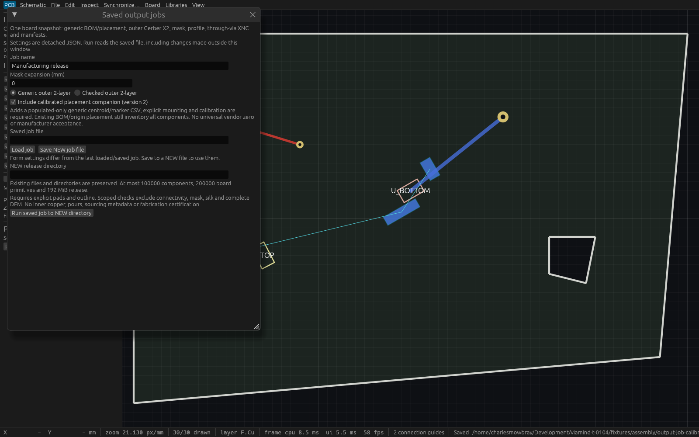

# Saved calibrated-placement companion verification

T-0104 adds an explicitly selected generic calibrated-placement companion to saved output jobs. The [approved public-source behavior](specs/calibrated-output-job-companion.md) requires version2 and `include_calibrated_placement:true`. Absent option preserves canonical version1 settings, manifests and outputs. See [job usage](saved-output-jobs.md).

## Production CLI and two MCP agents

The [portable production probe](verification/t0104-companion-smoke.py) passed [27 checks](verification/t0104-production-report.json) against the actual desktop application on HTTP7934, PID1848445. Its unique retained executable `/home/charlesmowbray/.cache/viamind/native-artifacts/t0104/production-verified` was built from source `36d610032a51ede45fe2167b978fb574b3aa90a5`, base `d8a8e573761bc673575a4a76af5d9fb06deccba6`; SHA256 `7012cc63ff1213bed2cfff573799905d79a40f2ba5c980694644177da58c3f7a` also matched the live executable. The [asymmetric fixture](../fixtures/assembly/output-job-calibration.viamind.json) preserves explicit top/bottom pads, tracks, through vias, polygon and cutout, adding only explicit surface mounting, local centroid(2,1)mm and marker37.125°.

Two initialized clients save/load the strict settings and publish byte-identical twelve-file generic releases from the same complete source cursor. The companion exactly matches standalone shared CSV; a separate Python CSV/vector oracle verifies reflected local centroids and top-view markers. Display-free CLI config/format payloads match the HTTP release exactly. Session-dependent release manifests are explicitly excluded from cross-process byte comparisons.

Ten existing version1 format/config payloads remain byte identical to retained prior production SHA256 `dd0f4da5ee49c9abe06aed071b33a38e8cfe2e989c3ddb6d1cb70eff67a9045e`. The optional manifest member remains absent. Version1-with-option, version2 missing/false/null, unknown outputs and duplicate options fail. NEW collisions, each process's own active native path, missing calibration, stale full cursor and a document width minimum stronger than saved zero baselines refuse atomically. A checked version2 job writes thirteen files including the trusted production DRC report. Population changes only the companion and its included count; older generic inventories remain all-component outputs. All exports/refusals preserve complete SessionSnapshot and document status. Three deliberate peer edits followed by undo restore the exact project/native status while the cursor advances honestly from0 to6.

## Native desktop inspection



The [native report](verification/t0104-native-inspection-report.json) is from a separate inspection-only production ViamindApp host, source `0056beb`, retained executable `~/.cache/viamind/native-artifacts/t0104/inspection-final-verified`, no MCP. Two local egui pointer events select the companion and three local pointer events resize that dialog from its initial420px scroll viewport. Production resizing/defaults are unchanged. It verifies the checkbox, generic populated-only description, saved/NEW release fields and Run button are visible, asserts complete session invariance each frame, captures opaque1600×1000 pixels through an actual WGPU Screenshot event, writes/fsyncs a NEW P6 file and closes itself. This is application-local synthetic input and native framebuffer evidence; it makes no OS-input or cadence claim.

The [lossless conversion report](verification/t0104-capture-conversion.json) independently decodes PNG and compares every RGB byte with the original P6 capture. Cua's separate actual-production snapshot succeeded with degraded AT-SPI metadata; its [bounded metadata](verification/t0104-cua-production-metadata.json) does not prove checked state.

Two historical inspection-only attempts produced no capture and terminated at their200-input bounds. The [initial failure](verification/t0104-inspection-initial-failed.log) and [diagnostic failure](verification/t0104-inspection-diagnostic-failed.log) show the checkbox worked but Run lay below the initial dialog viewport. The final local resize resolved that inspection condition. Neither failed attempt is counted as native success.

## Gates and bounds

[Full Linux log](verification/t0104-full-linux.log) on production source36d6100 passed formatting, strict all-target workspace Clippy,739 workspace tests/0failed/1ignored, workspace build and example build. These include immutable fixed-scalar capture, invalid/huge unused sourcing and schematic exclusion, strict JSON versions, default payload equality, cancellation retaining an actual blocking worker's admission slot, exact same-snapshot policy checks, actual CLI and two-agent parity, and compact640×400 save/load/run/result/error/newer-edit controls. A later inspection-only change passed [formatting, strict workspace lint and example build](verification/t0104-inspection-final.log). [Current88-tool catalog](verification/t0104-catalog-report.json), [18 isolated workflow checks](verification/t0104-agent-workflow.json) and13 tooling unit tests passed. Final integration on merged via-minima base `3c52571`, source `4a89748a2057c3fe066b2d154e5af535a2066fe3`, passed [11 focused tests, formatting, strict all-target workspace lint and workspace build](verification/t0104-final-combined.log). Its calibrated checked job captures and reports native10 document drill/annular minima; one-nanometre stronger floors refuse the entire release and leave no staging/session mutation. The unique combined executable SHA256 `f8f662c187083ebf71963d30938c1a11b6fcba947302401260609c048f170769` regenerated the [final88-tool reference](verification/t0104-final-catalog.json), passed [18 isolated workflow checks](verification/t0104-final-workflow.json) and13 tooling tests. Historical production/native proof remains labeled with its original sources. Latest clean integration on native symbol-ID editor base `adf2d9f`, source `6c09a38b422e5ec53847e8efc369035fa6fb8c29`, passed [11 focused tests, formatting, strict all-target workspace lint and workspace build](verification/t0104-latest-combined.log). Its retained executable SHA256 `82789aebea0a8bb63d917bfcf3bb1f836a7848fbea6e7457881dbecc94c531bf` regenerated the [88-tool reference](verification/t0104-latest-catalog.json) and passed [18 isolated workflow checks](verification/t0104-latest-workflow.json) plus13 tooling tests. Fresh final-head CI remains the merge gate.

The [master provenance](verification/t0104-verification.json) records exact sources, executable/artifact hashes and failure separation. The job keeps one bounded immutable board/rules capture and one retained shared manufacturing permit; no duplicate assembly snapshot. Borrowed text/primitive/calibration/reference validation precedes copying. Unused sourcing strings, DNP calibration and unrelated schematics are excluded. The fixed companion uses existing scalar transforms and32MiB CSV/192MiB release limits. Publication remains one NEW staged release root with no replacement. Generic marker conventions do not establish vendor rotation zero, polarity, connectivity or complete DFM acceptance.

## Reproduction

Build and retain a unique production binary from the frozen checkout. Launch it on a coordinated unused port using a copy of the fixture as its active native file, then run:

```sh
python3 docs/verification/t0104-companion-smoke.py \
  --binary /absolute/verified/viamind \
  --previous-binary /absolute/retained/prior/viamind \
  --project /absolute/copied/fixture.json \
  --repo "$PWD" --directory /absolute/NEW/probe-directory \
  --endpoint http://127.0.0.1:PORT/mcp
```

The prior executable is needed for historical default-byte comparisons. The mutation/export probe requires writable MCP admission. For separate native inspection, build `cargo build -p viamind-ui-egui --example t0104_inspection` and launch its retained executable with fixture path and a NEW PPM path. The [example source](../crates/ui-egui/examples/t0104_inspection.rs) is bounded and self-closing. Convert P6 to PNG without pixel changes and verify independent raw-RGB readback equality.
