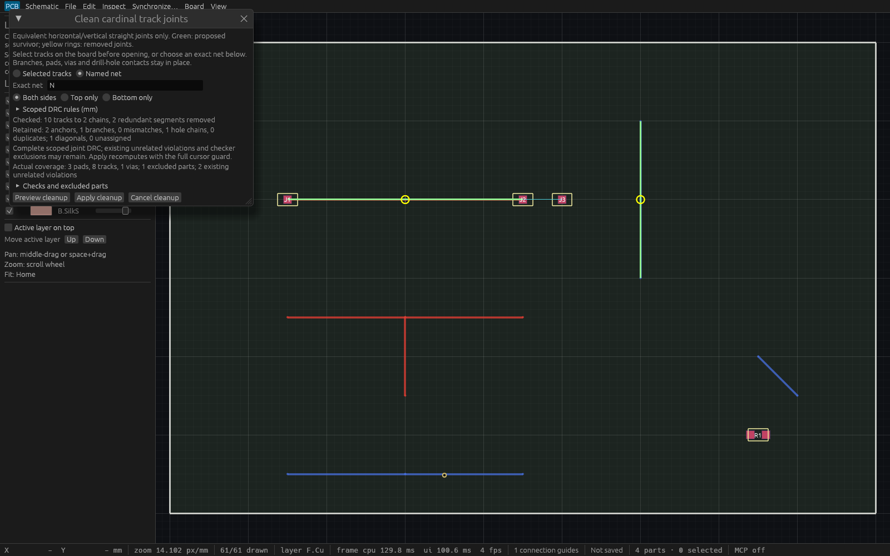

# Cardinal track cleanup verification

T-0091 adds an immutable checked preview and atomic equivalent cardinal track
cleanup. The public-source specification preceded implementation. Both the
native dialog and MCP use the same engine query/command, full session cursor,
bounded geometry capture, joint scoped DRC and one undo.

## Linux gates and exact production artifact

Product source `b64d5e6a4ae2ac4feca35d1e3a8df57b82672b9c` is based on
`cc1813f2c734eb808d702002da4bcc2c93bf6bf3`. All four required Linux gates passed:
format check, strict workspace/all-target Clippy, workspace tests and workspace
build. Tests: **653 passed, 0 failed, 1 ignored**, including doctests. The full
sequence held `/tmp/viamind-workspace-gates.lock` through doctests and unique
binary copies; workspace Rust source mtimes were refreshed before compiling to
prevent stale artifacts shared with other worktrees. Cargo used offline locked
dependencies, two build jobs, incremental compilation disabled, and the home
cache temporary directory. The retained production binary is unoptimized with
debug information stripped, SHA-256
`ab9fad43ace5de47dfd943c0a68170940a9c62d96ab180c60ae1140d2558be85`.

The production source and full-gate log remain historical evidence. A later label-only correction changes the checked summary arrow to plain ASCII
`to`; all engine/MCP/geometry behavior is unchanged. Focused format, strict UI
all-target lint, all three cleanup input tests and inspection build/capture pass
on that corrected source. Final combined CI gates the current branch; these
later changes do not relabel the historical production binary.

## Actual production MCP and atomicity

The retained production executable launched as PID `1195566` with its actual
desktop HTTP MCP server on port `7918`. The committed checker initializes two
independent MCP clients and performs **23 passing checks** against that server.
It verifies discovery, complete immutable SessionSnapshot capture, exact odd-Nm
cardinal far endpoints and deterministic smallest survivor IDs, independent
layer/ID selectors, actual legacy exclusions, branch/diagonal/all-net drill-hole
retention, unchanged conservative guide IDs/endpoints, one atomic four-delta
commit, stale-peer rejection, one exact undo/redo, malformed selector refusal,
peer edits, same-project reopen/new-stream refusal, and already-clean no-op.
Each refusal compares complete session state, including cursor and selection.

The first measured HTTP plan took **5.552 ms**, first commit **8.573 ms**.
Five warm commits took **5.876, 6.022, 6.346, 6.217 and 6.209 ms**
(mean **6.134 ms**). Nearby host load was `38.57/39.16/38.79` with concurrent
workspace builds. These measurements cover this small authored fixture with
the retained debug executable; they are not worst-case or responsiveness
guarantees and do not satisfy the separate native 100k-object 60fps target.

## Actual input and compact controls

Engine regressions independently check exact union geometry, both layers,
smallest stable IDs, branch/pad/via anchors, closed all-net drill-hole AABB
contact, duplicate rejection, guide invariance, complete joint DRC, actual
coverage, stale typed/dynamic/batch cursors, same-ID reopen, one undo/redo,
selector/deletion/capture/admission limits and the aggregate 1M hole-work cap.
An unrelated large schematic and invalid 3MiB sourcing record are retained
unchanged while geometry-only cleanup succeeds.

Three actual egui input tests exercise stored-track canvas picking with Shift,
immutable Preview, atomic Apply/Undo, named-net/layer input, cancellation,
peer/modal guards and a **640×400** viewport. Compact tests assert enabled Apply
and all Preview/Apply/Cancel rectangles lie inside the viewport while actual
legacy coverage is visible. A retained-worker test proves a cancelled draft's
result cannot revive. Command parity checks pass.

Initial fixture failures were corrected without weakening production limits or
assertions: integration fixtures now isolate the intentional two-operation
admission cap, the MCP fixture uses existing serde instead of an absent dev
dependency, and selected-track input uses the established one-step egui
press/release cadence with independent index/viewport/first-click assertions.
Independent review prompted actual retained DRC Coverage and compact footer
proof rather than generic exclusions prose.

## Readable native preview and capture provenance

The retained inspection source is
`efb865b9638b21e37ef88ff869f37bbdfd637ea0`; the inspection Screenshot helper and a single product summary label changed
since the verified source. A focused format check, strict UI all-target Clippy,
three actual cleanup input tests and example build passed. The uniquely copied
inspection binary SHA-256 is
`8d928dd1d24cabfe96df413d8cf3927e8d98c24a64c671ea9964e63abf15e464`.
It launched as PID `1298087`, with independently grounded mapped compositor
metadata at 1600×1000.

The host loads the authored fixture into the real shared engine and production
`ViamindApp`, prepares the named-net checked preview through actual egui events,
and transfers that app into a fixed-size native eframe WGPU window. Every
native UI callback asserts complete session equality, the two-chain checked
result, and all prepared Preview/Apply/Cancel bounds inside the actual viewport.
The inspection-only host requests eframe's native Screenshot API; the resulting
`Event::Screenshot` supplied the actual **1600×1000** WGPU framebuffer at
**11 UI passes**. UI passes are not presented-frame counts.

Opaque native RGB pixels were written to a newly created P6 artifact. The
committed standard-library encoder produces PNG without resizing or recoloring
and independently reads back the exact RGB rows. Native P6 SHA-256:
`3aee4522e8360b39b0d14f6f7581569e331dccefe2459fa07ad53ecfdee5504f`.
PNG SHA-256:
`5ef313e738e1abbd1d40fcb8771b72126a9154aee3ab0b86484eb14113c4ee2f`.
Both output paths use exclusive creation. The image was independently viewed:
green survivors and yellow removed joints are visible on both layers; the
branch, diagonal and drill-hole-contact chain remain; actual coverage,
exclusions and all three footer controls are readable.

This is an inspection-only native renderer artifact, separate from the actual
production HTTP checks. It is not a Cua screenshot or operating-system input
claim. The earlier b64 inspection host asserted the same immutable preview but
produced no image; the intermediate 3bc capture binary was built but never
launched. Those attempts are excluded from final image provenance. Root review then
found that the fef capture rendered an arrow as a missing-glyph square. The
ASCII `to` correction above passed focused gates and this fresh native capture;
the previous fef source/hash/image are retained in the master as superseded
visual evidence. No numeric semantics changed. Future
inspection hosts can close after capture to reduce desktop congestion; all
existing windows are preserved in this run.

The shared Cua daemon and a private direct Wayland runtime returned zero
windows and reported `Hyprland window enumeration unavailable: out of range
integral type conversion attempted`. Exact independently grounded own-PID
capture also refused the target as stale. Read-only compositor metadata showed
the real production window mapped with a tiny negative tiled height and the
inspection window mapped at 1600×1000. The malformed tile is a suspected cause,
not a confirmed source-level tool diagnosis. No desktop/tool configuration or
shared daemon changed, and no operating-system pointer/keyboard input is
claimed. Earlier inspection windows and all other previews remain preserved.

## Scope

Only assigned-net equivalent horizontal/vertical strict straight chains merge.
Branches, explicit pad/via anchors, all-net drill-hole contacts, unsupported
diagonals and duplicate/retraced geometry remain. Actual scoped checker
coverage and existing unrelated violations are reported; legacy visual pads
and unperformed checks remain excluded. This is not physical copper
certification, general bend optimization, obstacle routing, shove or complete
manufacturing DRC. [Workflow](cardinal-track-cleanup.md) and
[specification](specs/cardinal-track-cleanup.md) describe the exact finite bounds.

## Durable evidence

- [Master provenance and hashes](verification/t0091-linux-native.json)
- [Full Linux gate log](verification/t0091-linux-full.log)
- [Production HTTP report](verification/t0091-production-http.json) and [checker](verification/t0091-production-check.py)
- [Authored fixture](verification/t0091-cleanup.viamind.json)
- [Final inspection build](verification/t0091-inspection-build.log) and [native assertions](verification/t0091-inspection-native.log)
- [PNG encoding/readback](verification/t0091-png-encoding.json) and [encoder](verification/t0091-framebuffer-to-png.py)
- [Scoped capture refusal](verification/t0091-native-capture-limitation.json) and [final own-window metadata](verification/t0091-final-window.json)

Final artifact-head CI gates the combined branch before merge. Historical
production and inspection sources/hashes above remain unchanged by later
documentation commits or clean integration rebases.
