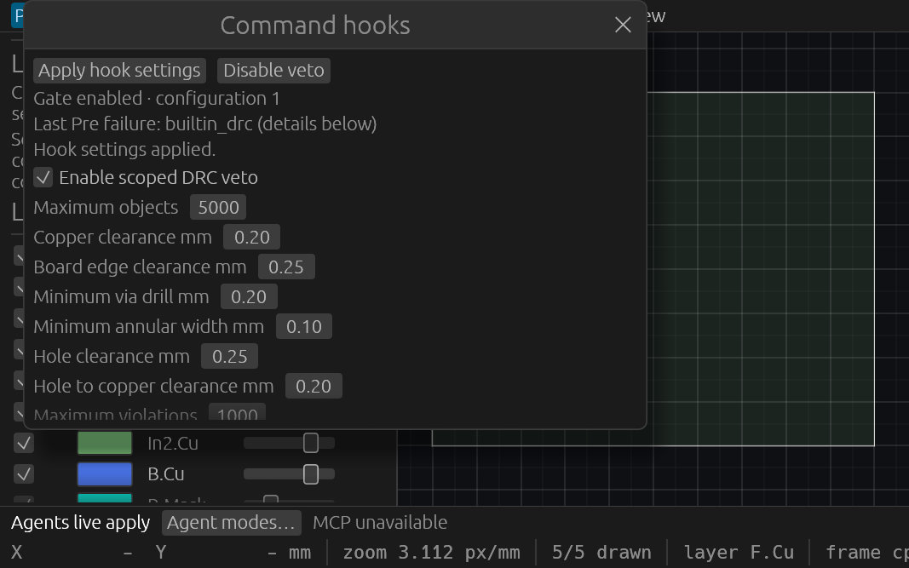

# Shared command hooks

Ticket: T-0118. Contract: [command-hooks.md](specs/command-hooks.md).

Open **Inspect → Command hooks**, choose the scoped PCB DRC settings, and press
**Apply hook settings**. **Disable veto** remains above the scrollable settings.
Enabling affects subsequent changed candidates; it does not validate the current
project. A batch may repair its final candidate atomically. Undo remains available.
Unsupported DRC coverage is disclosed; this is not a manufacturing certificate.

Agents can observe `get_command_hooks` in every mode. Live agents can use
`configure_command_hooks`, for example `{"enabled":true}`. Approval and Read Only
hide and reject configuration. Configuration, callbacks and bounded diagnostics
are transient, shared across clients, and survive New/Open without entering the
native document or undo history. MCP does not register executable callbacks.

Trusted native hosts register ordered Rust callbacks through
`register_pre_command_hook` and `register_post_command_hook`, and unregister by ID.
Pre callbacks borrow the complete coalesced candidate; error or panic vetoes before
transaction publication. Post callbacks receive compact immutable commit facts
outside engine and native file locks. Standalone `Engine` hosts explicitly drain
`take_pending_command_hooks()` and run the returned dispatches outside their own
locks. The contract specifies capacity, reentry, panic and deferred native-closure
behavior; trusted callbacks have no hard execution deadline.

## Original verified scope

The immutable original product is `feee91af076956981c66412b9335c3b3b2fed5d8`,
on T117 `d4a4baa1be4e304e40c1001dc1e231e555292d98`.
[master.json](verification/t0118/master.json) indexes retained artifacts and binaries.
Final combined integration and exact-head CI are recorded separately when complete.

- Linux formatting, strict workspace all-target Clippy, workspace tests/build and
  inspection build passed: **935 passed, 0 failed, 1 ignored**, 218 test groups.
- Thirteen engine hook cases cover rollback/history/redo/IDs, final-candidate batch
  repair, no-op behavior, selective undo/redo, private branch retention, callback
  ordering/capacity/generation, native-lock deferral, reentry, panic isolation,
  bounded metadata/diagnostics and peer advancement during post delivery.
- Actual compact UI input and two real initialized HTTP tests passed, including
  retaining writer admission after client cancellation until the observer finishes.
- Retained production passed **35 stdio checks** across three startup modes and
  **28 desktop HTTP checks** with two clients on owned port7950. A second agent
  independently repeated all63 checks and rehashed the executable/socket ownership.
- Exact generated catalog115, isolated agent workflow18 and Python tooling23 passed.
- Wide, compact veto and compact recovery inspections performed local egui input
  before actual production UI WGPU screenshots. Both painted action buttons fit
  their effective clips. All three hosts requested Close and were absent afterward;
  the launcher did not retain numeric process exit statuses.
- Original Color32 RGBA channels are retained in P7 **and RGBA PNG**; P6 retains
  identical RGB. A second decoder verified every channel. Alpha ranges include
  values below255; no opacity, compositor, OS-input or frame-cadence claim is made.

The strict-import failure and restricted-tool protocol assertion failure are
retained alongside their later successful full-gate results. The latter was a test
expectation error: hidden tools produce protocol refusal. It did not require a
product behavior change. Older inactive integration-test cache cleanup is recorded
separately from functional verification; retained executables and proof were kept.

## Reproduce

Use the retained binary paths and SHA256 values in `original-binaries.json`.
`production-probe.py --binary BINARY --repo CHECKOUT --mode live --report NEW.json`
runs a fresh owned headless process; use `approval` or `read_only` for those modes.
For desktop HTTP add `--url`, `--pid` and `--native` identifying the owned fixture.
The HTTP driver normalizes that fixture's hook settings and exercises veto/recovery,
New/Open and exact native-byte preservation. It must target the owned test preview.

`capture-native.py --verified RETAINED_DIRECTORY --directory NEW_DIRECTORY`
launches the retained self-closing inspection host in three modes. Run
`uv run --no-project --with pillow python encode-native.py NEW_DIRECTORY` to compare
all P7/P6 channels and produce exact RGBA PNGs. These scripts prepare local egui
input; they do not inject operating-system input.

## Combined Linux verification

The final product source is `3287ca5f7fd5a4d487ebd7f81550afd22384e309`,
combining T117 approval, T122 labels, corrected T119 artwork, corrected T123
whole-inventory queries, and T118 hooks. The two desktop inspectors and actions
remain available. The new query refuses pre-command reentry before process worker
admission and before a previously captured worker takes the engine lock. Its
regression fills both worker slots, exercises typed/JSON captured work, and proves
post-commit observation uses the committed cursor.

The scoped integration passed formatting, strict workspace/all-target Clippy,
**36 focused Rust checks**, workspace and inspection builds, **117 actual tools**,
and **18 isolated workflow checks**. The helper exited5 after its final Python
command searched the wrong directory and ran zero tests. The Rust/build/reference
checks had finished successfully; the corrected remaining-only Python invocation
passed **23 tests**, with both logs retained. No second broad Cargo run was made.

The retained combined executable passed **35 actual stdio checks** across Live,
Approval and ReadOnly and **28 actual two-client desktop HTTP checks**. Its owned
native preview is PID3168356 on port7958, backed by the fixture in `final/`.
Three fresh wide/veto/recovery native WGPU captures requested Close and their PIDs
were absent afterward. Every original P7 RGBA sample matches RGBA PNG; P6 retains
identical RGB. Local egui preparation and original alpha samples are disclosed;
these captures do not measure compositor opacity or frame cadence.

The combined evidence and immutable117-tool snapshots live in `final/`. The
master retains the original935-test scope separately. Independent final review reproduced all35 stdio and28 HTTP checks, rehashed both
retained executables, and decoded all three original RGBA/RGB/PNG sets exactly.
Wide and recovery controls were independently viewed; root viewed compact veto.
Exact final proof-head CI remains required before merge.

