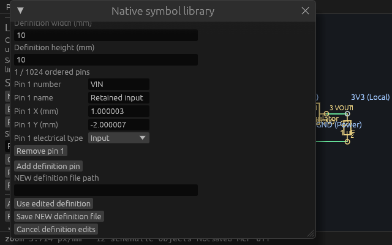
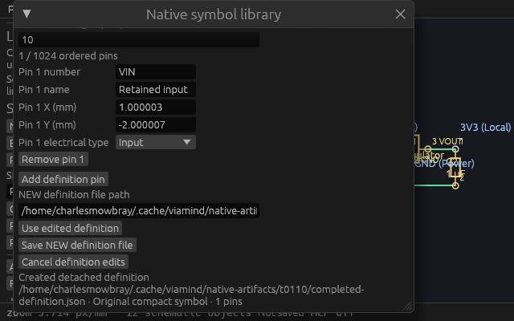

# Reachable compact symbol definition verification

The independently approved [public spec](specs/compact-symbol-definition.md) fixes the detached symbol editor at 640×400 logical points/default scale. The virtualized pin region reserves one complete row so the outer window can reveal it. Existing metadata/pin UUIDs, exact integer-Nm values, worker/draft/session behavior, native format, shared actions and tool catalog remain unchanged.

## Actual compact input

Focused gate 45525 passed two new compact and seven existing library tests. Before pointer clicks, helpers send real AccessKit ScrollIntoView and wheel input and require the complete actionable rectangle inside its actual background paint clip, intersected with the viewport. TextEdit's smaller internal glyph clip is not mistaken for its ancestor clip. Individual target reveal and complete-row reveal are tested separately.

The tests edit every metadata/pin field, select Input, retain field IDs/text cursor across earlier-row deletion, use/cancel the local definition, show errors, save exact odd-Nm dimensions/coordinates and preserve a colliding destination. A 1024-pin original fixture scrolls by actual wheel to its last row and back, retains the first field ID and enforces at most five rendered pin rows. Full session and document status remain exact. Existing load/export/placement controls also remain reachable.

The final full gate includes the extracted identical helpers shared by tests and native inspection. Earlier paint-oracle/scroll preparation and expected OS-message errors, plus an unused helper import rejected by lint, are retained as excluded history.

## Linux and real MCP

Full gate 36098 at source `1b60cc5c1d59e9bee39771370d672a55100fa5b4`, based on merged main `2e40ecca`, passed formatting, strict workspace/all-target Clippy, **761 workspace tests / 0 failed / 1 existing ignored**, workspace/inspection builds and 13 Python tooling tests. The external mutex remained held through doctests, unique executable copies and debug-symbol stripping. Source mtimes were refreshed with the canonical shared target, two jobs and incremental disabled.

The exact production executable SHA-256 `b1fb52f8134211cac5ffd4c9335380150720a3b98d2e7c12bcbc6fc11aaa897f` passed 88-tool discovery/exact committed catalog, 18 isolated agent workflow checks and 35 fresh stdio symbol writer checks. Cua-launched PID 2095184 on 7940 passed the same 35 actual desktop HTTP checks, each verifier using two independently initialized clients. Its live executable SHA and listener ownership matched. These cover inherited detached bounds, exact bytes, dirty session/status/native preservation, source cursor, NEW/collision/native aliases and stale export refusal; scheduling races remain the existing deterministic engine tests.

## Native 640×400 output

Inspection executable SHA-256 `46247657d5df7789e6711ebc3d4a114033aa60e38afb465143d11d630c2ca802` uses the same actual compact input/clip helpers. Preparation begins and remains at 640×400; it never enlarges the native window. It creates original VIN/Input geometry, removes an earlier pin while preserving IDs, and uses exact 1.000003/-2.000007 mm values. Separate owned hosts render the production ViamindApp with WGPU and assert complete session/status invariants before/after each UI callback. They exclusively create/fsync opaque P6 readback and self-close exit 0 after 11 UI passes, not a frame-cadence measurement.

The row view shows all five pin fields and Remove within a measured 131-point inner clip, plus Add/path/actions. Metadata above that view is intentionally scrolled. The completed view shows the Created notice and wrapped NEW path. Controls need not all appear simultaneously. Both native images were visually inspected and losslessly encoded; the verifier checks every RGB pixel/PNG CRC. Underlying schematic label crowding is inherited and outside this layout change. No OS-input or compositor-capture claim is made.

The [master](verification/t0110/master.json) indexes 28 durable artifacts with exact source, binary, capture and process provenance. Run `python3 docs/verification/t0110/verify-artifacts.py` for 28 hashes and two full native RGB checks. The retained production and old previews remain running/preserved; both owned inspection hosts exited.

Final stacked integration on T109, fresh exact-head CI and independent review remain gates. After predecessors merge, prospective main-plus-HEAD tree must equal the tested combined tree; content differences require fresh verification. Smaller/scaled viewports and multi-unit symbols remain separate work.
