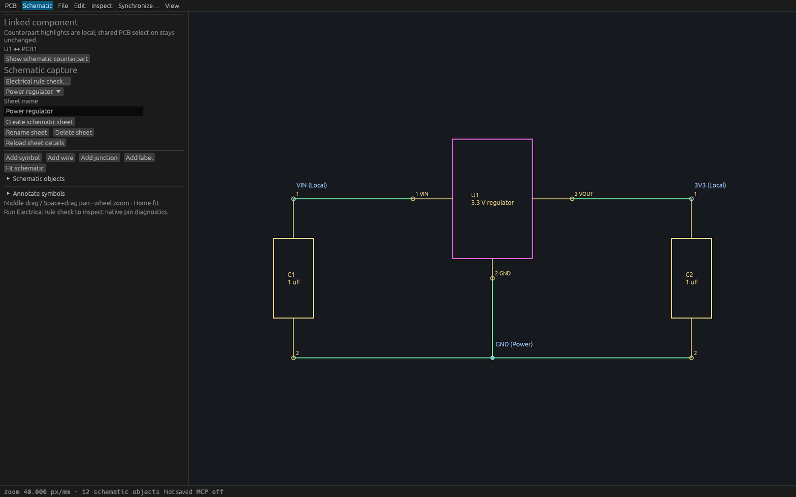
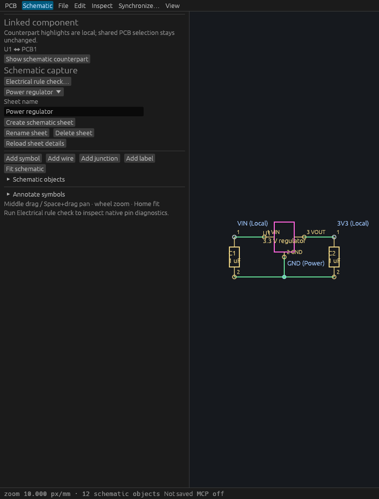

# Component cross-probing verification

T-0070 implements the [bounded stable-link behavior](specs/component-cross-probing.md) and [desktop workflow](component-cross-probing.md). Component identity comes exclusively from persisted symbol UUID links.

## Linux gates

Feature head `0e0bd3b64337690175da1aaa9a346491fa8b9d36`, based on merged T-0066 main `30e7531`, passed formatting, strict workspace all-target Clippy, complete workspace tests/doctests and workspace build: **413 passed, zero failed, one existing ignored**.

Three engine tests cover deterministic UUID mapping/pages/filters, exact source cursors and immutable session state, reference renumbering, explicit unresolved/unlinked rows, extreme integer coordinates and rejected identity/text/object/query limits. A real two-client HTTP test verifies discovery, unchanged model/history/selection/dirty state, independent deterministic reads, a peer rename, explicit unlink, connection-scoped undo and rejected input.

Five actual egui input workflows verify:

- A real PCB pointer pick derives a schematic highlight without switching modes. Explicit navigation centers its exact symbol and preserves shared edit selection/session state; source clearing and reselecting refresh correctly.
- A real schematic object selection derives a PCB highlight. Explicit PCB navigation preserves shared selection and hidden layer visibility, reports hidden counterparts and preserves camera position through layout.
- Peer unlink and same-project reopen clear old highlights/navigation.
- Unsupported selected copper and a 101-object selection produce explicit guidance without partial counterpart highlights.
- Rejected navigation preserves an active local routing preview and its point without model/session mutation.

Four deterministic controller tests cover the retained single receiver through replacement, changed source/cursor completions, disconnected workers, stale/busy navigation and excluded unsupported coordinate highlights. An additional ERC actual-input regression verifies first-ever PCB-to-schematic pin navigation survives initial native layout. Explicit camera navigation disables startup resize auto-fit; Home and fit actions restore it.

```sh
cargo test -p viamind-engine --test component_links
cargo test -p viamind-mcp --test component_links
cargo test -p viamind-ui-egui --test cross_probe
cargo test -p viamind-ui-egui cross_probe::tests
cargo test -p viamind-ui-egui --test erc
```

## Actual production MCP

The production Linux binary was copied while holding the shared build lock. SHA256: `48011215b25fbe93585b29008e99226c4d86a58107088bf99fd7529788961ccd`. With DISPLAY/WAYLAND_DISPLAY removed, real `--headless` stdio MCP passed nine [recorded checks](verification/t0070-native-mcp.json): tool discovery, the original linked regulator's three mappings, stable immutable reports/cursors, dual-ID filtering without duplicate rows, deterministic pagination, shared selection preservation, reference renaming without relinking, explicit unlink/undo and clean exit.

```sh
python3 scripts/verify-component-links-native.py /absolute/path/to/viamind fixtures/schematic/linked-regulator.viamind.json
```

The driver uses a separate temporary application session and edits only its in-memory test document.

## Native visual evidence

A separate [fixed-size inspection wrapper](verification/t0070-cross-probe-inspection.rs) loads the original linked regulator into the production ViamindApp, establishes one real shared PCB selection through UiAction, and opens the schematic workspace. The real background query derives U1's pink counterpart highlight and the U1 ↔ PCB1 sidebar mapping. It does not fabricate reports or highlights. Wrapper SHA256: `be206e23fc34e2a184ba3fbd5c108605544079edf07ceb65f7c3218df22bd3b4`.

Cua Driver launched the exact wrapper binary and captured its exact native 1600×1000 and 760×1000 windows. AT-SPI is unavailable for this egui surface; window discovery is degraded. The mapping panel and target highlight are readable at both widths; some existing schematic labels overlap in the narrow canvas. These captures verify the cross-probing controls/highlight, while the actual-input tests establish interactive behavior. No native Cua click success is claimed. The wrapper is distinct from the production MCP binary and has no MCP listener.





## Scope

No model/schema changes, reference-based inference, counterpart edit-selection propagation, electrical graph changes or pin/net cross-probing. Missing links, unsupported navigation coordinates, hidden layers, unsupported source objects and selection limits are explicit. Reports and navigation require current project, stream/cursor, source selection and persisted link; old worker completions cannot replace a newer context. Source selection retains its prior shared PCB/local schematic ownership.
