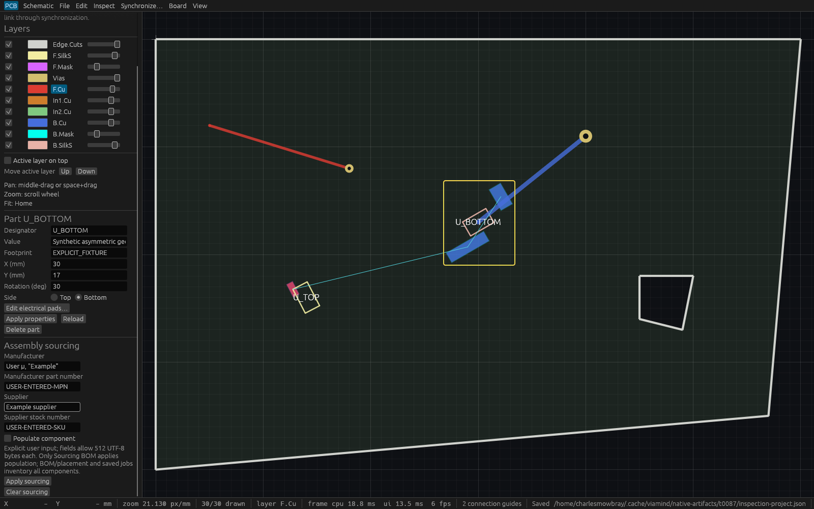

# Component sourcing verification (T87)

The implementation at `e75a5c70fe0a7c2af9e86f50a032e64fc0a2d320` passed
Linux formatting, strict workspace Clippy, all workspace tests (**595 passed,
one ignored**) and workspace build, plus nine focused synchronization tests.
Its [master report](verification/t0087-master.json) records exact artifact hashes,
paths and runtime provenance. Native evidence describes this source; subsequent
documentation and unrelated integration changes require fresh combined CI.

## Actual production application

The retained production binary was copied with `strip --strip-debug` immediately
after the successful workspace build. `/proc/1003561/exe` had the same SHA256.
The unchanged production application opened a schema7 fixture and served HTTP MCP
on `127.0.0.1:7913`. Its tiled desktop window was unsuitable for readable inspection;
the separate fixed-size wrapper below provides that capture.

The [production report](verification/t0087-production-report.json) contains
**35 successful checks** from two independent agent sessions and the actual
production binary's no-display CLI. These cover discovery and exact query fields,
guarded metadata edits, stale Part/full-cursor rejection, undo/redo, schema7
save/reopen, schema4 fallback after clearing, native-file protection, collision and
explicit overwrite behavior, and Python CSV parsing of Unicode, quotes and commas.
Both population groups remain in the sourcing table. Existing BOM and placement,
all seven fabrication files, board SVG, and ten saved-job output/config files match
the prior verified executable byte for byte. The saved release manifest's separate
source cursor is deliberately excluded from that cross-session comparison.

The synthetic `USER-ENTERED-*` identifiers and `User μ, "Example"` manufacturer are
explicit test input. They describe no real sourcing, stock or manufacturer approval.

## Readable native capture



The capture is the production `ViamindApp` inside an inspection-only
1600×1000 fixed-size eframe wrapper, PID983304 on HTTP7915. It selects the first
component and injects one documented egui scroll to expose the properties panel.
Production resizing and controls remain unchanged. The
[wrapper report](verification/t0087-wrapper-report.json) has four read-only checks,
including exact CSV equality with production CLI/HTTP and unchanged shared session.
The [Cua snapshot](verification/t0087-native-cua.json) reports unavailable AT-SPI
and an X11 metadata fallback. The screenshot establishes readability; actual
640×400 scrolling, field entry, Apply/Clear, undo, stale drafts, errors and CSV
dialog interactions are verified by `crates/ui-egui/tests/sourcing.rs`.
Native Cua input or widget-state discovery is not claimed.

## Reproduce

Use a fresh evidence directory and unused MCP ports. The retained binaries are
local verification artifacts; rebuilding does not require those paths.

1. Run the four workspace gates from `AGENTS.md`, then build the production binary.
2. Copy [the synthetic native fixture](../fixtures/assembly/sourcing.viamind.json)
   to a temporary native project path. Launch production with
   `VIAMIND_MCP_PORT=7913 target/debug/viamind --open /path/project.json`.
3. Run the portable production probe, providing the prior verified T84 executable
   for compatibility comparisons:

   ```sh
   PYTHONDONTWRITEBYTECODE=1 python3 docs/verification/t0087-sourcing-smoke.py \
     --binary /path/production --previous-binary /path/prior-verified-production \
     --project /path/project.json \
     --baseline-project fixtures/fabrication/asymmetric.viamind.json \
     --directory /path/NEW-production-evidence \
     --endpoint http://127.0.0.1:7913/mcp --repo "$PWD"
   ```

4. In a new external directory, copy
   [the wrapper source](verification/t0087-native-inspection.rs) to `src/main.rs`
   and replace `@REPO@` in
   [the manifest template](verification/t0087-native-Cargo.toml.in) with this
   checkout's absolute path. Build with Cargo, then run the wrapper with a second
   fixture copy and unused port: `wrapper /path/inspection.json 7915`.
5. Run the independent wrapper observer and capture that PID with Cua:

   ```sh
   PYTHONDONTWRITEBYTECODE=1 python3 docs/verification/t0087-wrapper-observe.py \
     --repo "$PWD" --endpoint http://127.0.0.1:7915/mcp \
     --directory /path/NEW-wrapper-evidence \
     --production-report /path/NEW-production-evidence/report.json
   ```

Existing inventory outputs still ignore population and sourcing. This evidence
establishes the scoped generic format and shared command behavior; vendor formats,
assembly centroids, procurement, alternatives and manufacturer acceptance remain
open work.
