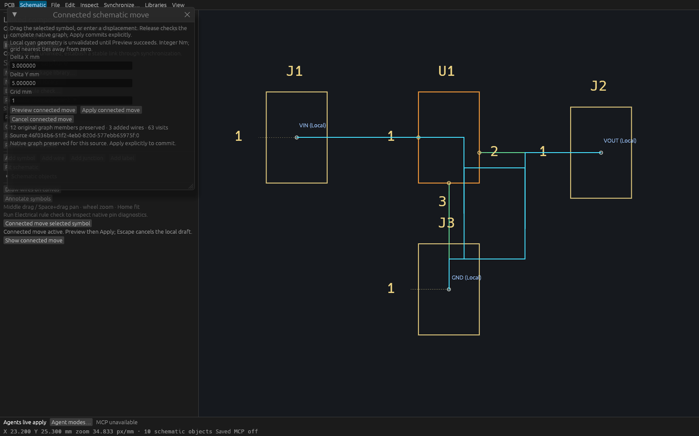
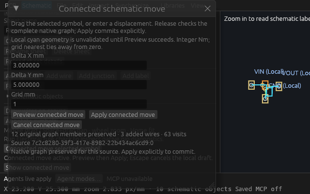

# Connected schematic movement verification

T-0125 implements one explicit symbol translation with supported cardinal endpoint wires. A local cyan sketch is unvalidated. Shared Preview checks the complete original native flat-graph member partition and explicit label scopes; Apply recomputes under the complete project/full-cursor guard. Unsupported contacts, changed graph membership and any budget failure refuse atomically. This does not establish ERC/DRC, physical continuity, arbitrary rubberband behavior, buses/hierarchy, or frame cadence.

## Source and verification scope

The independently approved public contract is [connected-symbol-drag.md](specs/connected-symbol-drag.md), approved at `499ac8bf`. The source follows the official KiCad 9 moving-symbol documentation linked there. The base is literal T124 `47d7133869c2bdd27b8248936cda848cb749efc3`, whose product tree matches merged main8358e4f.

| Evidence | Frozen source | Result |
| --- | --- | --- |
| Initial focused UI/MCP/core verification | 4ae62eae | fmt, strict workspace all-target Clippy, 30 focused checks |
| Original successful remaining full gate | 0e4ae717cdcbb390e243a2b3a6dfeeacc97881b8 | 1005 workspace passed, 0 failed, 1 ignored; 20 additional focused checks; workspace and inspection builds |
| Final expanded engine and fresh normal build | 2e119258978e5f3e0f422cd6cabb3ebed83aa158 | fmt, strict all-target Clippy, 14 engine checks, source-touch immediately before normal workspace build, inspection build; 119 actual tools, 18 isolated workflows, 23 Python tooling checks |
| Real stdio and desktop HTTP | production binary from final scope above | 44 checks: 31 across Live/Approval/ReadOnly stdio plus 13 desktop/two-client checks |
| Inspection-only lock correction | b23a303102f57916879836f015adfe76202e5ccf | helper-only fmt/strict all-target Clippy/source-fresh build passed; both native hosts exited0 |

The final two engine tests were added after the original full suite: a complete regulator with independently declared UUID partitions and label scopes, and a later unrelated peer edit surviving origin-owned drag undo. Both pass in the final 14-test scope. The original full count remains 1005; a 1007-test local full run is not claimed. Original full normal-build source touch happened at gate start; final scoped normal build explicitly refreshes inputs immediately before building and supplies the retained production binary.

## Runtime

The portable [production probe](verification/t0125/production-probe.py) starts three separately initialized stdio processes, checks strict typed schemas and access-mode admission, declares three asymmetric bend coordinates independently, checks actual whole-member graph partitions after commit, and exercises undo/redo/stale refusal. Every mode preserves source native bytes and read-only preview leaves complete session, document status and automatic DRC state unchanged.

Actual production desktop PID3537034 listens on7962 using the exact retained executable SHA256 `44137dbd620c56a9fe0cb49708adafc8eb77460373decc0ecb4fef6c71c0b192`. Two fresh same-name HTTP clients observe equal previews. A peer edit invalidates the original full cursor; peer undo restores the project, fresh Apply is one event, mover undo restores the entire project/native identity and bytes. The source cursor advances honestly from0 to4. The process identity is a recorded observation, not a promise that a process remains live indefinitely. Root independently reran ten real two-client checks, including later peer preservation through mover undo and independent original-member partition/label comparison. That separate review restored exact project/native bytes and advanced the same stream cursor4→8; its unchanged report and driver are tracked.

## Native controls

Wide1600×1000 and compact640×400 captures pass. Both hosts self-closed with exit0: wide55frames/17local injected events/two sidebar wheels, compact71frames/21events/four sidebar wheels. All six controls were wholly inside painted ancestor clips; all three completion buttons and native graph result were visible at capture. Every one of6,400,000 wide and1,024,000 compact RGBA samples, and4,800,000 wide and768,000 compact RGB samples, matches independently decoded PNG/P6; original alpha is255 throughout. Fixed inspection viewports use production ViamindApp/WGPU with explicitly local injected events, actual sidebar/window wheel input, effective painted ancestor clipping, and no OS-input claim. Both runs check complete session and complete DocumentStatus every frame, verify field reachability and completion-button/result visibility, retain original Color32 RGBA P7 plus identical RGB P6, and self-close after capture. The independent PNG encoder compares every original channel using an installed FFmpeg decoder; no flattening/unpremultiplication is performed. Raw captures and executable files remain outside Git; readable PNGs and reports are tracked.

## Bounds and failure history

Borrowed preflight admits at most100000 combined identities before native validation,10000 complete graph rows/2MiB text, planned new identities before copies, one cumulative1M contact budget, and2MiB append-precharged preview output. Two nonwaiting retained worker slots stay owned through serialization and caller cancellation. The owned graph shell excludes PCB metadata. Fresh final wire IDs follow successful temporary-ID proof; one sheet delta commits all changes.

Historical failures are retained under `verification/t0125/history`, separately from successful reports:

- Initial strict lint rejected a test helper lifetime before tests; corrected before the 30-check pass.
- Two authored cross-sheet fixtures collided with existing U1, then U2. The fixture now explicitly uses U3 and validates before planning. Lock-poison followers are not independent defects.
- A root review caught two test-only unwrap calls on a String-returning API. A cancellation audit refused as the waiter had acquired the build mutex; orchestration mistakenly continued. Both owned groups were then terminated and fully retired. The two partial gate logs and earlier childless-cancellation claim are withdrawn; they provide no frozen-source proof. No other lane was touched.
- A final regulator oracle initially used public connectivity limit10000 instead of the supported maximum100. Corrected tests and production clients assert their complete fixture graph is unpaginated. The private whole-graph planner bound remains10000.
- The inspection host initially called `ctx.content_rect` from inside `ctx.graphics`, reentering its context lock. Two failed, empty capture runs and the diagnostic backtrace are retained; neither provides native capture evidence. Hoisting the content rectangle corrects only the inspection helper; application production evidence remains separate.

## Reproduction

Run the ordinary four Linux gates from the repository instructions. The indexed historical and final scripts retain exact command ordering and source freshness. For the actual portable runtime:

```sh
python3 -B docs/verification/t0125/production-probe.py \
  --repo "$PWD" --binary /absolute/path/to/verified/viamind \
  --directory /absolute/path/to/NEW-proof-directory
```

Optional desktop verification adds `--url http://127.0.0.1:7962/mcp --pid OWNED_PID --expected-native OWNED_NATIVE`; the owned native must initially equal `fixtures/schematic/connected-drag.viamind.json`. It intentionally performs and undoes owned fixture edits. Never point this mutation probe at unrelated user work. Build the inspection example, then run it with `EXISTING_NATIVE NEW_OUTPUT_DIRECTORY [--compact]`; encode and verify using the tracked verifier. Paths must be NEW. No vendor/electrical certification is implied.

## Durable artifacts

The [master index](verification/t0125/master.json) records repository evidence hashes, external raw-channel and executable identities, historical failure scopes, source boundaries and runtime facts. Generated MCP references are indexed from immutable ticket-local copies; the global generated reference can legitimately change in subsequent tickets. The index itself is intentionally excluded from its own hashes. Final GitHub CI is an independent merge gate and remains pending at submission.




