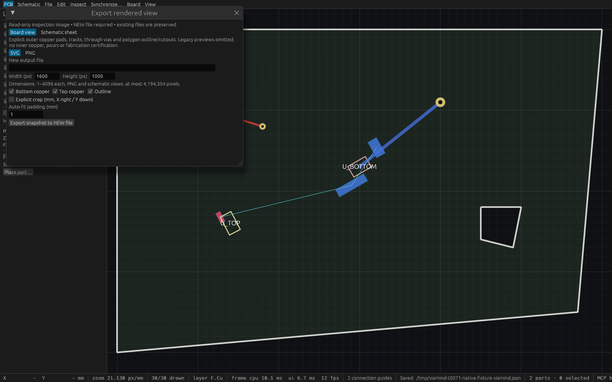

# Desktop rendered export verification (T71)

The reviewed implementation head72ae2d4 includes cross-probing main4618c28.
[Combined Linux CI](https://github.com/RL-Charles/viamind/actions/runs/38124965478)
passed fmt, strict clippy and workspace build/tests. Local full gates at e5c1144
passed417 tests with one existing ignored test. The only subsequent changes before
that CI were an unrelated additive cross-probing rebase.

## Retained evidence and provenance

- [Master report](verification/t0071-master.json): exact source and binary hashes.
- [Production CLI report](verification/t0071-cli.json):15 checks, no-display
  help/version, board and selected-sheet SVG/PNG, independent XML/Pillow decoding,
  collision byte preservation and unchanged native file.
- [Native HTTP report](verification/t0071-native-http.json):22 checks, four exports
  byte-identical to CLI, actual compact PNG image blocks, stale source guard across
  two agents, undo and unchanged design/history/status after read-only exports.
- [Cua metadata](verification/t0071-native-cua.json) and
  [native capture](verification/t0071-native-export.png), taken after native agent undo.

Both copied binaries were built from **e5c1144fa91b904ddd0ba210c53ac202a1bfaf8c**:
production SHA256 **17890de437ae1386ce2b05363f4a1aa912921ed0a3494c4c4a0202dae12659be**;
inspection wrapper SHA256 **51f432acc1b777618cab2435926b49420ae09cc4c69678d5955f03f002ab6233**.
Binaries are excluded from git. Historical `/tmp` paths in JSON identify the
original retained artifacts; all reports and the screenshot are tracked here.

The native capture is an explicitly fixed1600×1000 wrapper around production
`ViamindApp`, renderer and engine/MCP, opened with its public export-window entry
point. Production resizing is unchanged. AT-SPI exposes window metadata only on
this host; the screenshot establishes appearance, and actual input is verified by
`crates/ui-egui/tests/view_export.rs`. Its640×400 test scrolls to Export, clicks it,
checks output and scrolls to the result. Other actual form tests compare all four
outputs with production renderers and live MCP files, including invalid/stale
inputs, collisions, native protection and newer-edit notice.



## Reproduction

Use a fresh output directory: scripts intentionally refuse previously existing
output files. Python requires Pillow. Production CLI verification:

```sh
cargo build --locked -p viamind
python3 docs/verification/t0071-cli-smoke.py \
  --binary target/debug/viamind \
  --project docs/verification/t0071-export.viamind.json \
  --directory /tmp/viamind-t71-new-evidence --source-head "$(git rev-parse HEAD)"
```

[Inspection wrapper source](verification/t0071-native-inspection.rs) is kept outside
workspace targets. Create a temporary Cargo package using that source, path
dependencies to this checkout's `viamind-ui-egui`, `viamind-engine`, `viamind-doc`
and `viamind-mcp`, `egui=0.36` and `eframe=0.36` with default-features=false and
features `wgpu,wayland,x11`. Run it with the tracked fixture path as its first
argument. It binds127.0.0.1:7896; use a free coordinated port by updating this
inspection-only source if that port is occupied. Preserve existing previews.

```sh
python3 docs/verification/t0071-native-smoke.py \
  --binary /absolute/path/to/inspection-wrapper \
  --directory /tmp/viamind-t71-new-evidence \
  --endpoint http://127.0.0.1:7896/mcp
cargo test --locked -p viamind-ui-egui --test view_export
```

The retained original native preview is PID181252/window110379502695344 on7896.
This is process identity at capture time, not a lasting service guarantee.
