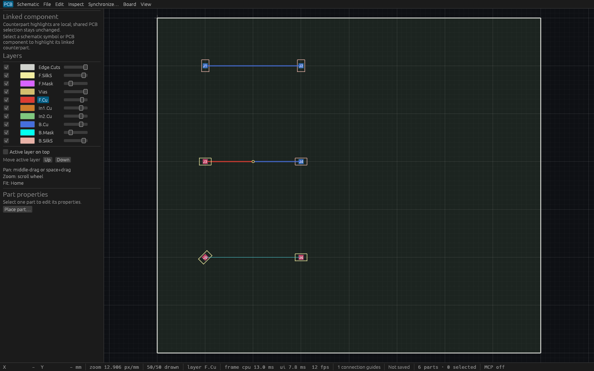

# Exact endpoint copper connectivity verification (T76)

[Master provenance](verification/t0076-master.json) records source c1a7d984 and
combined main c55dc7c. Linux formatting, strict workspace all-target Clippy,
458 tests (zero failures, one existing ignored test) and the workspace build pass.
The retained production binary SHA256 is
`0ddec17567e03fada92d4aa8e84a0166631d0bd9678421aa69939d2129c84837`.

[Production stdio](verification/t0076-stdio.json) has 17 passing checks.
[Actual desktop HTTP](verification/t0076-http.json) has 18 passing checks with
two independent agent clients on port 7903. The latter uses production PID
352718/window 110379505833376. No inspection wrapper serves that endpoint.

Both workflows discover the shared tools, route exact mirrored quarter-turn
off-grid pads and opposite-side pads through a via, compare net/query guide
counts, reject stale writes without changes, exercise one-command undo/redo,
save every identity and reopen the native project with the same residual guides.
The second HTTP client also moves a routed part, observes its restored guide,
and undoes its own edit. Read-only proof queries preserve session and dirty state.
The deliberately unsupported arbitrary-angle pad remains visibly unproved.

The actual production [Cua metadata](verification/t0076-production-cua.json)
and [capture](verification/t0076-production.png) identify the running process.
Its compositor tile is too small for visual inspection and AT-SPI exposes
metadata only. This capture supplies process identity, not native pointer input
or a readable board review.

The separate fixed-size [inspection wrapper](verification/t0076-inspection.rs)
loads the final HTTP-saved project and runs the same production `ViamindApp`
and WGPU renderer at 1600×1000. It has no MCP server or input injection.
Its SHA256 is `ddbf518e747be8ac3b8c0936e346d0ca14fdcda7925b90970d604cde1aa4b34e`;
PID 415543/window 110379506781040 are retained in
[Cua metadata](verification/t0076-board-cua.json).



The first row has a completed bottom-copper route, the second changes outer
copper side through one via, and the unsupported rotated-pad row retains the
only cyan connection guide. The status bar confirms one connection guide.
This image verifies rendering and scope, not frame-rate performance.

## Conservative scope

Tests cover deterministic partially connected islands, exact pad centers,
one-nanometer gaps, wrong layer/net, midsegment contacts, unsupported rotations,
invalid dimensions, and atomic route history. Drilled-away pads/tracks, foreign
holes, overlapping via annuli and short incident segments retain extra guides.
Count, per-string, aggregate text and spatial-candidate limits fall back to the
historical deterministic tree. Invalid via geometry also disables suppression
with a distinct reason. Additive `copper_proof` metadata describes the entire
board's analysis, independently of query pagination.

The existing actual egui pointer-routing regression now checks that rendering
and route endpoint discovery both clear the completed guide, then restore it
on undo. No new schema or dependencies are required.

This proof covers exact endpoint chains of supported native primitives.
It does not inspect board outlines or cutouts: stored track chains crossing a
cutout can suppress guides. It does not certify physical copper continuity,
clearance, planes, interior intersections or manufacturing suitability. Conservative bounding boxes may
retain guides for otherwise connected copper. Recorded timings are small-board
debug observations, not worst-case or frame-rate claims.

## Reproduction

```sh
cargo build --workspace --locked
python3 docs/verification/t0076-native-mcp.py \
  --repo "$PWD" --binary target/debug/viamind --report /tmp/t76-stdio.json
```

For the desktop workflow, launch that production binary with a clean project
and a free coordinated `VIAMIND_MCP_PORT`, then add
`--url http://127.0.0.1:PORT/mcp` and a separate report path. The script creates
an original fixture in a new temporary directory, opens it through guarded
lifecycle calls, and leaves the generated saved project clean and open.
Preserve existing previews when choosing the port.

```sh
cargo test --locked -p viamind-engine --test copper_connectivity
cargo test --locked -p viamind-mcp --test copper_connectivity
cargo test --locked -p viamind-ui-egui --test pad_routing
```
