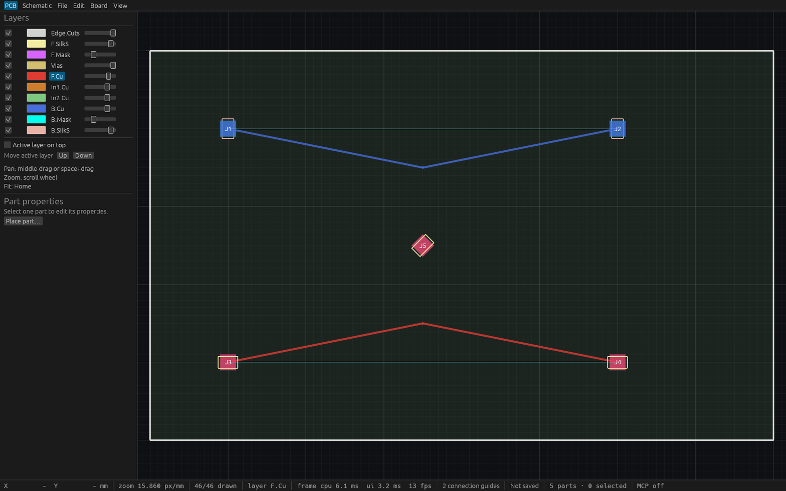
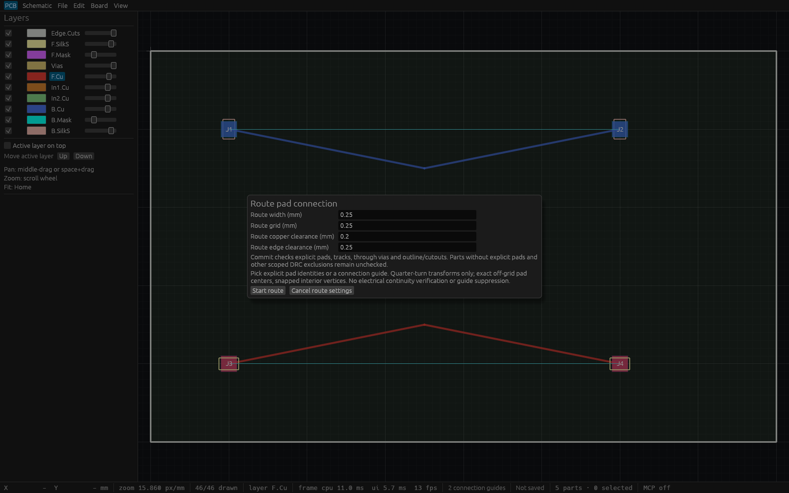

# Exact explicit-pad routing verification

T-0069 adds guarded rectangular SMD pad endpoint attachment and desktop pad/guide
picking. The [public contract](specs/explicit-pad-routing.md) defines exact integer
quarter-turn transforms, retained off-grid endpoints, grid-aligned interior
vertices and conservative guide counts.

## Automated checks

The complete Linux fmt, strict workspace/all-target clippy, workspace
unit/integration/doctest and workspace build gates passed on routing implementation
`b00730e9fb63033ce489634d22238fa4e4c6831a`: **380 passed, zero failed, one existing
ignored**. Final integration rebases onto schematic/PCB synchronization main,
preserving optional schematic links and additive command/UI/view registrations.
On integrated source `188c07b32755f9ee3fc86d5c3c5cc006582a0279`, fmt, strict
workspace/all-target clippy, **29 focused engine/UI/MCP tests** and the integrated
workspace Linux build passed. Fresh combined PR CI gates the final artifact head.

Engine checks cover typed/dynamic command parity, exact bottom-side rotated
centers, assigned net/copper side derivation, one undo/redo with stable copper IDs,
stale stream/sequence and whole-batch rejection, incompatible/missing/arbitrary
endpoints, off-grid interior rejection, immutable sorted/filter/paginated discovery,
foreign copper, incomplete preflight and bounded unrelated schematic capture.
Shared transform checks compare all signed quarter turns and bottom mirroring
against presentation geometry, including checked integer overflow.

Actual egui pointer/key checks exercise selecting pad origins and connection
guides, exact off-grid endpoints, snapped interior vertices, Backspace, Escape,
Enter/undo/redo, hidden copper layers, explicit endpoint change buttons,
unsupported arbitrary angles, stale concurrent pad-net edits, local preview
preservation and focus/workspace cancellation. Existing free polyline routing
checks continue to exercise modal guards, clearance errors and document changes.
MCP tests use independent agent contexts, immutable endpoint discovery, shared
command routing, stale rejection and own undo/redo.

## Scope

Quarter-turn rectangular explicit SMD pads on one common outer copper side are
supported. The command resolves persisted part/pad references again under the
captured session cursor; presentation corners never become model endpoints.
Legacy graphical pads and unassigned/arbitrary-angle targets cannot attach.
Only the desktop preview snaps interior vertices; agent-supplied off-grid
interiors reject. Guides remain conservative estimates after routed copper is
added. This does not verify copper continuity or complete the parent router.
There are no routed vias, track endpoint attachment, walkaround, push/shove,
posture constraints or obstacle avoidance. T65 scoped DRC exclusions and bounded
synchronous preflight limits remain.

## Native desktop HTTP and visual evidence

Two independent MCP clients connected to the copied production desktop binary
from the same verified routing implementation. All **16 checks passed**; see
[raw HTTP report](verification/t0069-native-http.json). Checks include immutable
query discovery, exact mirrored 90-degree/off-grid centers, derived bottom
copper/net, atomic two-segment commit, stale cursor and concurrent pad-net edit
rejection, same-side different-net rejection, arbitrary-angle/off-grid interior
rejection, one own undo/redo preserving IDs, and unchanged conservative guides.
Production binary SHA256:
`fe744bcd6a38e0721c1bb9205b36f2deef45146b233e247d2a74db33cbeb384f`.

First two-segment HTTP tools/call took **2.38 ms**. Five two-segment commits on
the five-pad fixture took **2.73, 2.91, 2.65, 2.51, 4.45 ms** (mean **3.05 ms**),
including synchronous preflight. This unoptimized Linux debug build and small
fixture do not establish worst-case latency or a native frame-rate result.

After integration, a separate copied production desktop binary passed the same
16 checks again over real HTTP on port 7895. See [integrated report](verification/t0069-native-integrated-http.json).
SHA256: `99de4f0f6d1dfd51b82fee7b7d8a890c064cd6da0c31f382a58c991001ba8d2b`.
The first commit took **6.83 ms**; five later small-fixture commits took
**5.07, 3.09, 2.44, 2.80, 1.99 ms** (mean **3.08 ms**). Both runs were on a
shared active development desktop, without controlled performance isolation.

Cua could not prove the actual tiled production window's capture identity and
returned `surface_identity_unproven`; no pixels from that refusal are presented.
Readable snapshots use an independently built fixed-size wrapper around the
same production `ViamindApp`, loading the [actual saved HTTP fixture](verification/t0069-route.viamind.json).
The [wrapper source](verification/t0069-native-inspection.rs) sets min=max
1600×1000 (captured 1568×980), and `--settings` calls production `begin_pad_route`.
It has no MCP endpoint. Its binary SHA256 is
`2fb90289d93fae40ccb2887a54118179396143b4a653a03a2c4544717ade8bc5`.
The temporary Cargo example was removed after building/copying. These images
show committed copper/settings; actual preview input behavior is covered by
pointer/key tests, without a native-input claim.

