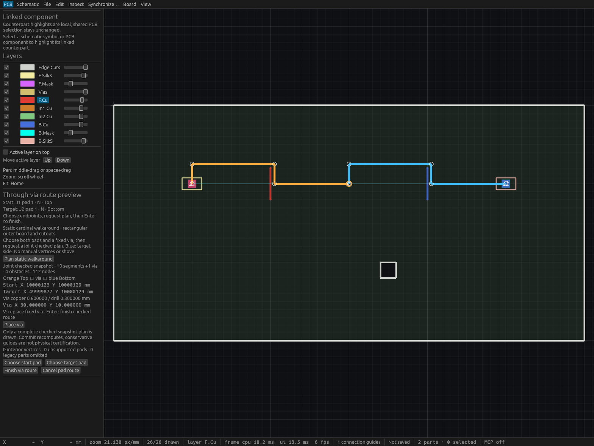

# Fixed-via two-side checked walkaround verification

## Scope

T88 extends checked static cardinal walkaround to opposite-side same-net explicit
pads through ONE fixed grid-aligned through via. Both legs share one captured
board/full cursor, one retained admission and cumulative obstacle, graph, edge,
intersection and result limits. No leg is returned as a checked proposal until
both paths AND the new via pass complete shared scoped DRC. Commit recomputes
and applies all new tracks plus one via atomically; one undo removes them.

The outer outline and every cutout must be axis-aligned rectangles. Exact
quarter-turn explicit pad centers and off-grid attachment stubs are preserved.
All existing via drill holes block paths regardless of net. No automatic via
placement, shove, generic-outline routing or physical certification is claimed.
Strict native 100,000 object 60 fps remains open.

## Automated evidence

The pure planner regression proves each 33-obstacle leg fits separately but the
shared budget rejects the second before graph expansion, preserving all consumed
counters. Independently expected two-side paths preserve exact123/129Nm local
pad offsets and bottom mirroring. Combined 64-box success/66-box refusal and
joint-only new-via edge, annular and nearby same-net hole-spacing failures are
covered. Peer edits, reopened stream guards, typed/dynamic/grouped rollback,
one event/undo/redo and old manual/same-side routing regressions are covered.

Actual egui pointer/key events exercise picking both opposite-side pads and the
fixed via, unchecked Finish refusal, retained immutable checked preview, V
replacement/replanning, peer invalidation, Escape and joint atomic commit/undo.
These are egui input tests, not an operating-system input claim.

## Actual production HTTP

The retained driver initializes two distinct clients against an actual production
desktop binary. It checks independently expected exact two-side detours, work
sums, immutable full sessions, derived sides/net, joint commit, stale peers,
one undo/stable redo IDs, geometry refusals, cumulative caps and same-project
reopen. All synchronous commit latency samples are retained below; these are
small-fixture observations from the unoptimized debug build under host load,
not a worst-case responsiveness bound.

## Readable native inspection

A retained inspection example reconstructs the pre-route board from the saved
production fixture, invokes production controls with real egui pointer events,
and requests a checked two-side preview. Every native frame asserts the complete
session remains unchanged and the checked path stays present. Fixed 1600×1200
viewport and logical-focus retention belong to the inspection host; production
focus-loss cancellation remains unchanged. Cua captures the native window without
operating-system clicks. The production HTTP binary is a separate verified copy.

The inspection uses production default 0.25 mm grid/track width, whereas the exact
HTTP fixture uses 1 mm grid/250001 Nm width. Their checked detours therefore need
not share the same intermediate vertices; both preserve the same exact pads and
fixed via.

## Provenance and limits

Binaries are copied under the entire-sequence shared Cargo mutex after source
mtime invalidation. Historical source hashes, binary hashes, driver output,
fixture and capture remain identified separately from later integration commits.
Conservative boxes can refuse physically feasible paths. Existing unrelated DRC
violations and documented checker omissions are outside this scoped guarantee.
Stored-endpoint guide proof is separate from physical continuity certification.

### Retained records

- [Linux/native master](verification/t0088-linux-native.json)
- [Complete Linux gate log](verification/t0088-linux-gate.log): **590 passed, 0 failed, 1 ignored**, including doctests; formatting, strict workspace all-target Clippy, workspace build and inspection build passed.
- [Actual production HTTP report](verification/t0088-native-http.json): **27 checks passed** against native desktop PID 944501, port 7914, with two independently initialized MCP clients.
- [Production verification driver](verification/t0088-production-check.py)
- [Saved production route](verification/t0088-route.viamind.json)
- [Retained native inspection source](../crates/ui-egui/examples/t0088_inspection.rs)

Production source **85a33c04b991a8c4cc7dcb0f8c5bca7ddc09f6e6**, based on
**0fb27a1**, produced unique binary SHA256
`051d6364fb908ef4465b003a3b57a9b3cbded16ef26dfc58e69cf618295bc1e0`.
The actual production window is 46×58 under this crowded compositor layout;
readable inspection uses a separate fixed native viewport. Existing windows were
preserved. No raw operating-system input or resizing was attempted.

First HTTP plan **2.40 ms**, first synchronous joint commit **3.40 ms**. Five warm
commits were **3.82, 12.67, 6.87, 6.06, 11.69 ms**, mean **8.22 ms**. All samples,
including the slower observations, remain in the report. Nearby host load was
**13.02/16.26/15.89** with concurrent builds. These small debug-fixture measurements
do not bound maximum-capacity synchronous commits.

The first full run found a new test's assumption that UUID-sorted discovery would
put the top pad first. The test now selects top/bottom by the known layer, retaining
exact side assertions; the required full rerun passed. No planner behavior or
numerical tolerance changed. Initial native inspection showed checked paths but
Finish below the sidebar fold. A second inspection-only scroll-memory attempt
also left Finish below the fold because the sidebar root IDs differed. Both captures are excluded from final
evidence. The final fixed 1600×1200 host asserts actual Plan, Finish and Cancel
control bounds before launch; application routing is unchanged.

### Final readable native capture

Final inspection source **b1cf0e72e9cb9ba0048dfef578edef2f94758a15**; unique
binary SHA256 `bd9da95d933e543ebc73f6a045073c4d10f800e1d5113186d866e332e1a4973c`.
Native PID **1004514**, fixed **1600×1200** window, captured **1568×1176** client
pixels. The image shows orange top-side and blue bottom-side checked detours,
the fixed via, both exact pad attachments, the rectangular substrate cutout and
complete Plan/Finish/Cancel controls. The checked default-grid preview reports
**10 segments +1 via, 4 obstacle boxes, 112 graph nodes**. Its one remaining
connection guide is appropriate for this immutable pre-commit inspection.

[Inspection build and strict lint log](verification/t0088-inspection-build.log)
and [runtime exact checked coordinates](verification/t0088-inspection-runtime.log)
are retained. Actual Plan, Finish and Cancel bounds are asserted inside the
inspection viewport before launch. Every native frame asserts the full session
is unchanged. No compact 640-pixel native claim is made for this new capture;
actual fixed-via input tests use 1600×1000. The two earlier clipped captures
remain excluded, and their source/binary/PID provenance is recorded in the master.
