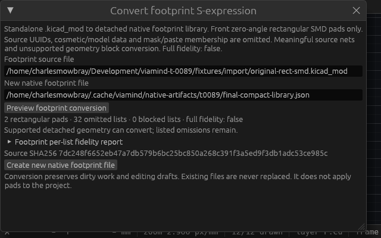
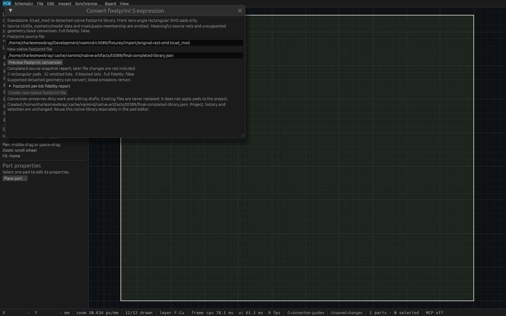

# Detached footprint conversion verification

T89 converts one bounded standalone `.kicad_mod` into a new detached native
rectangular SMD footprint library. Public-source spec precedes parser code.
There is no project conversion, inferred connectivity or full fidelity claim.
Known noncopper art/model metadata, mask/paste memberships and source UUIDs
are explicit omissions. Meaningful nets, unsupported copper/geometry and unknown
semantics block the entire output; no partial library is published.

## Exact geometry and immutable session

The original authored fixture has asymmetric signed odd-Nm pad positions and
sizes, optional source UUIDs, an empty unassigned net marker and omitted noncopper
art/model metadata. Parser regressions check exact local coordinates, all tested
header variants, every-list deterministic report, malformed identities/numbers,
semantic children inside recognized omitted metadata, and each resource limit.
The related board converter receives the same strict scalar pin-metadata fix.

Native library loading has descriptor-checked nonblocking FIFO-safe bounded IO.
Conversion reparses the exact preview SHA256, serializes/syncs before the native
file guard, then atomically publishes only a new file. Controlled peer native
save after staging rejects at publication without losing peer work. Existing,
symlink, source and current-native aliases preserve bytes. Dirty native project,
full cursor/history/selection/status remain unchanged by detached conversion.

Two existing components applied separately retain matching numbered pad IDs/nets,
receive distinct fresh IDs without nets for new numbers, and keep placement.
Application is explicitly separate and undoable. No IDs are generated by conversion.

## Automated and production evidence

[Complete Linux gate log](verification/t0089-linux-gates.log): **602 passed,
0 failed, 1 existing ignored**, including doctests, formatting, strict workspace
all-target Clippy, workspace build and native inspection build. Source
`ce71d1ac7473a6d035094937e932fd05bf63e10b`, base `0fb27a1`.

The actual accessible desktop suite passes three interaction cases: dirty work
and a real active schematic-wire draft survive Preview/Convert; compact 640×400
scrolling reaches Create and changed-source errors within viewport bounds;
context/path changes discard previews and unsupported pads never enable output.
Worker units cover close/reopen/path generations, one retained receiver, failed
spawn, disconnect and same-project reopened stream completion.

Production binary SHA256
`9cf92dc6462ce75ab4440db0c10d0b036a50710a6392e6f4c2ad059f3f6ea043`
passes [17 stdio checks](verification/t0089-production-stdio.json) and
[16 actual desktop two-client HTTP checks](verification/t0089-production-http.json),
owned PID1026091/port7917. The retained
[production verifier](../scripts/verify-footprint-conversion-native.py) checks
source SHA and all preserved bytes, strict schemas, unsupported/meaningfully
connected sources, destination conflicts, dirty-session immutability and separate
number-preserving undoable native application. The same original fixture is used
for both transports. Existing previews/windows are preserved.

## Readable native inspection

The retained [native inspection wrapper](../crates/ui-egui/examples/footprint_conversion_inspection.rs)
prepares production ViamindApp through actual egui input, then renders it in a
fixed native WGPU viewport. Every native frame asserts the complete prepared
session is unchanged. Compact Create bounds are asserted before launch.
Cua captures the exact owned native windows without operating-system pointer
input or desktop customization. The crowded production 16×22 window is provenance
only; it is not the readable interface proof.

Initial captures identified a missing font glyph for the introductory arrow.
The final label uses plain “to”. Source `d17344b5c0a96c32a8d05d357a27ef70741b9498`
rebases cleanly onto main `f5a6b96` and changes only that label. Its
[narrow refresh](verification/t0089-final-ui-gates.log) passes formatting, strict
UI all-target Clippy, all three actual-input cases, production and inspection
builds. Fresh production SHA256
`4f57014b31979e89273de650e5051ce290b62a06f6bedecaf765db5ecf31c176`
passes [17 stdio checks](verification/t0089-final-production-stdio.json).
Full workspace and actual desktop HTTP results above retain their exact historical
source provenance. All binary hashes, owned PIDs/windows and image hashes are in
[the Linux/native master](verification/t0089-linux-native.json).

Expanded normal per-list preview requires outer scrolling to reach Create. The
compact action capture directly proves the reachable control and readable plain
text at 640×400:

The completed view follows actual input publication of a new two-pad native
library, with complete session immutability asserted every native frame:

No unrelated canvas rendering claim is made.

## Limits

Front zero-angle rectangles only; 1 MiB source/output, depth32, 100000 tokens,
20000 lists/report items, 4096-byte tokens/paths and at most1024 pads. These are
bounded original fixtures, not a representative library/project corpus. Full
S079 compatibility and S083 cross-tool/fabrication fidelity remain open.

## Final integration

Final clean integration includes sourcing metadata main `80d67c0` and the
read-only fabrication overlay main `cd19c84`. The board parser
retains `assembly: None`; detached definitions contain no sourcing fields.
Range-diff preserves feature logic, with only additive engine exports, MCP
registration/dispatch and desktop action context changed. Sourcing, overlay and
conversion handlers remain present. Formatting
passes; fresh combined CI validates this integrated PR head. Historical binary,
test and native capture provenance above is unchanged.
