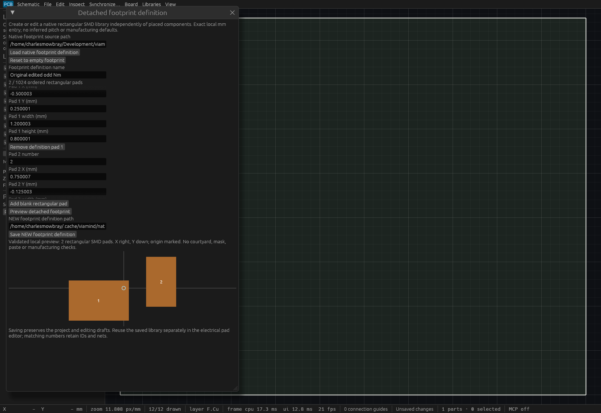
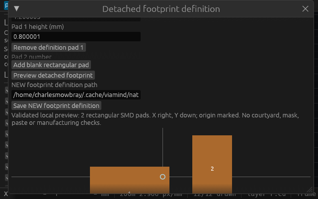
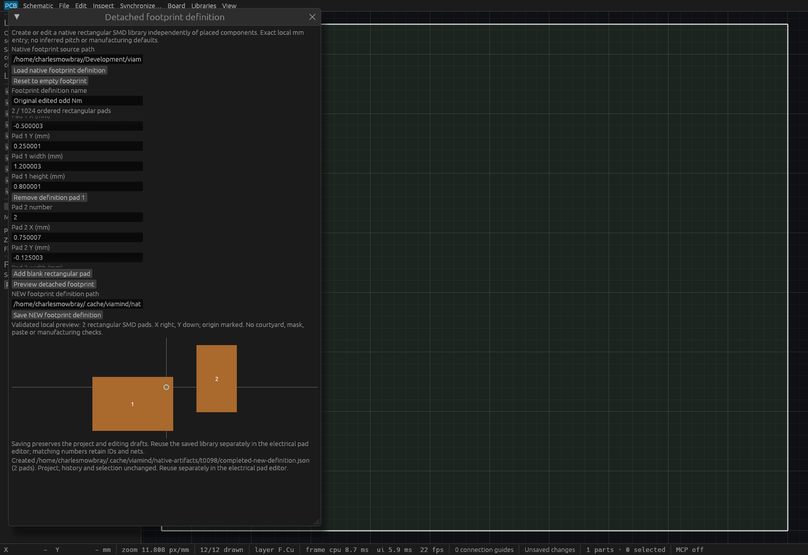

# Detached footprint definition editor verification

## Scope and source

The public-source [behavior spec](specs/footprint-definition-editor.md) was committed
and independently approved before implementation. This adds detached named native
rectangular SMD definitions to S035. It does not implement courtyard, silkscreen,
mask/paste, holes, other pad shapes or fabrication approval.

The [master report](verification/t0098/master.json) retains exact source commits,
binary identities and artifact hashes. Product source `4d460fe` passed the full
Linux sequence. Later inspection-only changes place capture completion before
the production dirty-document close guard and resize the ordinary dialog through
actual local egui pointer input for the wide view. They change no application
geometry, engine behavior or UI form implementation.

Historical product and inspection ancestry is retained by annotated tag
`verification/t0098/native-source` at `fae0e140762a0b464aa9eb0516e8ff669a428688`.
The GitHub commits API resolves the original full product SHA through this ref.

## Linux and actual input

Owned whole-sequence gate 60802 passed formatting, strict workspace Clippy with all
targets, **674 workspace tests, zero failures, one existing ignored test**, workspace
build and inspection example build. All **13 adversarial MCP tooling tests**, full
application discovery of **83 tools** and **18 isolated agent workflow checks**
passed. The gate script, complete output and queued source tree hashes are retained.

The actual-input tests cover a live schematic wire draft through detached creation,
exact odd-Nm geometry, compact scroll-to-Save/error bounds, and a stable accessible
text field identity when an earlier pad row is deleted. Load/edit/remove, peer
edits and same-project reopen retain the detached draft. The form disables mutable
fields and Reset during its retained operation; Close retains the receiver. Unit
tests exercise spawn refusal, disconnection and stale generation completion.

Saving does not apply geometry. A separate guarded electrical-pad import preserves
matching pad UUIDs/nets, component placement/rotation/side, linked symbol and
explicit assembly metadata; new numbers receive fresh IDs and unassigned nets.
One undo restores the exact original project, and redo restores the same IDs.

## Actual production MCP

The retained full application passed **24 stdio checks** and **23 checks over its
actual desktop HTTP endpoint using two clients**. These verify NEW native output,
exact serialized asymmetric geometry, independent reading, full session and dirty
status preservation, collision/symlink/native-path protection, invalid bounds and
unknown semantics, FIFO and oversized-path refusal, empty named definitions,
separate guarded reuse, stale part rejection and exact undo/redo. Production
executable SHA, PID and actual 7922 socket ownership are recorded.

The native file lifecycle race test stages the detached file, lets a peer save the
active project to that path, then proves publication refuses against the latest
native path without changing its bytes or session. Another test preserves a file
created at the destination after staging and verifies private stages are removed.
The existing shared reader regression swaps a source to FIFO before opening it;
its nonblocking same-fd regular-file check rejects without waiting for a writer.

## Native rendering

The retained inspection host source `83bc7d5` prepares the production
`ViamindApp` using actual local egui load/edit/preview/save and pointer-resize input.
Its actual native WGPU Screenshot produces an opaque P6 file, then lossless PNG.
An independent chunk-CRC and RGB decoder verified every output pixel against the
original readback. This is native rendering proof with local egui input; no
compositor capture, OS input or frame cadence is claimed.

All three hosts logged full SessionSnapshot and document-status invariants,
fsynced their captures and closed themselves successfully after 11 UI passes:

- **Normal, 1600×1100:** explicit odd-Nm fields, both numbered rectangles, origin,
  axes and Save visible. The ordinary dialog is resized using actual local input.
- **Compact, 640×400:** Save and destination are reachable after scrolling. The
  preview continues below the fold; this capture does not claim the whole local
  geometry is visible at once. Actual input separately checks error bounds.
- **Completed, 1600×1100:** NEW output/path and project/history/selection preservation
  notice are readable; the saved strict native JSON is retained.





The combined T95 base `c506d6b` introduced only unrelated checked-output work.
The sole rebase conflict appended engine exports; both modules remain intact.
Focused combined gate 18872 passed formatting, strict workspace/all-target Clippy,
six integration/actual-input/HTTP tests, workspace build and refreshed inspection
build. The retained combined app again discovered 83 tools, passed 18 isolated
workflow checks, matched the committed catalog exactly, and passed 24 detached
stdio checks. Historical production HTTP proof remains tied to its original
verified executable and PID.

Final independent review found a secondary MCP allocation boundary: JSON request
values already exist before typed decoding. Source `d45570b` now checks borrowed pad
count before visiting rows, and name/number/path byte bounds before `from_value`.
A 1025-null-row oracle proves count rejection precedes malformed-row decoding;
oversized strings and paths likewise refuse before typed ownership. Focused gate
31667 passed format, strict workspace/all-target Clippy, both MCP integration tests
and workspace build. Its retained production executable passed all 24 valid stdio
checks plus six real early-rejection/session-preservation checks, and the canonical
83-tool catalog remains byte-identical. This adds no native form/render change;
existing exact-source native captures remain applicable. The initial JSON transport
allocation is outside this typed preflight and is not claimed to be bounded here.

## Final named-net integration

After T97 merged as `b845cb7`, final source `c9bb7f1` preserved both additive
engine exports and UI action helpers. All detached feature modules, tests and
native inspection source remain byte-identical to the reviewed feature. Gate
66802 passed format, strict workspace/all-target Clippy, two MCP tests, three
actual-input tests and workspace build. Its uniquely retained combined production
executable discovered **85 tools**, regenerated the complete canonical catalog,
and passed 24 valid detached stdio checks plus six early request-boundary checks.
Historical native captures remain source `83bc7d5`; annotated tag
`verification/t0098/combined-native-source` retains that source and the pre-T97
bounded request refresh ancestry. Both historical source refs resolve on GitHub.

Verify retained artifacts without writes:

```sh
python3 docs/verification/t0098/verify-artifacts.py
```

Reproduce detached production checks on a fresh owned headless child:

```sh
python3 scripts/verify-footprint-definition-native.py \
  --binary /absolute/path/to/viamind --report /absolute/path/to/NEW-report.json
```

The verifier's optional HTTP URL is only for an owned scratch desktop: it starts
a new project and performs explicitly undoable component reuse. It must not be
pointed at a user's unsaved project.

## Supported limits

At most 1024 pads, 1 MiB serialized native files, 4096 encoded path bytes and 1 MiB
aggregate draft text. Name/number bounds are checked on borrowed data before
cloning; decimal mm retains integer nanometres without excess precision or
rounding. Local coordinates and positive dimensions are bounded to 10000 mm.
New rows are blank and require explicit geometry. No pitch, centroid, mounting,
population, sourcing, mask or manufacturing defaults are inferred.

Final combined CI and independent review are separate merge gates recorded on the
ticket and PR. The historical full gate and production reports retain their exact
source identity after unrelated integration changes.
