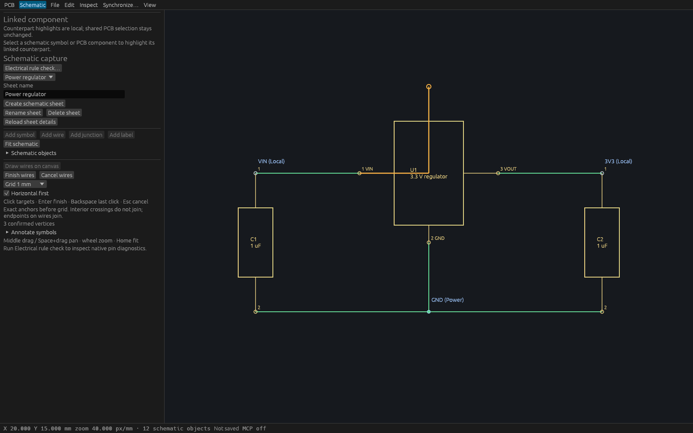
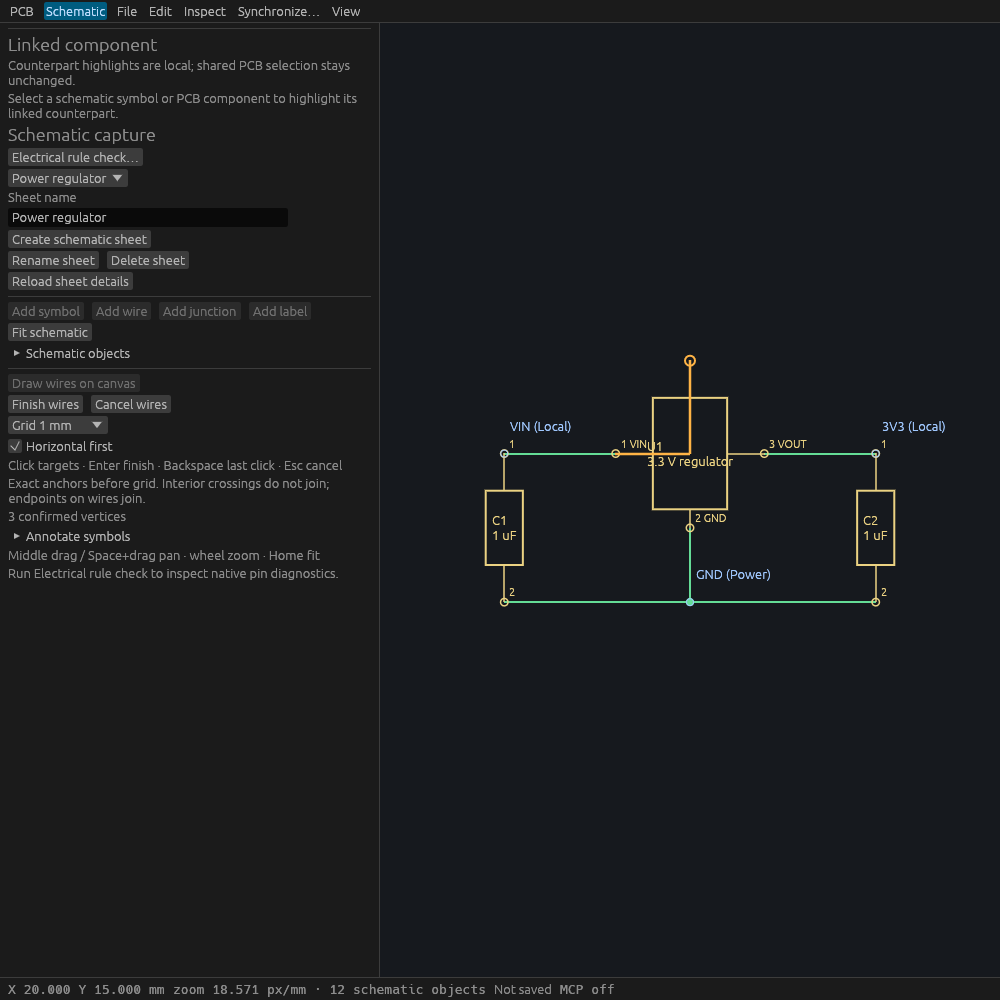

# Interactive schematic wires: Linux verification

## Source and supported scope

T74 adds an independent cardinal wire tool from the public behavior specification
in [the clean-room spec](specs/interactive-schematic-wires.md). The spec commit
`f1ed1a7` precedes implementation `e40e932`. The final implementation revision and
exact binary hashes are retained in [the gate report](verification/t0074-linux-gates.json).

Supported work is bounded selected-sheet snapshot/preparation, exact transformed
pin/endpoint attachment before grid, local cardinal preview, and one guarded
sheet-delta commit. There is no wire dragging, connection-preserving symbol
movement, bus/hierarchy support, implicit junction insertion or latency claim.
Commit includes the documented synchronous global validation preflight.

Linux gates passed on `d87826d05d4f102f4603fdda87e47f1f56aecfdb`: formatting,
strict workspace/all-target Clippy, **465 tests passed / zero failed / one existing
ignored**, workspace build and the inspection example build. Production binary
SHA-256 is `e3de89dc114cfca8da04e021f224673605b3c42ea9e4590462cfba71aeeb1f1f`;
inspection binary SHA-256 is `5c34bbb03719765584da5db022e3333bd6bb60dda7aa374032a31874dbedeb56`.

## Shared command and MCP

Five engine integration tests prove exact odd-Nm typed/dynamic creation, one-event
atomic undo/redo with stable nested wire IDs, native persistence/log replay,
unchanged unrelated project content, ordinary nonjoining crossings, native T joins,
malformed/stale/forged/reopened/batch rejection and selected-sheet/result budgets.
The global-budget regression uses 100000 unrelated vias and a separate unrelated
oversized sheet: a bounded selected-sheet snapshot succeeds, but commit rejects
unchanged before inherited global identity allocation.

The real two-client HTTP integration test checks discovery/schema, immutable
snapshot repetition, peer edits invalidating a proposal, one-event creation and
creator undo preserving the peer edit. The UI parity suite verifies every shared
action/tool schema and catalog mutation dispatch.

[The production stdio report](verification/t0074-native-stdio.json) records 13
checks through an actual built `viamind --headless --open` process, with display
variables removed. It covers discovery, deterministic read-only snapshots,
noncardinal and stale rejection, exact off-grid segments, unrelated content,
one undo/identity-preserving redo, crossings/T joins, exact native save and
same-UUID reopen followed by old-stream rejection. The retained saved design is
[the native wire proof](verification/t0074-native-wires.viamind.json).

## Actual desktop input and worker lifecycle

Four actual egui input tests drive production `ViamindApp`: mirrored/rotated
odd-Nm pin attachment within the screen threshold, two-click cardinal bend,
Enter/Finish commit, horizontal/vertical posture, Backspace, middle pan, wheel
zoom, Escape, crossing/T graph behavior, peer-edit rejection, same-project reopen,
actual editor toggle and conflicting object property drafts. View actions preserve
the entire model/history/cursor; a successful path is one transaction.

Controller tests separately prove retained pending receiver cancellation,
old-stream/sequence completion discard, the 256-vertex limit, exact anchors ahead
of grid, cross-probe/ERC navigation guards, repeated activation preserving the
path, and direct Finish rejection after selected-sheet context changes before
another frame can poll. Document replacement is polled in both editor modes;
reopening a document with a PCB component cannot strand an old schematic path.

## Retained Linux native preview

The inspection-only [wrapper source](verification/t0074-wire-inspection.rs) uses
production `ViamindApp` in a fixed-size eframe/WGPU window. It opens the original
regulator fixture, starts the production tool, and injects two egui pointer
press/release pairs through `raw_input_hook`. The unchanged production canvas
performs endpoint snapping and adds one bend. Runtime assertions require three
confirmed vertices and an unchanged entire project. The wrapper does not fabricate
wire draft vertices or create model objects.

Cua Driver launches the owned wrapper PID and captures its exact native window.
No Cua native input success is claimed; this host has no usable egui accessibility
input route. The application-input tests and wrapper event injection are labeled
separately from the production MCP process.



The wide window shows a snapped orange path from U1 pin 1, a cardinal bend, three
confirmed vertices, the grid/posture controls, Finish/Cancel and the crossing
explanation. Existing regulator symbols, labels and wires remain unchanged.



The narrow window keeps all wire controls and instructions readable. Existing
fixed-size circuit labels can crowd at the smaller fit zoom; zooming in remains
available. Native window metadata is retained in the wide/narrow capture reports.

## Reproduction

```sh
cargo fmt --all -- --check
cargo clippy --workspace --all-targets --locked --offline -- -D warnings
cargo test --workspace --locked --offline
cargo build --workspace --locked --offline
python3 scripts/verify-schematic-wires-native.py --binary target/debug/viamind --report /tmp/wires-report.json
```

The local sequence ran under the shared workspace gate mutex with source mtimes
refreshed for this worktree, and copied verified binaries before releasing it.
The temporary Cargo inspection example was removed after its build; its exact
source is retained above. Final combined CI validates the submitted main-based
revision; unrelated clean rebases do not change the retained binary provenance.
