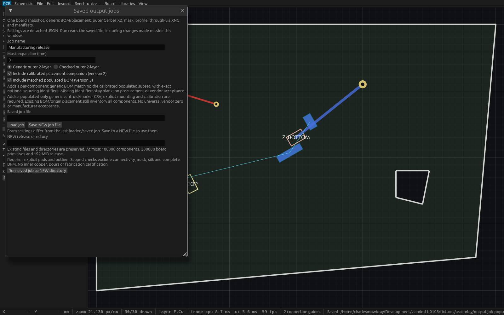

# Matched populated output-job verification

Ticket T-0108; public behavior contract: [spec](specs/matched-populated-output-job.md).

Version3 is an explicit detached job with both `include_calibrated_placement:true` and `include_populated_bom:true`. It adds `assembly/populated-bom.csv` alongside the existing calibrated placement companion. The generic per-component BOM includes exactly the same populated component IDs, all explicitly declared mounting types, and only exact optional user-entered sourcing identifiers; unavailable identifiers remain blank. Generic older inventories still include all components. This does not establish procurement availability, universal vendor rotation zero, polarity or manufacturer acceptance.

The optional `populated_assembly` manifest summary identifies both files, included count and the specified domain-separated SHA256 of sorted UUID bytes. This digest identifies the component set, not file content. Existing manifest entries remain filename-to-byte-length mappings with a complete exported cursor. Version1 and version2 canonical settings and output payloads remain unchanged.

## Exact production proof

Production source `c4d426190af0927442d3e83ee0890b35ceb52914` passed all four Linux gates: 756 workspace tests passed, 0 failed, 1 ignored. It produced retained executable `~/.cache/viamind/native-artifacts/t0108/production-verified`, SHA256 `2ab21728bec4c95ffe2c2e4efdbf8317260178495505143bb25252ddef08d88a`. The actual application runs on HTTP7938, PID2001429, with its own copied native fixture. The [35-check production report](verification/t0108-production-report.json) was produced by the [portable independent probe](verification/t0108-population-smoke.py); its optional-null reader correction was committed after the unchanged Rust binary was built.

Two initialized clients publish byte-identical13-file generic releases at the same complete source cursor. The14-file checked profile runs the trusted production DRC on that same owned board/rules snapshot. Independent Python CSV/UUID/hashlib readers verify exact escaped Unicode, quotes and newlines, optional blank fields, mounting, stable UUID BOM ordering, matched placement membership, declared count and domain-separated digest. The fixture deliberately has a different reference order from UUID order. The existing calibrated coordinates/markers also pass an independent vector oracle.

Display-free CLI and HTTP format/config payloads match exactly; session-dependent release manifests are explicitly excluded from cross-process comparisons. Retained prior T104 production SHA256 `82789aebea0a8bb63d917bfcf3bb1f836a7848fbea6e7457881dbecc94c531bf` independently produces identical ten version1 and eleven version2 format/config payloads. Their new optional summary remains absent.

Strict version/flag/null/duplicate/unknown-field failures, stale complete cursors, existing release collisions, each process's own active native file, partial calibration and stronger captured document rules refuse without partial publication. A deliberate population change removes exactly one ID from both companions while preserving older inventories. Three deliberate peer edits and undo restore exact project/native/status while advancing the cursor honestly from0 to6. Accepted and refused observations/exports preserve complete session state and document status.

The first probe stopped after five successful checks because the independent reader compared an absent CSV identifier with JSON `null`. [Failed report](verification/t0108-historical-reader-failure.json) and [trace](verification/t0108-historical-reader-failure.log) are retained separately. It reached no peer edits. Correcting absent/null-to-blank interpretation changed the probe only; that attempt is excluded from success claims.

## Native desktop inspection



The separate [inspection host](../crates/ui-egui/examples/t0108_inspection.rs) uses production ViamindApp from the same frozen source, retained `~/.cache/viamind/native-artifacts/t0108/inspection-verified`, SHA256 `986079c967b0d4bf05cf41d14fdb70fb1369fd1ad8ac705f2f2743100d22ea70`. It has no MCP, uses a fixed 1600×1000 viewport, injects four application-local egui pointer events to select both checkboxes and three to resize only its local dialog. Production defaults are preserved.

The [native report](verification/t0108-native-inspection-report.json) verifies both selected options, matching generic sourcing/placement descriptions, all saved/NEW path controls and Run visibility, and complete session invariance on every frame. Actual native WGPU Screenshot pixels are written to a NEW fsynced P6 file and the host closes itself. The [conversion report](verification/t0108-capture-conversion.json) independently compares every RGB byte after lossless PNG encoding. This is native framebuffer and local synthetic-input evidence, with no OS-input or cadence claim. A separate fresh [Cua actual-production snapshot](verification/t0108-cua-production-metadata.json) returned degraded AT-SPI metadata; it does not prove selected checkbox state.

## Bounds and shared paths

[20 focused tests](verification/t0108-focused-linux.log) and [full Linux gates](verification/t0108-full-linux.log) cover borrowed included-only sourcing validation before calibration-reference allocation and geometry copying, per-field/aggregate limits, oversized invalid unused/DNP metadata exclusion, one retained manufacturing permit, immutable captured sourcing through later peer edits and canceled awaiters, exact old payloads and atomic failures. The compact 640×400 actual-input test saves a cleared version1 descriptor, reloads/saves version3 to a new path to prove form restoration, reaches Run/result/digest through scrolling, compares every release file with the shared MCP writer and verifies errors/newer-edit status.

The [actual88-tool catalog](verification/t0108-catalog-report.json), [18 isolated agent workflow checks](verification/t0108-agent-workflow.json) and13 tooling tests passed. No model/native/event schema changes or new standalone CSV kind are introduced. The single snapshot keeps borrowed board/rule/calibration/sourcing bounds,32MiB CSV and192MiB release limits, and the existing staged NEW-root no-replace publication contract. Checked DRC retains its existing geometry coverage/exclusions and captured named-net minima. The final combined integration below passed; exact-head CI remains the merge gate.

[Master provenance](verification/t0108-verification.json) indexes exact report, fixture, helper, capture, log and retained executable identities. [Sample manifest](verification/t0108-release-manifest.json), [BOM](verification/t0108-populated-bom.csv) and [placement](verification/t0108-calibrated-placement.csv) expose the independently parsed synthetic release bytes. Fixture identifiers are explicit test strings and do not claim actual sourcing.

## Reproduction

Build and retain a unique production binary from the frozen source. Launch it on a coordinated unused port with a copy of [the fixture](../fixtures/assembly/output-job-population.viamind.json) as its active native file, then run:

```sh
python3 docs/verification/t0108-population-smoke.py \
  --binary /absolute/verified/viamind \
  --previous-binary /absolute/retained/T104/viamind \
  --project /absolute/copied/native-project.json \
  --repo "$PWD" --directory /absolute/NEW/probe-directory \
  --endpoint http://127.0.0.1:PORT/mcp
```

The probe requires writable MCP admission and performs three reversible peer edits with undo. The CLI opens the supplied project path, so use that same active native copy for protection checks. For native inspection, build `cargo build -p viamind-ui-egui --example t0108_inspection`, then launch its retained executable with the fixture and a NEW PPM path. Preserve original P6 pixels during PNG conversion and independently compare decoded RGB.

## Final combined integration

After transplanting only T108 commits onto frozen T106 `7178e7d7edf94f3e50cbaf06c1c7aefcaa74d5d5`, source `c781570e94b9a4f5472122d8ca02b49f18d6aaa1` passed [17 focused integration tests, fmt, strict all-target workspace Clippy and workspace build](verification/t0108-final-combined-linux.log). The unique retained executable is `~/.cache/viamind/native-artifacts/t0108/production-final-combined-verified`, SHA256 `3adbb92ff788b976a002c03ce1aa27a265ceafffd405b12a7e4c7511d05238e3`. Its [actual 91-tool catalog](verification/t0108-final-combined-catalog.json), [18 isolated agent workflow checks](verification/t0108-final-combined-workflow.json) and 13 tooling tests passed. Canonical references were regenerated from this executable. These combined checks supplement the separately identified original full gate and native production proof; they do not relabel those historical artifacts. Final exact-head CI is pending.
