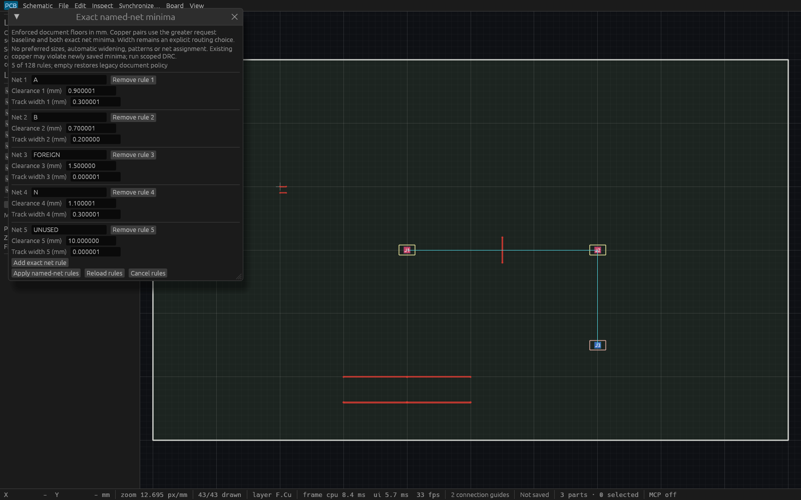
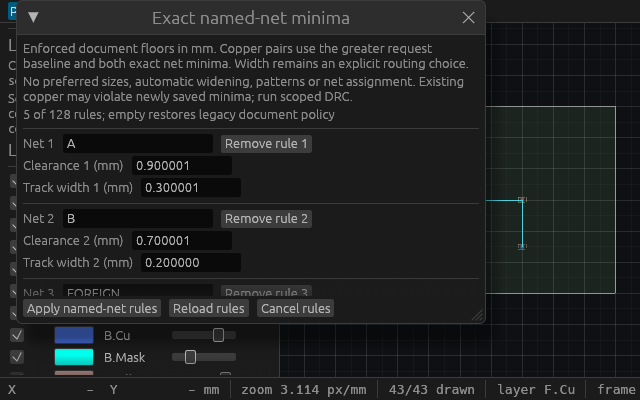

# Exact named-net minima verification

T-0097 persists exact named-net copper-clearance and track-width floors. The
[public-source specification](specs/named-net-minima.md) was committed and
independently approved before implementation. Both native editing and MCP use
the same guarded engine command, full session cursor and one undo.

## Shared policy and captured sources

Different-net copper uses `max(request baseline, first net floor, second net
floor)`. The global maximum expands broadphase discovery; narrowphase resolves
only the actual pair. Track width remains an explicit integer-Nm choice. A
request below its exact named minimum refuses without widening geometry.
Existing tracks can violate newly saved minima; scoped DRC reports their actual
stored IDs and exact width/floor.

The map accepts at most 128 exact names, 128 Unicode characters/256 UTF-8 bytes
per name and 32768 aggregate name bytes. Clearance is 0..100mm; width is
1Nm..100mm. Names must be trimmed, nonempty and control-free. Native JSON keeps
original map tokens, rejecting duplicate names. Seed visitors bound names and
rows before owned rule materialization. Borrowed validation precedes all new
policy copies in scoped DRC, automatic DRC, route/cleanup captures, render and
fabrication snapshots. Rule rows/names also count against existing caller
budgets. Unrelated schematics and assembly metadata stay outside geometry-only
captures. Existing native file loading has no global file-size cap; this change
adds bounds specifically to rule materialization and captured policy.

An empty map omits new native/report/checked-plan fields, preserves legacy
serialized bytes and minimum feature versions, and keeps inherited routes and
DRC behavior. Nonempty rules require native schema 8; policy event deltas
require log version 8 or later. Clearing the map restores old feature-version
calculation. Saved output jobs retain request baselines separately from the
captured `report.document_net_rules`; smaller saved baselines cannot lower
persisted minima.

## Linux gates and exact artifacts

Verified product source is
`6566e8066e8ccfcb7ba2d6ff04be462ef7fc4f35`, based on merged checked-output-job
main `c506d6b67e318a59e199c2faa136e718b982ac13`. All required Linux gates pass:
format check, strict workspace/all-target Clippy, workspace tests and workspace
build. The full suite passed **696 tests, 0 failed, 1 ignored**, including
doctests. An additional **38 targeted tests** passed before the full suite.
Canonical MCP tooling passed **13 tests**, discovered **83 full-app tools**, and
passed **18 isolated agent workflow checks**.

The entire gate and uniquely copied binaries held
`/tmp/viamind-workspace-gates.lock`; source mtimes were refreshed inside it to
avoid stale metadata from other worktrees. Cargo used offline locked
dependencies, two jobs, no incremental compilation and home-cache temporary
files. The production executable is unoptimized with debug information
stripped, SHA-256
`0d356ea32eaafb2fe581d6458f2d327d58ac968551c7918c7d1c75ef8e38b504`.

Initial compile/lint issues were corrected before these gates. A full-suite
failure exposed four integration fixtures competing with the intentional
two-operation planning admission limit. Only fixture synchronization changed;
production admission limits, expected geometry and assertions were retained.
The final full gate includes the merged checked-job implementation.

## Actual production HTTP and saved manufacturing jobs

Cua launched the retained full desktop executable as PID `1590343`, with its
actual HTTP MCP server on port `7924`. Two independently initialized MCP clients
passed **42 checks**. The exact-PID/window Cua snapshot also succeeded; its
metadata is retained separately. This is a real production executable, separate
from the inspection hosts below.

The driver verifies immutable map/full-cursor queries, unknown-input refusal,
exact pair max and distant-pair discovery, unrelated global-max isolation,
odd-Nm width issues, atomic replacement, stale peer rejection, no-op,
undo/redo, malformed/over-budget input refusal and same-UUID reopen/new-stream
rejection. It checks below/equal explicit route width, independently expected
foreign-net walkaround inflation/path, both-side joint-via plan/commit, cleanup
width refusal, exact undo and retained document provenance. Native save/open
preserves schema8 rules; clearing restores the authored fixture's schema4 and
omitted policy.

A separate authored supported fabrication board verifies the actual saved-job
path. A checked release with zero saved baselines and document GND width
250000Nm publishes **12 files** at exact width equality. Validation and manifest
carry the same captured cursor; validation distinguishes requested zero rules
from document minima. Raising the document width to 250001Nm rejects the same
job without release/staging output. A foreign pair with actual clearance
800000Nm is found with document floor 800001Nm and request copper baseline
zero; the actual saved job refuses it without publication. Complete session
state is compared around refusals. A separate engine/MCP regression retains
an old captured policy while the caller changes its document, proving the
checked snapshot uses its own exact policy. Direct-validator budget tests
accept the existing 2MiB text boundary and reject one added rule-name byte.

Single fixture HTTP wall times were: policy edit **1.332ms**, exact-width free
route **1.570ms**, named walkaround commit **3.239ms**, checked release
**14.489ms**. These small authored debug-fixture samples under concurrent
host activity are not worst-case or responsiveness guarantees.

## Actual input and native renderer evidence

Four actual egui tests cover exact decimal parsing, odd-Nm typing, atomic
Apply/Undo/Redo, local Cancel, malformed precision, duplicates, peer/stale and
same-project reopen requiring Reload, stable remaining row field identity after
removal, incompatible modal guards, and invalid borrowed capture rejection.
The compact **640×400** tests assert persistent Apply/Reload/Cancel rectangles
inside the viewport. No model floats, rounding or implicit widening are used.

Final inspection source is `83f92ef` (full SHA in the master provenance).
Its only change after the product source is an inspection-host captured guard
before `app.show`: after successful readback, later close callbacks cannot
reenter a cancelled editor. Format, strict workspace/all-target Clippy and the
example build pass on this source. The inspection executable SHA-256 is
`7d581f64588d553711232bf26704b1bd74d590940126af5691ff52d0f25e948d`.
The initial hosts produced correct images then asserted during a subsequent
shutdown callback; those attempts are excluded from final visual evidence.
Product behavior and the historical production binary remain unchanged.

Each final host loads the authored rules file through the native loader,
prepares the real production editor through egui, then transfers the app to a
fixed native WGPU window. Every active native callback asserts complete session
equality, active editor and prepared footer bounds inside the actual viewport.
An actual eframe `Event::Screenshot` supplies the opaque native framebuffer.
Each newly created P6 output is flushed/fsynced and losslessly encoded as PNG
with exact RGB readback, without resizing or recoloring. Wide PID `1600622`
and compact PID `1601113` each captured at **11 UI callbacks**, then cleanly
self-closed. Callback count is not presented-frame count. Cua launch readback
records the exact own PID/window and dimensions.

Both final images were viewed: five exact names and odd-Nm values are readable
in the wide editor; the compact editor scrolls rows while Apply, Reload and
Cancel remain visible. These are inspection-only native renderer artifacts,
separate from actual production HTTP and actual egui input tests. They make no
operating-system input claim.

## Durable evidence and scope

- [Master provenance and artifact hashes](verification/t0097-linux-native.json)
- [Linux gate summary](verification/t0097-linux-gates.json) and [complete log](verification/t0097-linux-full.log)
- [Production HTTP report](verification/t0097-production-http.json) and [executed checker](verification/t0097-production-check.py)
- [Core rules fixture](verification/t0097-rules.viamind.json) and [checked fabrication fixture](verification/t0097-checked-rules.viamind.json)
- [Saved checked job](verification/t0097-checked-job.json), [validation report](verification/t0097-checked-drc.json), [release manifest](verification/t0097-checked-manifest.json)
- [Inspection build](verification/t0097-inspection-build.log), [wide runtime assertions](verification/t0097-inspection-wide.log), [compact runtime assertions](verification/t0097-inspection-compact.log)
- [Catalog discovery](verification/t0097-catalog-discovery.json) and [agent workflow](verification/t0097-agent-workflow.json)

To repeat the HTTP checker, copy it to a new owned empty directory and run it
against a fresh owned desktop session with arguments `PORT BINARY SOURCE_SHA
REPOSITORY`. It writes its fixtures and NEW checked-release outputs beside
itself; existing evidence paths are not reusable destinations.

Final combined artifact-head CI must pass before merge. Local production and
inspection hashes remain tied to their exact historical sources above.
There is no class hierarchy, wildcard/pattern policy, preferred-size inference,
implicit widening, layer/region priority, document via-size minimum,
differential routing or push/shove. Existing scoped DRC coverage, exclusions and
work/result limits remain authoritative; this is not physical connectivity or
manufacturing certification. Broader S-055 rules, full S-059 routing and the
strict native 100k-object 60fps target remain open.
