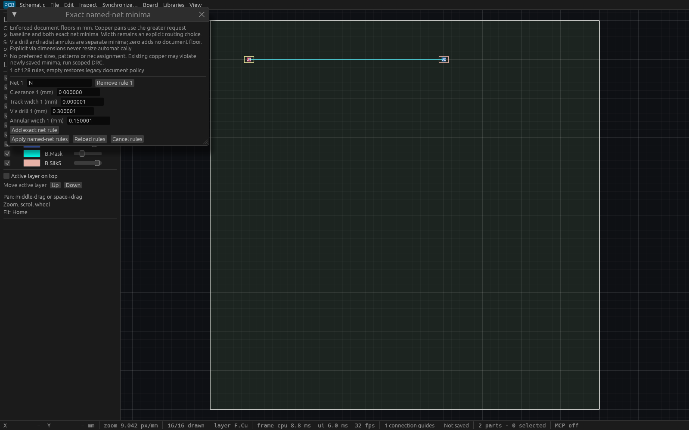
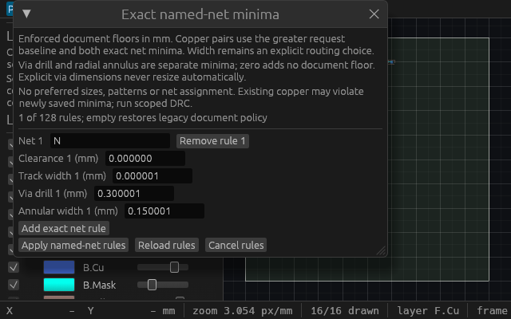

# Exact named-net via minima verification

T-0101 extends the [persisted exact-net policy](named-net-minima-verification.md)
with drill-diameter and radial-annular-width floors. The
[public-source spec](specs/named-net-via-minima.md) was independently approved
before implementation. Existing explicit via dimensions remain unchanged.

## Shared constraints and canonical persistence

For each assigned via, the shared checker resolves the greater request baseline
and matching exact-name document minimum independently for drill and annulus.
Drill compares the exact stored drill diameter. Annulus uses the checked integer
comparison `diameter - drill >= 2 * minimum_annular_width`: a half-Nm radial
shortfall cannot round up to compliance. Requests can strengthen document
minima. Existing stored geometry can violate newly saved rules; DRC reports the
actual via ID and its required floor without resizing it.

Each new integer field accepts 0..100000000Nm. Zero adds no document floor and
is canonically omitted in native files, policy deltas, reports and requests.
Explicit zero fields normalize to the same bytes as absent fields. Existing
128-row/32768-name-byte policy bounds and strict duplicate-key detection still
apply before secondary owned allocations. The new fixed-size scalars travel
with the same validated, immutable geometry captures: scoped and automatic DRC,
routing, cleanup and checked manufacturing use the central resolver. No second
project capture or separate checked-output rule interpretation is introduced.

Any nonzero via floor requires native/event feature10. Zero-only via fields
preserve legacy feature8 policy bytes and empty-map legacy feature calculation.
Feature requirements compose by maximum with unrelated native features.
Replayed base/before/after policy values enforce their feature headers. Clearing
via floors never silently deletes clearance/track-width rules or other features.

Manual pad-to-pad through-via routing and fixed-via two-side walkaround reject
undersized explicit vias before segment allocation/search. Both retain complete
joint tracks-plus-via DRC before any checked plan or commit. The route APIs,
exact off-grid endpoints and one grouped undo remain unchanged.

## Exact Linux and live production evidence

Historical verified source is
`020b70f474b2630424f44b52065cfd66f5c74a22` on merged T98 main
`14953656f2835a6694c0a8975e88cd32528e6ed4`. Formatting, strict workspace/all-target
Clippy, workspace tests and Linux workspace build passed: **715 passed, 0 failed,
1 ignored**, including doctests. An earlier focused run passed **42 tests** and
strict lint. Catalog tooling passed **13 tests**, discovered **85 actual full-app
tools**, and passed **18 isolated agent workflow checks**.

The full gate held the shared external mutex through doctests and unique binary
copies, with workspace Rust mtime preflight, offline locked dependencies, two
jobs, no incremental build and home-cache temporary files. Production SHA-256:
`805ce54106e28315d0a5947904f767bd0d248bb32ab26fed47a06552c5bf7678`.
Initial compiler error conversion and test-only Copy lint were fixed before
runtime acceptance. An inherited diagnostic assertion was updated to the actual
supported feature version, preserving its exact message check.

Cua launched that exact production desktop executable as PID **1721109**, HTTP
MCP port **7928**, separately from inspection hosts. Two independently initialized
clients passed **42 inherited policy checks** and **37 new via checks**. These
verify immutable full-cursor provenance, one atomic replacement, stale/reopen
refusal, malformed scalar bounds, duplicate native fields, native10 header
rejection at8/9 and exact schema8 byte restoration after clearing via fields.
The legacy checker also verifies existing copper-clearance, track-width,
manual/free/detour/cleanup behavior and unchanged checked-output constraints.

For all three explicit-via plan/commit APIs, one-Nm drill and half-Nm annular
shortfalls refuse with the complete session unchanged. Manual and checked
two-side routes at exact equality preserve authored dimensions, grouped events,
IDs and one undo/redo. Stronger request baselines still win. A stored primitive
via with half-Nm radial shortfall produces the actual stable-ID DRC issue.

Actual saved zero-baseline checked jobs publish **12 files** at exact document
via equality. Validation reports retain both request rules and captured document
rules; release/validation cursors agree. Raising either document floor by one Nm
rejects the same saved job with no release or hidden staging. Geometry and policy
undo exactly. Unit/MCP regressions additionally cover retained captured policy,
automatic edit/undo issue refresh and empty/zero legacy report equality.

Single debug-fixture HTTP wall times were policy **1.356ms**, manual via commit
**1.681ms**, checked joint plan **1.815ms**, joint commit **1.894ms** and checked
release **14.040ms**. These measurements under concurrent host work are samples,
not worst-case latency or frame-rate guarantees.

## Actual input and readable native renderer proof

Four actual egui tests type exact odd-Nm values into the shared editor, verify
atomic Apply/Undo/Redo and Cancel, malformed precision and duplicates, stale peer
and same-project reopen/Reload, stable identities for both new fields after row
removal and modal/capture guards. At **640×400**, Apply/Reload/Cancel bounds remain
inside the viewport, outside the scrollable rule body.

The unchanged generic inspection host was rebuilt from exact product source
020b70f. Its executable SHA-256 is
`163ef039eb7bc3453a4688e1482ad6d966355bfe9008fcd78c1971171b7a892a`.
It loads the authored native fixture and prepares the real production editor
through egui before transferring it into a fixed native WGPU window. Each active
callback checks complete session equality, editor state and prepared footer
bounds. An actual eframe `Screenshot` event supplies opaque native pixels to a
new exclusive P6 file, flushed/fsynced before self-close. Lossless PNG encoding
verified exact RGB readback. No desktop settings or shared capture daemon change.

Wide PID **1723056** captured **1600×1000** and compact PID **1723432** captured
**640×400**; each self-closed after **11 UI callbacks**. Callback count is not
presented-frame count. Cua launch metadata binds each exact owned PID/window and
size. Both images were viewed: odd-Nm drill/annulus values, zero semantics,
no-resize disclosure and all footer controls are readable. These inspection-only
native renderer images are separate from actual production HTTP and actual egui
input tests; they make no operating-system input claim.

## Durable artifacts and practical scope

- [Master provenance and hashes](verification/t0101/master.json)
- [Linux gates](verification/t0101/linux-gates.json), [full log](verification/t0101/linux-full.log) and [focused log](verification/t0101/focused-pass.log)
- [37 new production checks](verification/t0101/production-via-http.json), [executed checker](verification/t0101/production-via.py) and [HTTP client](verification/t0101/client.py)
- [42 inherited production checks](verification/t0101/legacy-production-http.json) and [checker](verification/t0101/legacy-production-check.py)
- [Authored exact native fixture](verification/t0101/via-rules.viamind.json), [legacy zero fixture](verification/t0101/legacy-zero-via.viamind.json) and [byte-identical cleared fixture](verification/t0101/cleared-via-to-schema8.viamind.json)
- [Checked-job fixture](verification/t0101/checked-via-rules.viamind.json), [saved job](verification/t0101/checked-via-job.json), [validation](verification/t0101/checked-drc.json) and [manifest](verification/t0101/checked-manifest.json)
- [Wide runtime](verification/t0101/inspection-wide.log), [compact runtime](verification/t0101/inspection-compact.log), [catalog discovery](verification/t0101/catalog-discovery.json) and [agent workflow](verification/t0101/agent-workflow.json)

Repeat the new checker from a fresh owned directory containing its client.py,
against an isolated owned desktop session, with arguments `PORT BINARY SOURCE_SHA
REPOSITORY`. It replaces only that verification document and creates NEW outputs
beside itself. Historical evidence paths are not reusable destinations.

Final combined integration source `eb7d2d937a531e3ce9ebdf20d0f90475feff6dd5` includes merged read-only
agent admission and assembly calibration. Native feature calculation preserves
`max(geometry, assembly metadata, named rules)`, and log10 retains strict
assembly9 Part-before/after validation. A mixed authored fixture separately
checks drill-only, annulus-only and both floors at10, older header9 refusal,
byte-identical restoration to assembly9 after clearing only via floors, then
policy8 and geometry4 after clearing only their respective features.

The final sequence passed formatting, strict workspace/all-target Clippy,
**36 focused tests /0 failed**, workspace build, **85-tool** actual combined
catalog generation and **18** agent workflow checks. The unique final executable
hash is `9a93b449909c22b626614c2730f87578be63ddc0f09c02bc21ac350ec29b4f73`.
See [combined log](verification/t0101/final-combined.log),
[actual catalog](verification/t0101/final-catalog-discovery.json) and
[workflow](verification/t0101/final-agent-workflow.json). The historical715 full
suite was retained; unrelated full local gates were not repeated.

Exact final artifact-head CI must pass before merge;
historical executable/image hashes stay tied to source020b70f above. Existing
scoped DRC geometry coverage, exclusions and limits remain authoritative. No
preferred-size inference, resizing, net-class/region hierarchy, blind/buried or
microvia support, push/shove or fabrication certification is claimed. Broader
rules/routing and the strict native100k-object60fps acceptance remain open.
