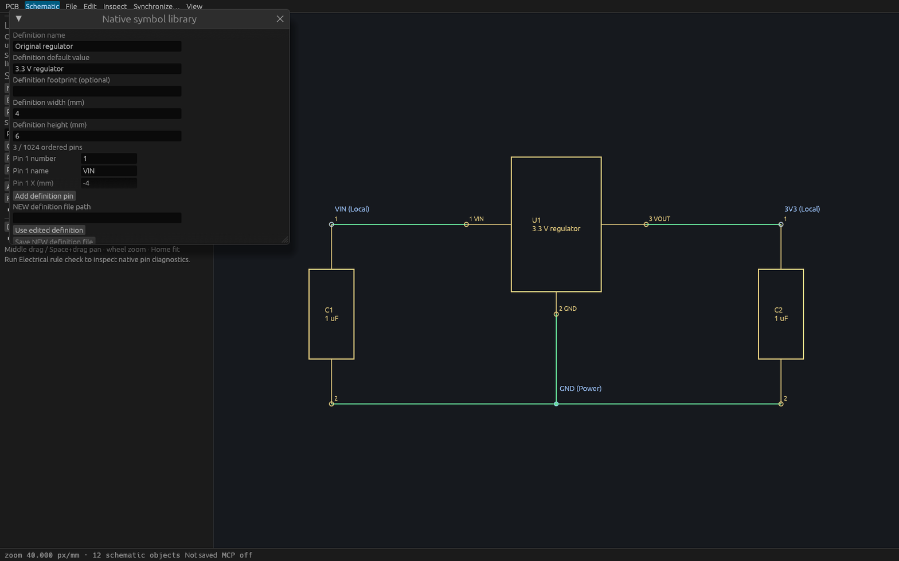
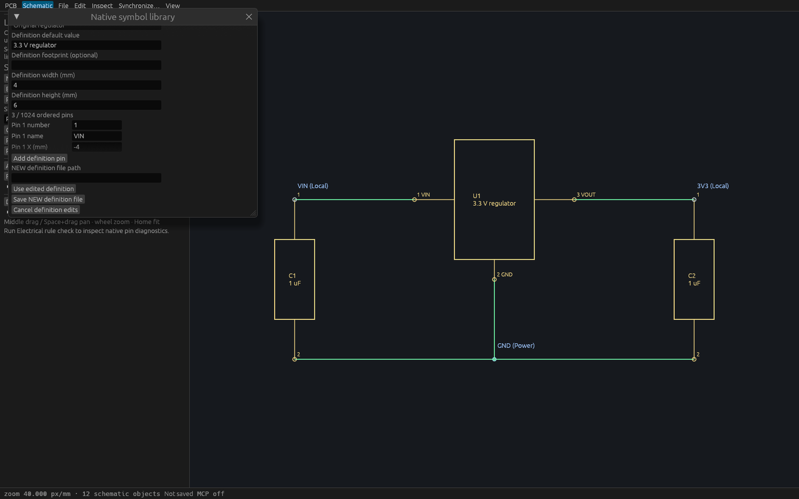

# Native symbol definition editor verification (T86)

The [public-source specification](specs/native-symbol-definition-editor.md)
precedes implementation. The editor creates or copies detached single-unit
rectangular definitions. Local edits and NEW file saves preserve the complete
project, history, selection and existing schematic instances. Explicit Use
selects a validated placement template; guarded placement creates fresh symbol
and pin identities in one undoable transaction.

## Linux gates and provenance

[Gate provenance](verification/t0086-linux-native.json) identifies production
source `763431f7d1a4e40c4ad912fbcbdc748f4879a753`, based on `8d77b23`.
Formatting, strict workspace all-target Clippy, **557 workspace tests, zero
failures, one existing ignored timing test**, and workspace build passed.
The [complete gate log](verification/t0086-linux-gates.log) includes doctests.
The copied production binary SHA256 is
`c1de0e34c72baa6cdf3cbcad6aa7bc6f1e26f19faf26be124f871aeae3ed713f`.

The branch integrates main `8e2a7d7`, including the separately verified PCB import.
Rebase preserved both README workflow links; Rust changes were additive context.
Editor, shared writer, worker and MCP
feature modules are unchanged from the verified production source. A later
inspection-only change transfers prepared scroll memory into its native host.
Its source is `56ddcc0f220118a7a279acb756a96f5356f2754f`, binary SHA256
`c8a4afe01e271e5f99eabd72304a51c4523c94d4d7e08532141c567d52cf85e8`.
[Strict lint and inspection build](verification/t0086-inspection-scroll-gates.log)
passed separately. Fresh combined CI checks the final integration head; retained
native binaries retain their historical source identity.

All builds and copies held the shared cache mutex, refreshed local Rust source
mtimes, disabled incremental compilation and used two jobs. A bounded cleanup
under the same mutex removed 345 unused older cached executables (64.16 GiB),
preserving running processes, source files and retained verification artifacts.

## Actual input and failure recovery

Six actual egui library input tests cover new/copy/edit, exact odd-Nm body and pin
coordinates, electrical types, add/remove, NEW save, typed reload, explicit Use,
mirrored quarter-turn placement, one undo and redo. They also cover invalid
precision and duplicate pin numbers, Cancel preserving the loaded definition,
and collision recovery at 640×400 without changing existing file bytes.
Assertions independently check stored rotation/mirror and transformed pin
coordinates. One initial expected coordinate used the wrong quarter-turn sign;
the expectation was corrected to the documented native downward-Y transform.

Bounded editor units cover 1024 pins, stable row identity, 4096-byte fields and
256 KiB aggregate text. Retained-worker tests cover disabled pending inputs,
duplicate requests, hidden completion/reopen, injected spawn failure and
disconnected completion. Errors preserve editable fields and engine state.
The existing four library input tests remain included in the six-test count.

## Production MCP

[Production stdio](verification/t0086-production-stdio.json) passed **32 checks**.
[Actual production desktop HTTP](verification/t0086-production-http.json) passed
**33 checks** through two independent clients on port 7912, PID 838345.
The [portable verifier](verification/t0086-symbol-definition.py) checks strict
tool inputs, exact odd-Nm detached bytes, peer reload, immutable session saves,
NEW collisions and symlink/directory preservation, invalid dimensions, duplicate
pins, oversized fields/pin counts and absence of staging files.

It then verifies fresh instance/pin IDs, exact geometry, one transaction, scoped
peer undo refusal, creator undo/redo, revised file saves leaving existing
instances unchanged, peer edits invalidating stale placement, and active-native
destination protection. The [resulting native project](verification/t0086-editor-result.viamind.json)
and original native bytes were checked. Stdio uses one connection; HTTP uses two
independent sessions. The desktop process is the exact production binary above.

The [production capture metadata](verification/t0086-production-cua.json) and
[image](verification/t0086-production-window.png) identify that process. Its
105×135 compositor tile is process provenance, not readable editor evidence.

## Readable native inspection

The retained [inspection host](../crates/ui-egui/examples/t0086_inspection.rs)
prepares the production ViamindApp through actual egui kittest input, transfers
its scroll memory and renders at 1600×1000 with native WGPU. Every frame asserts
the entire engine session remains unchanged. It has no MCP server.

| Prepared scroll position | Capture | Exact-process metadata |
| --- | --- | --- |
| Definition body properties and first pin | [Image](verification/t0086-editor-properties.png) | [Metadata](verification/t0086-editor-properties.json) |
| Explicit Use, NEW save and Cancel | [Image](verification/t0086-editor-save.png) | [Metadata](verification/t0086-editor-save.json) |

Both captures were visually inspected. The library and nested pin list scroll;
these images show their selected positions rather than every pin field at once.
Cua recovered X11 window metadata because AT-SPI was unavailable. Checked state
and editing behavior are established by actual egui input tests, not native OS
pointer injection. The first inspection discarded prepared scroll memory and
showed only the library's top controls; it is excluded from these evidence files.

## Reproduction and scope

Build the production workspace, then run the retained verifier with `--binary`,
`--fixture fixtures/schematic/regulator.viamind.json` and a new `--report` path.
For desktop checks, launch that binary with a free `VIAMIND_MCP_PORT`, then add
`--port PORT`. It creates new temporary files. Set TMPDIR to a writable directory.
The inspection example accepts project path, library path and optional `save`.

See the [operator guide](native-symbol-definition-editor.md). Definitions remain
single-unit rectangles; multi-unit packages, arbitrary graphics and external
symbol formats are open parent work. Saving does not update existing instances,
place a symbol or implicitly select the edited definition.
