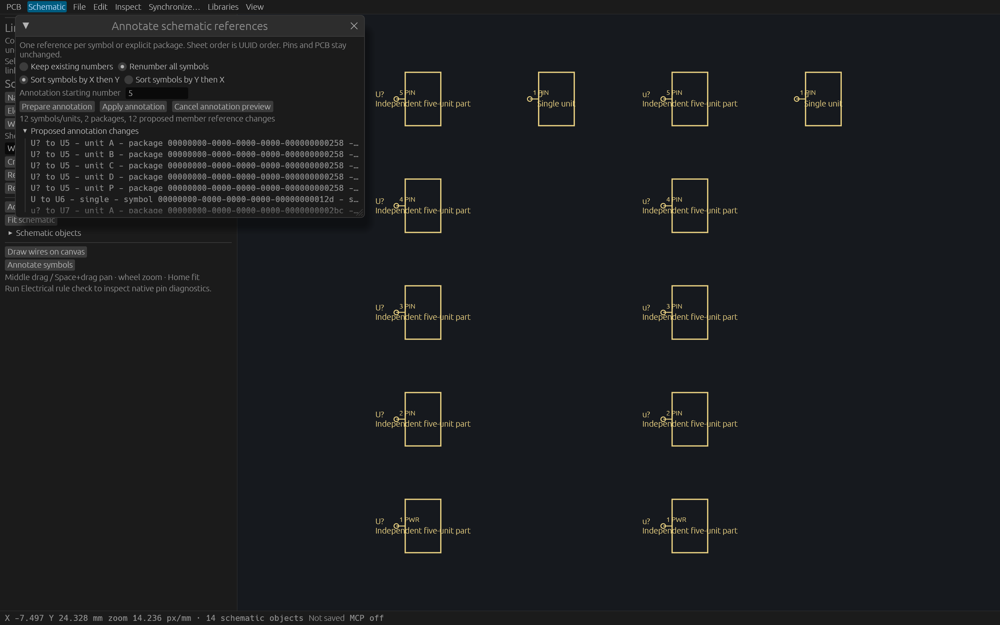
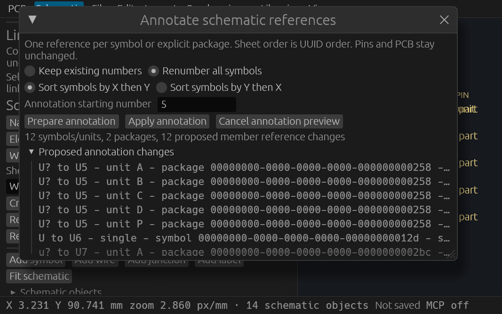

# Package-aware schematic annotation verification

## Supported behavior

`preview_schematic_annotation` plans references by explicit owner: one ordinary
symbol or one stored multi-unit package. A package consumes one number, and all
its units (including explicit power units) retain the same reference. The anchor
is the member with the lexicographically smallest unit key. Reference allocation
uses the chosen X/Y order and complete sheet order; default sheet order is UUID
order. Existing retained spelling is preserved. Numeric aliases ignoring case
and leading zeros conflict across owners.

The desktop's **Annotate symbols** entry opens the shared review. Prepare leaves
the complete project and document status unchanged. Apply submits the exact
preview command, guarded by full session cursor and complete original sheet map;
one Undo restores every affected unit. Option edits and Cancel discard only the
local proposal. Same-project reopen clears the review, and peer edits disable
stale Apply. Ordinary old callers may explicitly omit the cursor; grouped callers
require it, and all new previews include it.

## Bounds and coverage

100 sheets, 2000 actual symbols, 10000 combined schematic structural rows/pins/
package members, 256 KiB known schematic text, 2 MiB serialized expected sheets,
and a separately bounded 2 MiB + 8 KiB whole command envelope. Borrowed capture
checks precede sheet copies. Raw decoded JSON is checked before secondary typed
sheet allocation on registry/MCP dispatch; this does not cap the original
transport JSON decoding. The annotation invariant checks the existing schematic
identity namespace, seeded by project identity, without revalidating unrelated
PCB identity or assembly content. UUIDs, geometry, pins, wires, roles, membership,
values, footprint fields and PCB remain unchanged. Package PCB aggregation,
hierarchy and automatic reference prefix inference are outside this increment.

## Evidence status

Source `272d5d2f39dc6cb8feecd9aad5d00d0fe8bc36a9` passed all Linux gates:
fmt, strict workspace all-target Clippy, **819 passed / 0 failed / 1 ignored**,
workspace build and inspection example build (session 59228). Prior source
`db1d596` passed 30 focused checks: 5 legacy, 9 package, 6 inherited package,
2 boundary, 2 actual HTTP and 6 actual UI checks. The sole later code change is a direct cursor accessor
for strict lint. Historical failed attempts remain separately indexed.

The authored fixture uses distinct unnumbered spellings
U?, u?, U and u for separate owners, preserving the foundation's native exact
reference uniqueness across owners.

Actual retained production `0ccd0d0e75ee3ed0718e71473994da8919225d6634c35731c151830cfc509a93`,
PID 2463504, serves port 7945. Two initialized clients passed **29 checks**, including
whole-package Apply, Undo and Redo, exact peer reads, stale sequence/reopen,
malformed raw guards and schema 11 round trips. Seven actual headless read-only checks
passed. One Apply with 12 units and two packages measured 20.33 ms under current load; this is
a fixture observation, not a worst-case latency claim.
Root independently reran all 29 checks against the same retained production
binary on a fresh owned copy and observed 13.38 ms for Apply. Its exact report is
[indexed separately](verification/t0115/independent-production-http.json).
The desktop now shows that external verification fixture; original fixture bytes
and all historical capture/source identities remain unchanged.

[Master](verification/t0115/master.json) indexes durable logs, drivers, exact
source and binary hashes, launch metadata and native outputs. Every indexed
artifact and original raw RGBA/RGB capture can be independently verified.

## Native inspection provenance

Inspection-only hosts drive the production ViamindApp with actual egui option,
text and button events, then display its uncommitted shared preview using the
native WGPU renderer. Full session/status invariants are checked each UI pass.
Prepare/Apply/Cancel bounds use exact labeled widget IDs and the current native
read_response rectangles. Hosts self-close after exclusive-created, fsynced
Screenshot-event outputs. Original Color32 RGBA is retained as P7; the RGB-only
review PNG preserves every corresponding sample and omits alpha explicitly.
UI passes are callback counts. Logical focus retention is an inspection aid;
there is no OS-input, compositor-capture or frame-cadence claim.

The wide 1600×1000 and compact 640×400 hosts self-closed after 12 and 11 UI passes.
Actual framebuffer sizes were 2667×1667 and 1067×667. All native action rectangles
fit the production window/content. Both review PNGs were viewed: options, starting
number, package/member count, unit references and Prepare/Apply/Cancel are
readable. Root independently viewed both images and compared every RGB sample
against both original P7 RGBA RGB channels and P6; the exact
[independent audit](verification/t0115/independent-native.json) is retained.
Long UUID metadata truncates to one row; full metadata remains in
its tooltip/JSON, and actual compact scrolling reaches the final member.

## Final integration

The original proof source above remains fixed. Only T115's 13 commits were
transplanted onto literal T114 evidence head
`95faf8245a65d05cb2ef0c01ef38cdb3e374e020`. Twelve commits have equal range-diffs;
one drops the identical inherited closure type annotation already upstream.
Final additive prose enables whole-package annotation in the package editor and
precisely describes the existing structural and serialization bounds.

Combined source `14ba5353c75c7ccdd037bdebf48d3e99cbe703aa` passed session 35811:
fmt, strict workspace all-target Clippy, **38 focused checks**, workspace build,
actual **109-tool** catalog generation/exact drift check and **18 isolated agent
workflow checks**. The focused checks include legacy annotation, grouped owners,
byte bounds, actual MCP clients, compact annotation and all three inherited
complete-package desktop workflows. Retained combined executable SHA256:
`5385a45f3fe7527cbfa39b0d0c07d82e227cd82cd8d51d105fb2dbd9e75c9312`.

Fresh exact artifact-head CI remains the merge gate. No new native or full
workspace claim is inferred from the scoped integration gate; the original
819-test and actual/native proofs retain their historical source identities.
