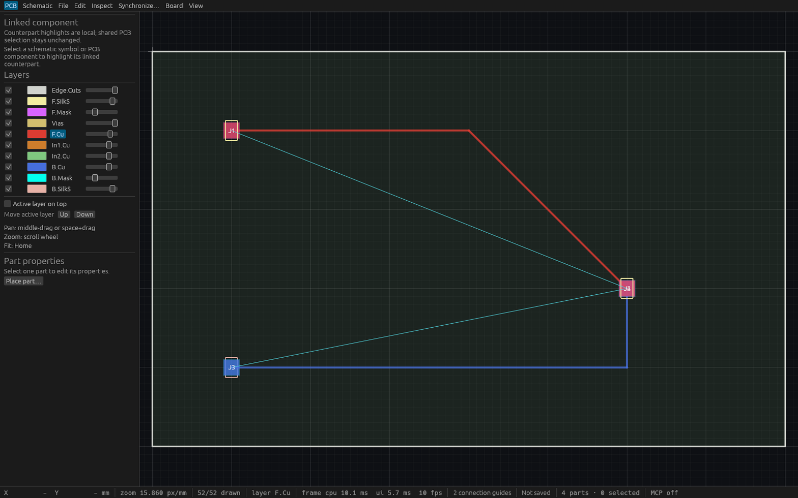
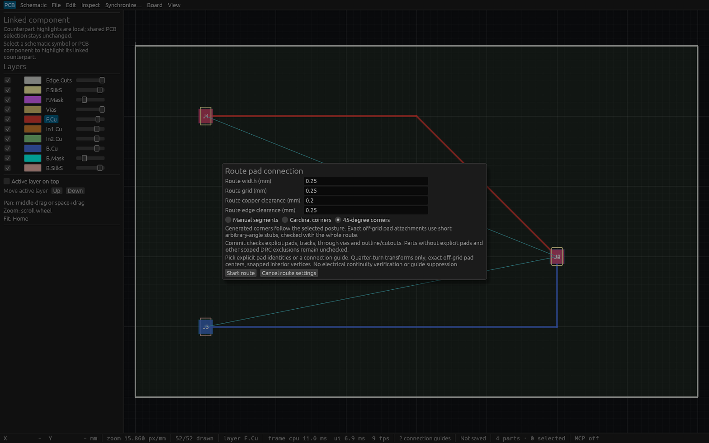

# Exact pad route posture verification

## Scope and Linux gates

T-0077 implements [the public-source posture contract](specs/pad-routing-postures.md).
The desktop and `route_pad_posture` use one bounded integer planner and the existing
guarded joint route preflight. [Usage and limits](pad-route-postures.md) describe
the explicit corner choices, exact endpoint stubs and local controls.

Code head `02c78212a61fd2beba19ca3c4aa3221b55d00538`, based on main `c55dc7c`, passed:

- `cargo fmt --all -- --check`
- `cargo clippy --offline --locked --workspace --all-targets -- -D warnings`
- `cargo test --offline --locked --workspace`: **461 passed, zero failed, one existing ignored**, including doctests.
- `cargo build --offline --locked --workspace`

The complete sequence held the shared workspace gate mutex, refreshed workspace
Rust source mtimes and copied the production binary before releasing the mutex.
No Rust source edits occurred during the sequence. [Retained provenance](verification/t0077-linux-native.json)
records the code revision, base, counts and exact binary identity.

Before the full gates, **47 focused checks** passed across router, engine, UI and
MCP. Independent geometry assertions cover all quadrants, both major axes,
signed odd grids, nearest-grid stubs, zero/collinear/coincident anchors,
consecutive duplicate removal, preserved revisits, input/output limits, model
range and impossible nearest anchors. Shared typed/dynamic commands prove
independent bend coordinates, derived net/side, exact quarter-turn endpoints,
whole-path clearance rejection including a tiny endpoint stub, stale peer edits
and one undo/redo preserving IDs. Existing free, manual pad and through-via
routing regression suites remain green.

## Actual desktop input

Three actual egui pointer/key tests drive production `ViamindApp`. They choose
the corner radios, pick pads, toggle horizontal/vertical or straight/diagonal
posture, compare exact locally generated points, add a snapped waypoint, remove
it with Backspace, cancel with Escape and commit with Enter. Draft changes
preserve the complete session. One undo removes all planned segments; redo
restores their identities. A real concurrent component-side edit rejects the
frozen plan while retaining its editable local waypoints.

The MCP parity suite discovers the matching schema/action and exercises a
bottom-side exact route through independent agent contexts.

## Production native HTTP verification

The retained production binary SHA256 is
`f86074c03ed74607493f11773cd313db03df1465a7bc08d88676e97cd59e1526`.
It ran as PID `413568`, window `110379506604128`, MCP port `7901`.
[Twenty-seven assertions](verification/t0077-native-http.json) passed through two
independent real HTTP MCP clients. They discover the tool and immutable exact
endpoints, compare all four independently expected ordered paths and stubs,
verify derived copper net/layer, reject malformed and stale proposals without
session changes, reject foreign copper on a generated leg, and exercise one
undo/redo for every posture. Connectivity queries remain separately immutable.

The first cardinal-primary commit measured **6.16 ms** wall time over HTTP.
Five warm octilinear-primary commits measured 2.41, 4.79, 3.11, 3.40 and 3.00 ms,
mean **3.34 ms**. These are four-part debug-board observations on a shared,
loaded host, including HTTP overhead. They establish neither worst-case commit
latency nor native cadence. Commit preflight remains synchronous under the
engine lock; local preview does not run DRC. The strict native 60 fps target
remains open.

The [standalone verifier](verification/t0077-native-http.py) requires a fresh
owned empty production application on its supplied port and its verified binary
path. It saves [the exact native routing fixture](verification/t0077-route.viamind.json).
The actual production [Cua metadata](verification/t0077-production-cua.json) and
[capture](verification/t0077-production-native.png) identify its native window.
Its compositor-assigned 16×23 size is too small for readable board inspection.
No resize or native input fallback was attempted; older previews were preserved.

## Readable native inspection

Readable board and settings captures use a separate fixed-size inspection
wrapper around the production UI, engine and renderer, with the saved fixture.
The retained [wrapper source](verification/t0077-posture-inspection.rs) contains
only viewport setup and optional activation of the production posture settings.
It does not supply draft geometry or change model objects. Pointer/key claims
come from the actual input tests above, and production HTTP claims come from
the application binary above.

Inspection binary SHA256 is
`9d54c6678934e074882f9390c52038a788525453eae406374eb4fdd829893678`.
Cua captured board PID `427859` / window `110379507239616` and settings PID
`428253` / window `110379507663072` at 1568×980. Both images were inspected:



The saved board shows the red top straight/diagonal route and blue bottom
horizontal/vertical route. Top and bottom target pads share nearly the same
position, so their labels overlap. This retained pre-integration binary uses
the historical pad-only guides; the two cyan guides are not a completion claim.
Later connectivity-proof increments are independent of this planner.



The settings image shows the manual/cardinal/45-degree controls and explicit
stub/preflight limits. The posture toggle itself is exercised by the actual
input tests; this settings-only wrapper does not create a local route draft.

## Limits

This is deterministic user-directed path generation, with at most 510 supplied
waypoints and 1024 generated segments. Short exact endpoint stubs may have
arbitrary angles. The whole generated path, including stubs, must pass complete
scoped preflight; unsafe or incomplete reports reject without partial mutation.
Existing unrelated violations and unsupported legacy pad geometry retain the
shared preflight's documented limits. No obstacle avoidance, walkaround, shove,
via-transition posture, pad-edge inference or full physical continuity claim
is introduced. Conservative connection guide analysis is a separate API.

## Reproduction

```sh
cargo test --locked -p viamind-router --test posture
cargo test --locked -p viamind-engine --test route_posture
cargo test --locked -p viamind-ui-egui --test route_posture
cargo test --locked -p viamind-mcp --test routing
python3 docs/verification/t0077-native-http.py PORT /path/to/verified/viamind
```
