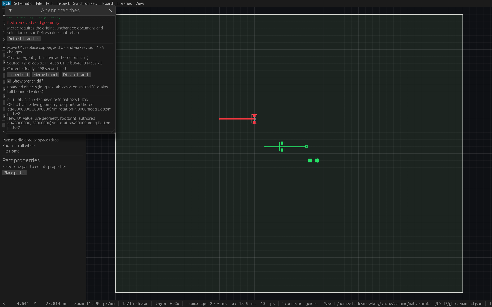
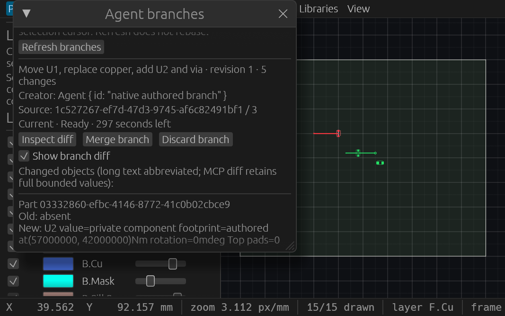
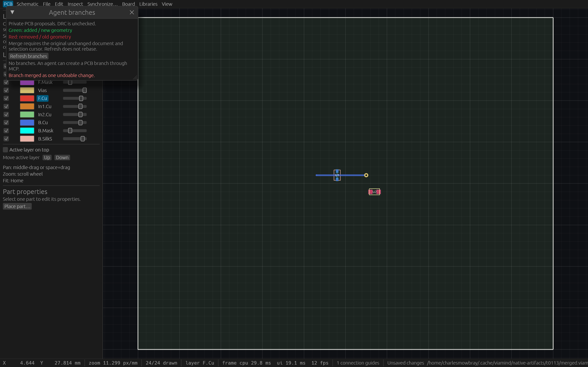

# PCB command branches and visual review

An initialized live MCP connection can prepare a transient PCB proposal without changing the shared document. Human review is available under Board → Agent branches. Green geometry shows additions/new values; red geometry shows removals/old values. Modified objects show both. The overlay is local, respects visible layers and never changes shared selection or hit testing.

## Lifecycle

1. Read `get_session_state`; pass its project UUID and full cursor to `create_pcb_branch`, with a short label.
2. Pass returned branch UUID/revision and bounded original command calls to `apply_pcb_branch`. Read candidate geometry with `inspect_pcb_branch`; inspect deterministic paged before/after values with `get_pcb_branch_diff`.
3. Review in the desktop, or explicitly merge your own proposal with `merge_pcb_branch` using its revision and original project/full cursor. One successful merge is one ordinary undoable engine transaction with the same generated IDs. `discard_pcb_branch` removes an unused proposal.

Ordinary live editing remains the default. An admitted live agent can explicitly merge its own proposal. This feature provides voluntary isolated preparation and process-local connection ownership; it does not enforce human approval or authenticate arbitrary remote clients. Two connections with the same display name have different ownership. A human can inspect, merge or discard any proposal. Startup read-only mode exposes list/diff observations and hides all five candidate/lifecycle handlers.

## Limits and stale sources

Four proposals per process; five-minute idle lifetime renewed only by successful application; 5,000 whole-project structural rows and 2 MiB borrowed serialized project before copying; 128 coalesced changed objects and 2 MiB serialized deltas; 64 commands and 64 KiB serialized request per application. Every command result is checked before the next step. One nonwaiting process-wide preparation permit stays with the actual worker after an MCP awaiter is canceled.

Supported original commands are `add_part`, `move_part`, `delete_part`, `update_part`, `transform_parts`, `set_part_pads`, `add_track`, `delete_track`, `add_via`, `delete_via`. Other commands refuse. Existing original command validation applies. Private geometry is explicitly unchecked for complete DRC/manufacturing readiness; merge schedules the existing automatic DRC controller.

Any live edit, selection change, undo/redo or reopen can stale the original full cursor and refuse merge. Refresh updates facts without rebasing. Saving unchanged geometry does not stale the cursor. A failed apply keeps the previous candidate/revision/lease; a failed merge keeps the proposal. New/Open, leaving PCB, incompatible editing or lost proposal clears the local ghost. Original stale diffs can still be inspected or discarded until expiry.

The [public pre-code contract](specs/pcb-command-branches.md) defines exact budgets, guards, worker lifetime, native invariance and verification requirements. Native inspection uses application-local egui inputs and actual WGPU Screenshot readback. It establishes painted visibility and retained-channel equality, with no OS-input or display-cadence claim. Original RGBA channels are retained separately from the same-RGB review image; alpha omission is explicit.

## Verification

Original source `032740a386c47f5adf98d91bbe954d26b947deaf` passed formatting, strict workspace all-target lint, full Linux workspace tests (804 passed, zero failed, one ignored), workspace build and native inspection example build. The preceding focused gate passed 18 tests: nine engine, two MCP unit, one actual two-client/read-only HTTP, two compact UI and four command parity tests. All 13 existing Python reference-tool tests passed separately; that output was recorded in the ticket, without a retained standalone log.

The retained original production executable passed 23 initialized stdio checks, 25 checks with two same-name live HTTP connections, eight actual startup read-only checks, canonical discovery of 100 tools with exact recheck, and 18 agent workflow checks. Production source/binary hashes and report hashes are retained in [the evidence index](verification/t0113/master.json).

Actual native WGPU captures passed at wide and compact sizes and after merge completion. Every original RGBA RGB sample matches its retained P6 sample and PNG sample; alpha ranges from 242 to 255 and is omitted only from review RGB files. Controls and effective clipping bounds were checked from current native responses. All three inspection processes self-closed. The wide and compact captures are scrolled to review controls; the legend is visible separately in the merge-completion capture. Production window discovery was degraded X11 metadata only and is not evidence of painted controls.

Historical constructor, unused import and strict-lint failures are retained with corrected successful gates. One waiting gate was deliberately canceled before acquiring the build lock and is not a passing gate. Final combined source `b54593abcd733e3d02e11d0fe58d08ec7b7dbbfb`, atop frozen T112 `b76179325f8205df093bb45908dfeea1fdf1a52c`, passed formatting, strict workspace all-target lint, 33 focused tests (nine engine, two MCP unit, one actual two-client/restricted HTTP, three compact UI, four parity, five existing copper editor, nine bounded release parser), workspace build and inspection build. Its retained production binary passed 23 initialized stdio checks, eight startup read-only checks, 104-tool actual discovery, 18 isolated workflow checks and 13 reference-tool tests. Restricted HTTP now actually observes a nonempty candidate and verifies every stable diff fact plus nonincreasing remaining idle time. Opening the existing copper editor clears the private ghost with complete live-session invariance.

Two final test-only failures are retained: cancellation polling could steal admission from its real worker, corrected by an actual future-pending handshake; whole diff equality included naturally decreasing remaining idle time, corrected by exact stable-field equality plus a nonrenewal assertion. Production behavior did not change in those corrections. Original full/native/HTTP proof remains scoped to `032740a`; An independent agent reviewed the implementation, all 30 original indexed artifacts, both original executable identities and every native channel/sample, then reran all 23 initialized stdio checks against the exact final production executable successfully. Fresh exact-head CI remains required before merge.
