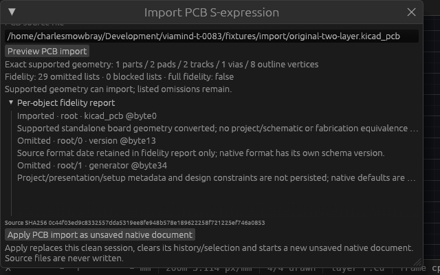
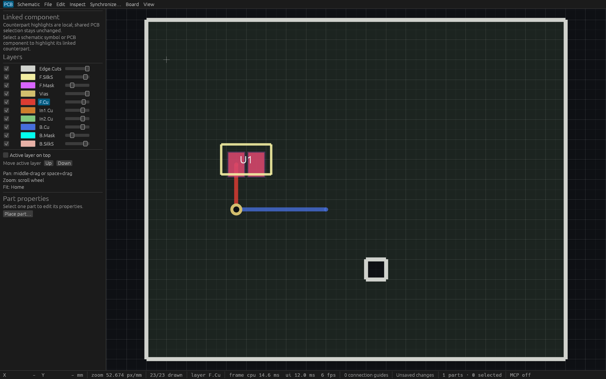

# Standalone PCB import verification (T83)

## Independent conversion and guarded lifecycle

The [public behavior spec](specs/pcb-sexpr-import.md) precedes implementation and
cites the official public file-format documentation. The original
[two-layer fixture](../fixtures/import/original-two-layer.kicad_pcb) was authored
for these checks. No external application code or assets were used.

The parser imports exact integer-Nm geometry: one front zero-angle footprint,
two rectangular SMD pads, two outer-layer straight tracks, one through via and
eight outline/cutout vertices. Original part/pad/track/via UUIDs and explicit VIN
and GND nets survive conversion. Outline edge UUIDs remain report-only omissions;
native outlines have no edge identities. Every source list receives a bounded,
deterministic fidelity classification. The fixture reports 29 omitted lists,
zero blocked lists and `full_fidelity=false`.

Eight parser tests cover asymmetric odd-Nm coordinates, quoted strings/BOM offsets,
legacy identity aliases, supported version headers, canonical layer ordering and
arity, net/UUID conflicts, unsupported shapes/rotations/copper, open/crossed or
ambiguous outlines, cutout containment, exact decimal rejection and all resource
limits. A long-token regression preserves complete source tokens without repeated
diagnostic amplification. Four engine integration tests and two controlled unit
tests cover read-only preview, dirty-native protection, full project/stream/cursor
and exact source SHA256 guards, a peer edit during loading, bounded regular-file
reads, nonblocking raced-FIFO opening and active native canonical-path aliases.

Apply replaces only the guarded clean session and starts an unsaved native
conversion with no active source save path. It clears old history and selection;
subsequent native edits remain undoable. Undoing such edits still leaves the
conversion dirty until a successful native Save As. Source files are never written.
A regression externally replaces an active native JSON file with supported PCB
text: Preview can parse it, but Apply rejects that native path unchanged.

## Linux gates and binary provenance

[Gate provenance](verification/t0083-linux-gates.json) records source
`06422509241c65579a459329141e6484472c95dc`, based on main `8d77b23`.
Formatting, strict workspace all-target Clippy, **574 workspace tests, zero
failures, one existing ignored test**, workspace build and inspection-example
build passed. The complete gate sequence, including doctests and binary copies,
held the shared cache mutex and refreshed local workspace source mtimes first.
Preliminary focused runs are excluded from that workspace count.

Production binary SHA256:
`76f4b3ccb4e48d6dbc17681949fa929338e32c255972f04468d6faa03f5e93b9`.

Inspection binary SHA256:
`3488c1e5e75221dc3ecbaba6635f9627882572bfbbdafcd3fa933e5eb7fd4ab8`.

The final feature branch cleanly rebases onto main `51e5c87` (rectangular-cutout
walkaround). Range-diff confirms all seven feature commits are unchanged; final
formatting and whitespace checks pass. Fresh combined CI checks the integrated
head. These native reports identify their original verified binary source rather
than attributing the copied binaries to the later integration commit.

## Production MCP and native save/reopen

[Production stdio](verification/t0083-native-stdio.json) passed **17 checks**.
[Actual desktop HTTP](verification/t0083-native-http.json) passed **16 checks**
through two independent clients on port 7909, production PID 857800. Both verify
tool discovery, repeat read-only previews, exact counts and identity fidelity,
strict inputs, wrong project, changed source bytes, unsupported pad rejection,
peer-created unsaved work, active native path protection, imported-unsaved state,
edit/undo, native Save As and same-project reopen with a new stream. Source and
previous native file bytes remain unchanged. Stdio additionally verifies clean
process exit. The retained [public driver](../scripts/verify-pcb-import-native.py)
creates only new temporary files and preserves a reproducible original fixture.

The native bounded DRC report checks all two pads, two tracks, one via and its hole,
and the explicit outline with no excluded parts or truncation. This fixture has
zero native violations. Native defaults differ from omitted source rules; this
proves native object coverage, without asserting source-rule or fabrication
clearance equivalence.

[Production capture metadata](verification/t0083-production.json) and its
[capture](verification/t0083-production.png) identify the actual desktop process.
Its compositor tile is only 110×58, so it supplies process provenance rather than
readable visual evidence. Native OS pointer input is not claimed.

## Desktop input and readable native inspection

Four actual egui input tests use the File menu, source field, Preview and Apply.
They verify read-only reporting, completed conversion-report retention, stale peer
edits, source-change errors, unsupported geometry and preserved active wire drafts.
At **640×400**, actual scrolling places the complete Apply button and the complete
error label within the viewport. Three worker tests cover stale generation/path,
close/reopen, old stream, disconnected completion, injected thread-spawn failure
and retention of exactly one outstanding receiver.

The retained [inspection example](../crates/ui-egui/examples/pcb_import_inspection.rs)
prepares the production `ViamindApp` through actual egui kittest inputs, then renders
that state in a fixed-size native WGPU wrapper. It preserves the prepared entire
engine session on every frame. The wrapper does not serve MCP or inject OS pointer
input; production MCP checks above are separate.

| View | Requested size | Capture and exact-process metadata |
| --- | --- | --- |
| Supported preview and initial fidelity rows | 1600×1000 | [Image](verification/t0083-preview-wide.png), [metadata](verification/t0083-preview-wide.json) |
| Compact dialog scrolled to Apply | 640×400 | [Image](verification/t0083-compact.png), [metadata](verification/t0083-compact.json) |
| Converted board, unsaved native document | 1600×1000 | [Image](verification/t0083-imported.png), [metadata](verification/t0083-imported.json) |

The normal preview shows the source, exact counts and explicit incomplete fidelity.
Its initial dialog height requires scrolling to reach Apply. The compact capture
shows Apply fully within the window together with the source, counts, omissions
and replacement explanation. Longer row reasons truncate visually with full
hover text; complete classifications and UUIDs are retained in MCP reports. The
converted board visibly contains two pads, red top copper, blue bottom copper,
the through via and the rectangular cutout; its status remains unsaved.





## Limits and reproduction

This is a restricted standalone PCB converter, not a full project importer.
Schematic data, hierarchy, arbitrary footprint rotations/back-side transforms,
nonrectangular or drilled pads, curved copper/outlines, zones, inner copper,
stackup/materials, source design rules, models and graphical fidelity are not
implemented. Unsupported copper/outline or unknown semantic data blocks Apply;
listed cosmetic/setup omissions remain explicit. Versions 7–9 corpus-wide
fidelity, round trips and broad project equivalence remain open parent acceptance.
The result never claims full fidelity or fabrication readiness.

```sh
cargo build --workspace
python3 scripts/verify-pcb-import-native.py \
  --binary target/debug/viamind --report /tmp/pcb-import-stdio.json
```

For desktop checks, launch that production binary in a separate clean session on a
free coordinated `VIAMIND_MCP_PORT`, then add `--url http://127.0.0.1:PORT/mcp` and
another report path. Existing unsaved work is rejected. Readable inspection can be
reproduced with `cargo run -p viamind-ui-egui --example pcb_import_inspection --
fixtures/import/original-two-layer.kicad_pcb compact 640 400`; modes `preview` and
`imported` use the same original fixture and production UI.
