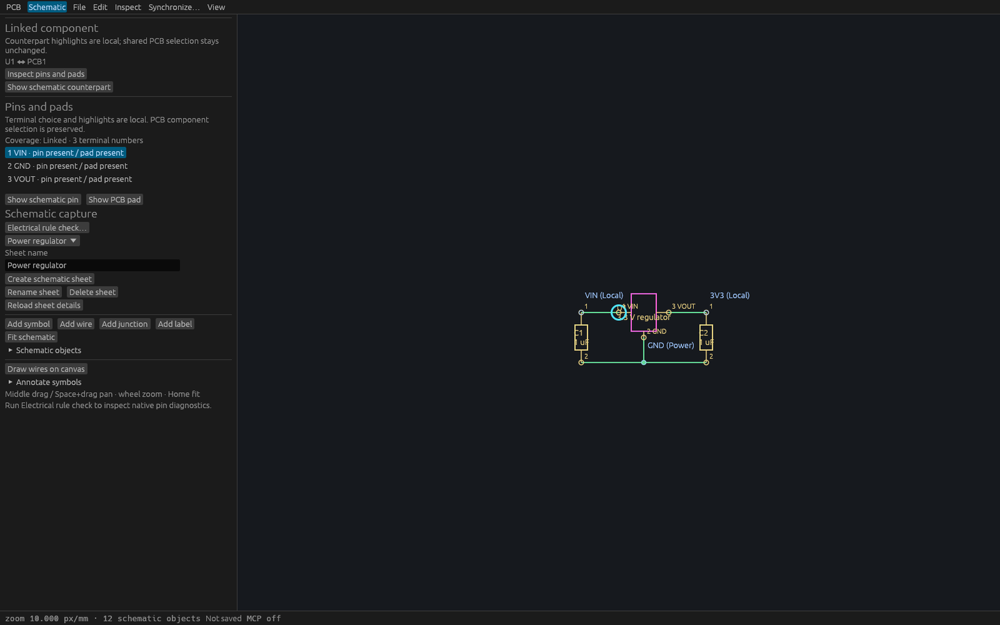
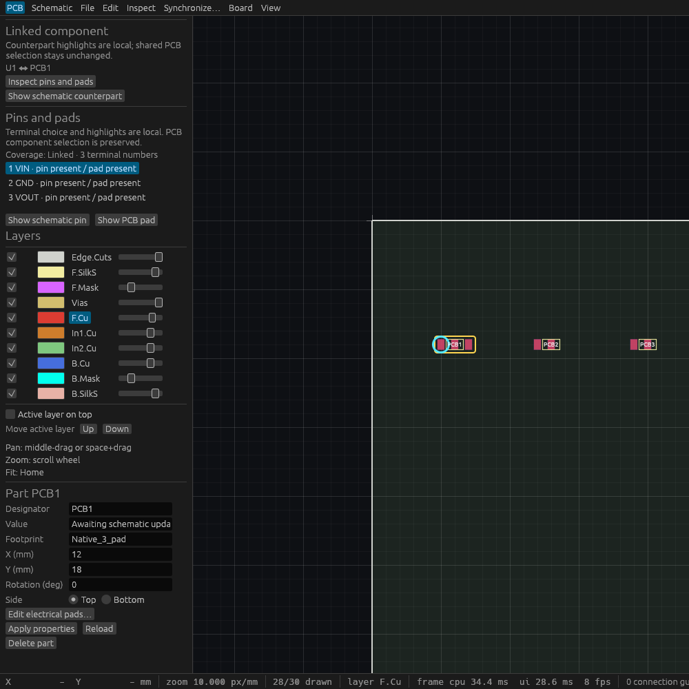

# Pin/pad cross-probing verification (T79)

## Shared geometry and identity

The [behavior spec](specs/pin-pad-cross-probing.md) precedes implementation.
The query captures one immutable engine snapshot and pairs exact terminal numbers
only through explicit stable symbol links. The original linked regulator fixture
intentionally uses different PCB and schematic references (PCB1 and U1); seven
physical terminal pairs are still resolved. No reference or net inference occurs.

Tests cover exact odd-Nm mirrored quarter-turn centers, unsupported arbitrary
angles and extreme coordinates, invalid dimensions, whole-component mismatches,
legacy previews, unlinked/empty components, malformed identities/numbers, unrelated
object/text limits, deterministic paging and unchanged session/dirty state.

The actual egui input suite selects terminal rows and navigates from both source
editors. It checks exact view centers and unchanged complete session/selection,
hidden copper, active wire previews, selected-symbol property drafts, peer edits,
source-selection replacement and same-project-UUID reopening. Canceling a property
draft retains local component selection; only then is explicit navigation allowed.
Two worker tests reject old stream/selection/page completions and disconnected or
cursor-mismatched results while retaining one outstanding receiver.

## Linux and production MCP

[Linux gate provenance](verification/t0079-linux-gates.json) records source
`b056058090f5abf153ff8f000f98cdad64bd149d` on merged main `5fb15a6`.
Formatting, strict workspace all-target Clippy, **488 workspace tests, zero failures,
one existing ignored test**, and the workspace build passed. The preliminary four
actual desktop tests are excluded from that workspace total. The entire sequence
and binary copies ran under the shared cache mutex with source mtimes refreshed.

Production binary SHA256:
`a4da8deb0717d747aba961e67cd0d39240accccc9bb37add96851d16d73e869f`.

[Production stdio](verification/t0079-native-stdio.json) passed **13 checks**.
[Actual desktop HTTP](verification/t0079-native-http.json) passed **12 checks** with
two independent MCP clients on port 7904, production PID 517579. Both discover the
query, resolve all seven terminals through part and symbol IDs, compare repeated
read-only results and pages, reject invalid inputs unchanged, preserve identities
after rename, exclude arbitrary angles and whole-component mismatches, explicitly
unlink/undo, and save/reopen with unchanged pairs and a new stream ID. The reopened
read preserves the clean complete session; stdio additionally verifies clean exit.

The [production Cua metadata](verification/t0079-production.json) and
[capture](verification/t0079-production.png) identify that actual production
process. Its 16×5 compositor tile is too small for readable visual verification.
No native OS pointer-input success is claimed.

## Readable native inspection

The retained [inspection harness](verification/t0079-pin-pad-inspection.rs) uses
actual egui kittest button inputs against the production `ViamindApp` to prepare
terminal selection and navigation. A separate fixed-size native WGPU wrapper
renders that state. It does not serve MCP or inject native OS pointer input.
Runtime assertions preserve the entire engine session and selected physical pair.
The corrected harness locates the PCB component through its stable symbol UUID,
independently of PCB references. Its focused strict Clippy and build are verified
separately; production Rust code is unchanged from the full Linux gate source.

Inspection binary SHA256:
`db175525adf92f2f934bc77e039b441b86a53297c2e1b4bc2cd106d0cd370131`.
The retained harness revision is `a1f717389a911edaae7a4b3e3a33e4e1b68faf59`.
Its focused strict Clippy and build passed after the fixture lookup correction.

| Native view | Requested size | Capture and exact-process metadata |
| --- | --- | --- |
| Schematic VIN endpoint | 1600×1000 | [Image](verification/t0079-schematic-wide.png), [metadata](verification/t0079-schematic-wide.json) |
| PCB pad 1 center | 1600×1000 | [Image](verification/t0079-board-wide.png), [metadata](verification/t0079-board-wide.json) |
| PCB pad 1 center, narrower window | 1000×1000 | [Image](verification/t0079-board-narrow.png), [metadata](verification/t0079-board-narrow.json) |

Each capture shows the selected VIN terminal, both explicit navigation buttons,
and the cyan endpoint or pad-center ring. The narrower window retains readable
terminal controls. The existing schematic labels crowd at the default minimum
10 px/mm navigation zoom; that inherited circuit-text limitation remains visible
in the schematic capture. Terminal controls and the selected endpoint remain
readable. These captures verify native rendering of state prepared by actual egui
inputs, separately from the actual production HTTP checks above.





## Scope and reproduction

Only explicit native rectangular SMD pads with complete unique numbered pin/pad
bijections and supported exact quarter-turn centers can navigate. Unlinked,
missing-symbol, legacy-preview, empty and mismatched components remain explicit.
No hierarchy, arbitrary-angle exact coordinates, net highlighting, ERC or copper
continuity is inferred. Inspected text/structure limits and source cursors apply
to every page; peer changes require reinspection.

```sh
cargo build --workspace
python3 scripts/verify-pin-pad-probe-native.py \
  --binary target/debug/viamind --report /tmp/pin-pad-stdio.json
```

For desktop checks, launch that production binary on a free coordinated
`VIAMIND_MCP_PORT` with the original linked regulator fixture, then add
`--url http://127.0.0.1:PORT/mcp` and a separate report path. The driver opens the
fixture with the current lifecycle guard, writes only new temporary native files,
and leaves its saved result clean. Existing unsaved work is rejected.
