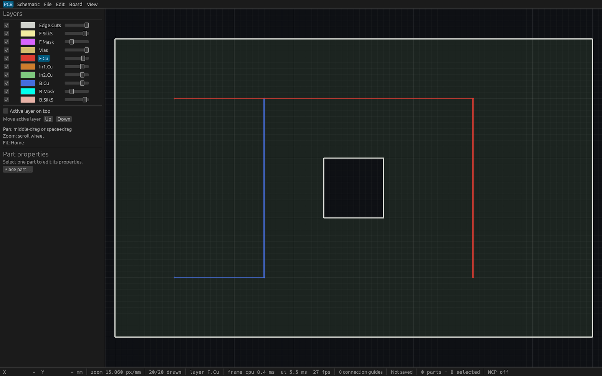
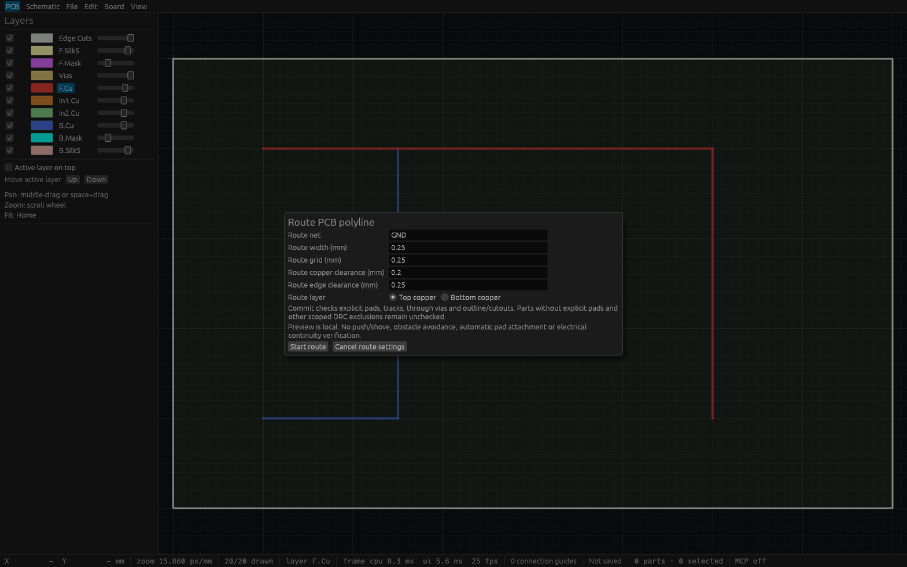

# Interactive PCB polyline routing verification

This is a straight-segment routing foundation under T-0065. Walkaround, push/shove,
automatic pad attachment, via routing and electrical continuity remain open.

## Automated checks

The complete Linux fmt, strict all-target clippy, workspace test/doctest and
workspace build gates passed on source `6c3cc08172f48d83c1a53acb79b7658c81e364b4`:
353 tests passed, zero failed, one pre-existing ignored. Final integration rebased
onto annotation/ERC/PNG main and generalized the shared cursor error message.
Fresh combined CI and focused integration checks cover that version.

Five engine tests cover typed/dynamic execution, exact model coordinates and
identities, one undo/redo, stale stream/sequence/project guards, guarded dispatch
without a session context, same initial batch cursor, rollback of earlier batch
edits, foreign copper, cutouts, incomplete reports and bounded board capture.
Large unrelated schematic/project text remains preserved and is not copied by
routing preflight; oversized board/input text rejects unchanged.

Two router tests cover signed and odd grid ties plus integer extrema/overflow.
Four actual egui pointer/key tests cover local snapped vertices and hover,
Backspace/Escape, Enter commit/undo/redo, concurrent edits, retaining rejected
previews, clearance errors, modal guards and focus/document/workspace changes.
MCP tests exercise independent agent contexts and own undo/redo.

## Native HTTP and visual checks

The final source `4d8a8f99da4037ec7951f3774c48195764821408` passed fresh
combined CI, focused engine/builtin/MCP/actual-input integration checks and the
integrated workspace build. Its copied production desktop binary has SHA256
`990f86d7c188ae1f2dd979ec3ace90fc451caf92268551d075c53afe65c9648e`.
Two independent HTTP MCP clients passed ten checks: discovery, exact multi-track
commit, stale rejection preserving the whole session, one own undo/redo, a
1000-track native fixture, repeated commits, clearance/off-grid rejection without
partial changes and final top/bottom copper routes. See [raw report](verification/t0065-native-http.json).

HTTP tools/call wall time (including synchronous preflight) was **2.72 ms** for a
two-segment route on an otherwise empty board. Five two-segment commits with
1000 existing separated tracks took **29.88, 21.75, 24.56, 28.59, 34.38 ms**
(mean **27.83 ms**). This unoptimized debug build ran on the current Linux desktop;
these small fixtures do not establish a worst-case bound or a frame-rate claim.

Cua captured the production app, whose Hyprland tiled frame was 223×279. The
compositor refused resizing and AT-SPI was unavailable; no native pointer/key
claim is made. Readable screenshots below use a separately built fixed-size
inspection wrapper around the unchanged production `ViamindApp`, loaded from
the [actual committed native fixture](verification/t0065-route.viamind.json).
The wrapper sets min=max viewport to 1600×1000 (captured 1568×980 pixels), starts
the settings form through `begin_route` only in `--settings` mode, and has no MCP
endpoint. The [wrapper source](verification/t0065-native-inspection.rs) is retained;
its temporary Cargo example was removed after copying the verified binary.
Pointer/key routing behavior is covered by the actual-input tests above.

## Limits

Only explicit pads/tracks/through vias and explicit outline/cutouts enter scoped
preflight. Legacy parts and other DRC exclusions remain unchecked; unrelated old
violations may remain. Incomplete work/results reject the route. Preview is local
and unchecked. Synchronous preflight holds the engine lock and can delay other
operations. Small measured fixtures do not establish a worst-case latency bound
for the 100000 structural-object/1000000 candidate-pair limits.
