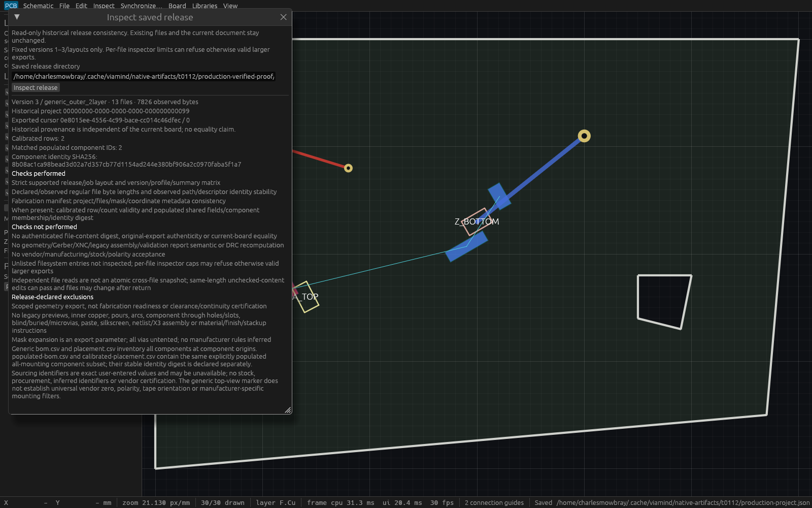

# Saved manufacturing release inspection verification

`inspect_output_release` reads a detached historical release without capturing or changing the current design. Desktop File → Inspect saved release, initialized MCP (including startup read-only mode), and `viamind --inspect-output-release DIRECTORY` share the same bounded reader. The CLI mode runs before engine/window/server creation and writes JSON facts to stdout.

## Supported observations

Versions 1–3 and their existing generic/checked profiles use exact fixed paths. The reader checks strict manifest/job/version/summary structure, declared versus observed regular-file byte lengths, fabrication manifest metadata, and observed directory/file identity stability. Version 2/3 calibrated rows have checked fixed integer decimal coordinates/rotation, unique IDs and references, explicit mounting/side and declared counts. Version 3 additionally checks sorted quantity-1 populated BOM IDs, exact shared reference/value/footprint/mounting, matching component membership/count and the existing domain-separated component-set identity digest.

Manifest file entries are byte lengths. The component digest identifies a set of UUIDs. Neither authenticates file content. Gerber/XNC, older assembly tables and checked DRC artifacts receive file-type/byte-count checks only. The reader does not recompute geometry, DRC, centroid, polarity, stock, manufacturer acceptance, source-board equality or original-export authenticity. A same-length edit to unchecked content can legitimately pass. Unlisted entries are not inspected.

This is a bounded subset of existing releases: 64 KiB release/job/fabrication JSON, 32 MiB per CSV, 16 MiB validation, 128 MiB combined fabrication and 192 MiB total. Generic writer tables can use more than the inspector's per-CSV cap; otherwise valid larger releases can refuse.

## Filesystem and worker contract

Linux read-only descriptor-relative access retains the chosen root and known subdirectories. Final symlinks refuse; file open uses NONBLOCK and the opened descriptor must be regular before reads. Fixed names derive from validated layouts. Payload reads check caps before append; opaque files stream through a fixed buffer. Final validation reopens the chosen root path, subdirectory entries through the original root FD and known files through retained subdirectory FDs, comparing device/inode/mode/length/mtime/ctime; manifest bytes are reread. These are observed race checks, not an atomic cross-file snapshot. Files can change after return and read access times are outside payload invariance.

One nonwaiting process-wide reader permit remains owned by the actual blocking worker, including detached/canceled awaiters. It is separate from manufacturing admission and takes no document/native/controller locks. Desktop retains one fallible named worker, disables bounded controls while pending, polls hidden completion and reports historical project/cursor independently of the current board.

## Reproduction

Build and retain unique production and `t0112_inspection` binaries from the recorded source. Launch the production application with a copied fixture, coordinated unused MCP port and `--agent-read-only`. Run the portable probe with a NEW output directory:

```sh
python3 docs/verification/t0112-production-probe.py \
  --binary /absolute/retained/current/viamind \
  --previous-binary /absolute/retained/T108/viamind \
  --repo "$PWD" --native /absolute/copied/project.json \
  --directory /absolute/NEW/probe-directory \
  --endpoint http://127.0.0.1:PORT/mcp
```

The probe creates six synthetic releases in its own new directory and temporarily modifies only those files for refusal/limitation checks, restoring every payload. It does not edit the live document. The prior binary is required for output/config byte comparisons. To reproduce native evidence, invoke the retained inspection example with copied project, generated version3 release and NEW PPM destination. The fixed-size wrapper uses production ViamindApp, has no MCP, receives explicit path setup from the harness argument, injects two application-local button pointer events plus three dialog resize input frames (five raw egui pointer events) and captures an actual native WGPU Screenshot. It asserts complete session invariance each frame and closes after NEW capture/fsync. This is local synthetic-input/native framebuffer evidence, not OS input or cadence evidence.

## Original full and production proof

Frozen Rust source `46ba5513e845855f50e83b0119e3315b39eb8450` passed [all four Linux gates](verification/t0112-full-linux.log): **798 workspace tests passed, 0 failed, 1 ignored**, plus15 separate fabrication and2 desktop worker tests. The [focused surfaces log](verification/t0112-focused-surfaces.log) identifies earlier source `d48a77e`:9 core reader/parser tests plus actual initialized two-client read-only HTTP, desktop worker, compact640×400 input and display-free CLI tests all passed. The expanded hidden real-success and pending disabled-controls test passed in the final full gate.

The initial full run on `a0e841f` found a test coordination race: new fixture exports used a separate mutex from an existing test intentionally saturating the production two-slot manufacturing pool. The [failed log](verification/t0112-historical-full-failure.log) is retained. A shared **test-only** fixture mutex fixed coordination without altering production admission or assertions. The corrected full run above is the success evidence.

Retained production executable `~/.cache/viamind/native-artifacts/t0112/production-46ba551-verified`, SHA256 `3c3d9fc74e45977141c466745e58fa2750cca7cf6c5e35c8fb0f84c7e3076c4d`, ran as PID2242966 on actual read-only HTTP7942 during both56-check proofs. Its observed live executable identity equaled the retained binary. The [successful portable probe](verification/t0112-production-report.json) passed **56 checks**: six version/profile releases; exact two-client HTTP/display-free CLI facts; original exporter config/format bytes; independent Python CSV/UUID/hashlib matched membership/count/digest and escaped Unicode; strict/mutated input failures; nonblocking FIFO and final symlink refusal; honest same-length unchecked Gerber mutation passing; restored payloads and complete live session/status/native invariance; and initialized read-only stdio parity. The historical release deliberately has project UUID99 while the live document has UUID1.

The prior exporter is retained T108 combined source `c781570e94b9a4f5472122d8ca02b49f18d6aaa1`, SHA256 `3adbb92ff788b976a002c03ce1aa27a265ceafffd405b12a7e4c7511d05238e3`. Every existing format/config file matches; session-dependent release manifests and checked validation artifacts are excluded from cross-process byte comparisons. These are verification hashes, not new release content-authentication fields.

An initial [probe attempt](verification/t0112-historical-probe-failure.json) passed53 checks then stopped because the full-catalog discovery helper intentionally required writable tools inside a read-only stdio process. Its [trace](verification/t0112-historical-probe-failure.log) and [original harness](verification/t0112-historical-probe.py) are retained separately. The corrected probe uses initialized raw tools/list for that read-only check. No production Rust changed and every scratch payload had already been restored. This failed attempt is excluded from success claims.

The [actual92-tool catalog](verification/t0112-catalog-report.json), [18 isolated agent workflow checks](verification/t0112-agent-workflow.json) and [13 tooling tests](verification/t0112-tooling.log) passed. These identify the original base before the final T111 integration; the final combined gate is recorded below.

## Native desktop evidence



The separate [inspection host](../crates/ui-egui/examples/t0112_inspection.rs) uses production ViamindApp from the same frozen source and retained `~/.cache/viamind/native-artifacts/t0112/inspection-46ba551-verified`, SHA256 `5fbbc0cfb093f038672607d639abb590a792d789e64dbc35af702c6ae9fc4ea9`. It has no MCP, sets an inspection-only fixed1600×1000 viewport and closes after successful capture/fsync. Production resize behavior is preserved.

The [native report](verification/t0112-native-inspection-report.json) proves path/action, historical project/cursor, matched count/digest, performed checks, limitations and release-declared exclusions visible; complete session state remains invariant each frame. The explicit release path comes from the harness argument, so no native path-typing claim is made. Two application-local button pointer events start the real retained reader. Resize uses three raw-input frames, containing five pointer events (three moves plus press/release); the raw report's legacy `local_resize_pointer_events:3` field counts those frames. Actual WGPU Screenshot pixels are written to a NEW fsynced P6 file, then [losslessly converted and independently decoded](verification/t0112-capture-conversion.json) with every RGB byte equal. PID2246628 self-closed. This is local synthetic-input/native framebuffer evidence; no OS input or cadence claim.

Fresh Cua production [launch](verification/t0112-cua-production-launch.json) and [enumeration](verification/t0112-cua-production-windows.json) returned no enumerated window target, so no Cua screenshot is claimed. The native framebuffer image is explicitly from the separate fixed-size inspection host.

[Master provenance](verification/t0112-verification.json) indexes durable reports, logs, fixture, harness, capture and exact retained executable identities. The final combined integration is recorded below; exact-head CI is the merge gate.

Root independently reran the same actual production probe: [all56 checks passed](verification/t0112-independent-production-report.json). It separately verified28 original indexed artifact hashes, all3 retained executable hashes, the live production identity and every one of4,800,000 RGB samples against original P6 pixels, and viewed the readable native result. This review supplements the source audit; the combined T111 gate is recorded below and exact-head CI remains the merge gate.

## Production preview lifecycle

After the original and independent proofs, PID2242966 was observed absent. Its final application log had no exit diagnostic. Root found no matching coredump or kernel OOM/segfault/reset evidence; no cause was established. The original report/capture remain historical verification and no continued-process claim is made for that PID.

Only this lane's verified preview was restored, on the same unoccupied7942 endpoint, using [the explicit launcher](verification/t0112-launch-production-restored.sh). As of2026-10-11T18:38:22Z, PID2287238 had the same exact retained executable SHA256. Two initialized read-only clients discovered the inspector, observed equal full session/status/native state, and successfully read the historical release; [health report](verification/t0112-production-restored-health.json). The fresh cursor is a new stream, not relabeled as the original proof stream. Cua [launch](verification/t0112-cua-production-restored-launch.json) and [metadata snapshot](verification/t0112-cua-production-restored-state.json) found the actual1920×1200 production window. Its degraded AT-SPI fallback proves only window metadata, not inspection checked state; the separate native framebuffer remains the visual proof. No other preview process was stopped or relaunched.

## Final combined integration

Only T112's own commits were transplanted onto frozen T111 `bdfd94f61aa45257e2c4951a6c50a4f82320cf5b`. Frozen combined Rust source `3ec6ccb80d742c3b626eda306099955a137b8932` passed [the final scoped gate](verification/t0112-final-combined.log): formatting, strict workspace/all-target Clippy, **24 focused tests**, workspace build, [actual 97-tool canonical catalog](verification/t0112-final-catalog-report.json), [exact committed reference drift check](verification/t0112-final-catalog-drift.json), [18 isolated workflow checks](verification/t0112-final-agent-workflow.json) and 13 tooling tests. This supplements the original 798-test full gate; no second full/native claim is inferred from the clean unrelated integration.

Unique combined production binary `/home/charlesmowbray/.cache/viamind/native-artifacts/t0112/production-final-combined-verified`, SHA256 `a651c4e982727e642f0b7a92562c3a1542ab3e2de068a0e5f59a966ce4fbb12b`, is retained separately. The original native/56-check production and independent rerun binaries retain source `46ba551`; none is relabeled as this later combined build. Subsequent committed reference/evidence updates contain no Rust changes. Fresh exact-head CI is required before merge.
