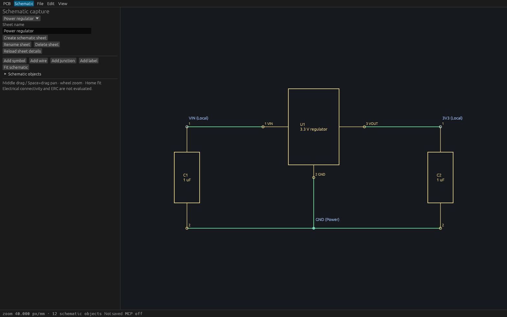

# Schematic capture on Linux

Choose **Schematic** in the desktop toolbar. Create or select a sheet, then add
symbols with numbered pins, wires, junctions and local/global/power labels.
Coordinates and dimensions accept millimetres with up to six decimal places.
Symbol pins use local coordinates; mirroring reflects local X before the selected
quarter-turn rotation. Choose objects in **Schematic objects** or click their
anchors to edit or delete them. Undo/redo use the same shared engine as agents.

Edits capture a complete sheet guard. A concurrent edit preserves the draft and
requires explicit reload before applying it. Reopening a document clears old
forms even when its project UUID is unchanged. **Reload sheet details** refreshes
the rename/delete guard; reload an object draft to adopt its current content.

Middle drag or Space+drag pans, wheel zooms, and **Fit schematic**, Home or
**View → Zoom to fit** fits the active sheet. PCB and schematic cameras are
independent. Changing workspace cancels an interrupted PCB gesture.

## Annotate symbols

Expand **Annotate symbols** in the schematic panel. Choose **Keep existing** to
preserve numbered references and fill available numbers, or **Renumber all** to
assign every reference again. Choose X then Y or Y then X ordering and a positive
starting number, then **Prepare annotation** to inspect the proposed changes.
Preparing changes no document data. **Apply annotation** changes references in
one undoable transaction across all sheets.

References use a 1–16 letter ASCII prefix and a positive number or `?` placeholder.
Allocation treats prefixes case-insensitively and numbers without leading-zero
distinctions; conflicting retained references require correction or renumbering.
Default sheet order is stable sheet UUID order. Agent clients can supply an
explicit complete sheet order to `preview_schematic_annotation`, then send the
returned guarded command to `annotate_schematic`.

A concurrent schematic edit rejects an old preview. Prepare it again to inspect
the current changes. Board-only edits preserve the preview. Reopening a document
clears the desktop preview. This operation changes schematic references only;
PCB synchronization is a separate capability.

The [Linux annotation verification report](verification/t0063-annotation-native.json)
records the tested production binary, 14 headless MCP checks, full workspace
gates, desktop input regressions and verification limits.

## Original regulator example

Open [the native example](../fixtures/schematic/regulator.viamind.json), which
contains three rectangular symbols, seven pins, five wires, a junction and three
net labels. This is original example geometry. Connectivity, ERC, buses,
hierarchy and board annotation are separate capabilities.

The image is a real wgpu native window at 1600×1000 using a temporary fixed-size
wrapper around the production `ViamindApp`, because the host's production window
was tiled too narrowly for inspection. It shows the same fixture and rendering
code. The actual application binary separately passed 12 checks through two
independent live HTTP MCP sessions: discovery, bounded immutable queries,
guarded edits, stale rejection, connection-specific undo, redo, native save and
same-project reopen. The report records binary/image identities and this limit:
[native verification report](verification/t0058-schematic-native.json).

Actual egui input regressions cover forms for every modeled object, pin identity,
edit/delete/undo, invalid exact-nanometre input, stale sheet/object guards,
same-project reopen, active-workspace fit, and interrupted PCB drag cancellation.
