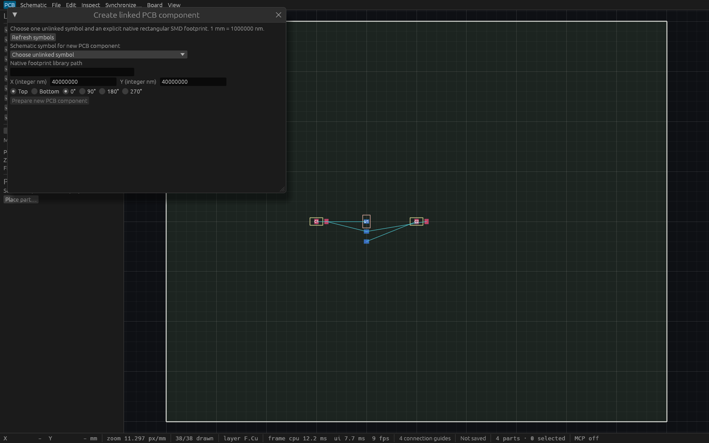

# Linked component creation verification

T-0072 implements the [public behavior contract](specs/schematic-component-creation.md)
and [explicit desktop/agent workflow](schematic-component-creation.md).

## Automated coverage

Five engine workflows verify typed/dynamic parity, immutable deterministic previews,
independently expected regulator VIN/3V3/GND groups across three created components,
exact off-grid bottom-side rotation/placement, unchanged schematic and existing
copper, one undo/redo with stable created IDs, native/log schema6 persistence,
numbering/geometry/assignment/ref/link/bounds failures, exact project/cursor
staleness, same-UUID reopen, batch rollback and resulting-project object limits.

Three actual egui input workflows exercise the Synchronize entry, symbol picker,
explicit library path, integer coordinate entry, side/rotation, prepare/create,
undo/redo, form-change invalidation, peer edit/reopen rejection, invalid coordinates
and missing files. Two deterministic controller tests verify the retained single
worker while hidden/replaced and literal stale same-stream completion guards.

A real two-client HTTP integration verifies tool/schema discovery, deterministic
read-only preview, a peer edit, stale rejection, creation as one event, connection
scoped independent undo/redo, and saved native identities. A peer can selectively
undo its own unrelated component while preserving the creator's linked component;
the creator's own Undo removes only its component.

Initial strict all-target Clippy and focused engine/desktop/worker gates passed.
The first full run found a test-only fixture mutation bypassing the UI action
catalog; that setup now uses UiAction. Production creation already used its
catalog action. Fresh source CI 38124548871 on 0ec09399 passed Linux rustfmt,
strict Clippy, workspace tests/build and UI/MCP parity. Final local Linux gate,
production/native evidence and integration CI are recorded below before review.

## Scope

One explicit rectangular SMD component per action, quarter-turn geometry and exact
numbered pin/pad graph mapping. Existing PCB/schematic geometry and copper remain
unchanged. There is no implicit library search, bulk replacement, component removal,
routed-net migration, placement/clearance or fabrication certification. Previews
carry exact project/stream/cursor guards and publish no new model identities.

## Full local Linux and production native evidence

Exact feature source `0ec09399b3be024e1a394e1ad8b8ac4d037b5bde`, based on merged
pad routing main `bf142bf`, passed fmt, strict workspace/all-target Clippy, complete
workspace tests (**422 passed, zero failed, one existing ignored**) and workspace
build. The production binary was copied while the shared build lock was held:
SHA256 `e1ba954636ec4c9bfd1bf46c0f18a8a204df5ab5a7cf498722d3b91e8c7a1ef4`.
Rebase onto cross-probing main preserves both controllers and catalog actions;
fresh combined CI gates the final PR head.

The actual production binary passed **17 headless stdio checks** with DISPLAY and
WAYLAND_DISPLAY removed ([report](verification/t0072-native-stdio.json)), and
**18 checks over actual desktop HTTP** on port 7897 with two independent clients
([report](verification/t0072-native-http.json)). Both runs verify independent
VIN/3V3/GND groups, geometry preservation, one undo/redo, schema6 persistence and
a same-UUID reopen where the old command's exact project still matches but its
old stream alone rejects. HTTP also verifies independent peer own undo/redo.
The public [verification script](../scripts/verify-schematic-component-native.py)
passed a separate fresh 17-check production stdio run.

Small-fixture debug creation took 2.76 ms over stdio and 6.66 ms over desktop HTTP
on a shared active development machine. These measurements do not establish
worst-case latency or frame-rate performance.

The actual tiled production window was 223×131; its [capture](verification/t0072-production-native.png)
is retained only as provenance. The readable image below comes from a separately
built fixed 1600×1000 [inspection wrapper](verification/t0072-component-inspection.rs)
around the unchanged production ViamindApp. It loads the actual saved HTTP
result (three linked components and the peer's independent R99), then opens the
creation form. All original symbols are already linked, so its picker has no
available symbol. The legacy automatic outline display is not a fabrication
boundary. Wrapper SHA256:
`74097964731374057b47735c88d5a81e62ce05103d8fc7682de1b6214aab3f5a`.

Cua Driver captured the exact wrapper PID/window at 1568×980 pixels. AT-SPI is
unavailable and metadata discovery is degraded; no native click/typing claim is
made. Actual input behavior is established by the egui pointer/key tests.

