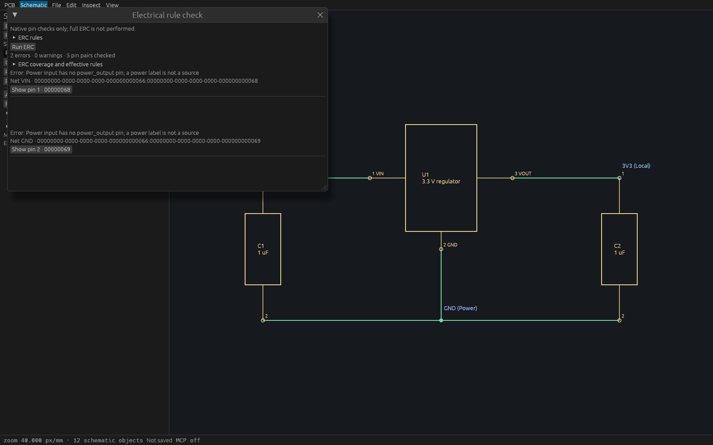
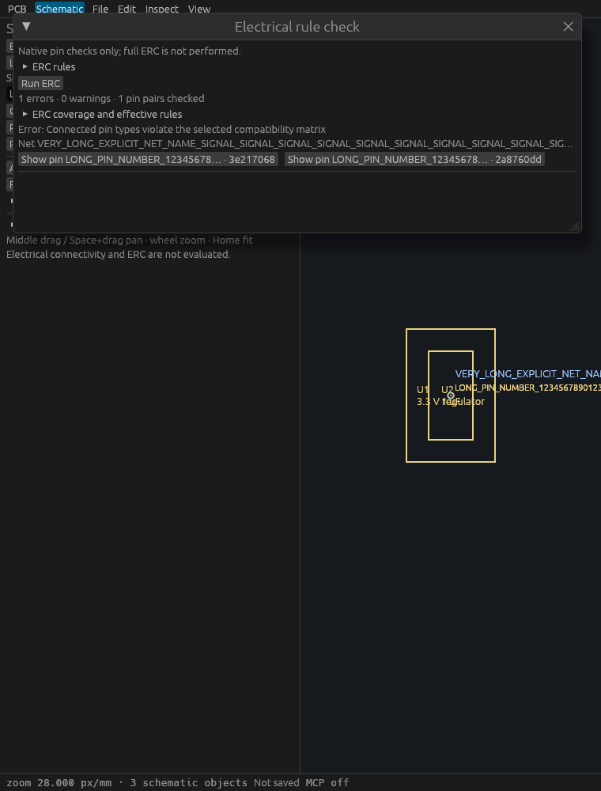

# Desktop native ERC verification

T-0067 adds a manual desktop workflow for the [scoped native ERC policy](specs/schematic-erc.md). The [desktop behavior specification](specs/schematic-erc-desktop.md) defines lifetime, freshness and navigation. Full ERC is never claimed.

## Linux gates and actual input

Feature head `d8e0fa9` passed formatting, strict workspace all-target Clippy, complete workspace tests and workspace build: **364 passed, zero failed, one existing ignored**, including doctests. A subsequent text-only sidebar correction describes the now-available manual check. A clean rebase onto current main is verified by fresh combined PR CI.

Three deterministic controller tests cover one retained pending receiver, cursor/policy freshness, project replacement, same-ID reopen with a new stream, stale completion and disconnected workers. Five actual egui input workflows exercise the production window:

- Run the original regulator check, navigate an exact pin without engine mutation, reject stale navigation after a peer edit and rerun.
- Change/reset a diagnostic severity, preserve model/history/selection and clear old results after same-project reopen.
- Show honest supported scope for an empty project, label stale zero-issue reports as historical, and verify UI/MCP action parity and invalid input rejection.
- Change an Output/Output matrix entry from Error to Warning through the actual 760-pixel form.
- Scroll a 40-issue virtualized report to its final diagnostic. The row allocation matches the actual font-scaled row height.

```sh
cargo test -p viamind-ui-egui erc
cargo test -p viamind-ui-egui --test erc
```

## Production MCP and native inspection

The verified production Linux binary was copied while holding the build lock and driven through real `--headless` stdio MCP without DISPLAY/WAYLAND_DISPLAY. Eleven checks passed, including discovery, deterministic immutable output, independent policy overrides, result truncation, undo/redo, clean exit and the actual 250000 pin-pair work bound. The original regulator reports the expected missing power-output sources on VIN and GND. [Recorded results](verification/t0067-native-mcp.txt).

Native captures use a temporary [inspection harness](verification/t0067-erc-inspection.rs) that loads the real native fixture into the production ViamindApp, opens the production ERC window and starts the real bounded worker. Cua Driver launches the exact binary and captures its exact window. AT-SPI is unavailable for this egui window: metadata discovery is degraded, so these are visual inspection evidence; interactive behavior is proven by the actual-input tests above. No Cua native click success is claimed.

The 1600×1000 window shows the original regulator and both expected issues. The 760×1000 window uses a [native stress fixture](verification/t0067-long-labels.viamind.json) with a 126-character net name and two 128-character pin numbers. Both pin buttons remain visible; summaries truncate while full names and stable identities remain available on hover. The stress fixture intentionally overlaps symbols to produce a connected output conflict. Captures predate only the sidebar wording correction.





## Scope and limits

One background request may run at a time, including through document replacement; old-stream completions are discarded. UI frames never join the worker. Fresh navigation requires the current project, stream, full source cursor and exact effective policy, then revalidates persisted sheet/symbol/pin identity and endpoint. Navigation changes local view state only.

The shared graph/pair/result bounds remain explicit. Incomplete or stale reports never certify a current all-clear. This increment adds no automatic ERC, hierarchy, buses, hidden-power inference, native markers/power flags or full ERC certification. Policy is per request and is not persisted in the design.
