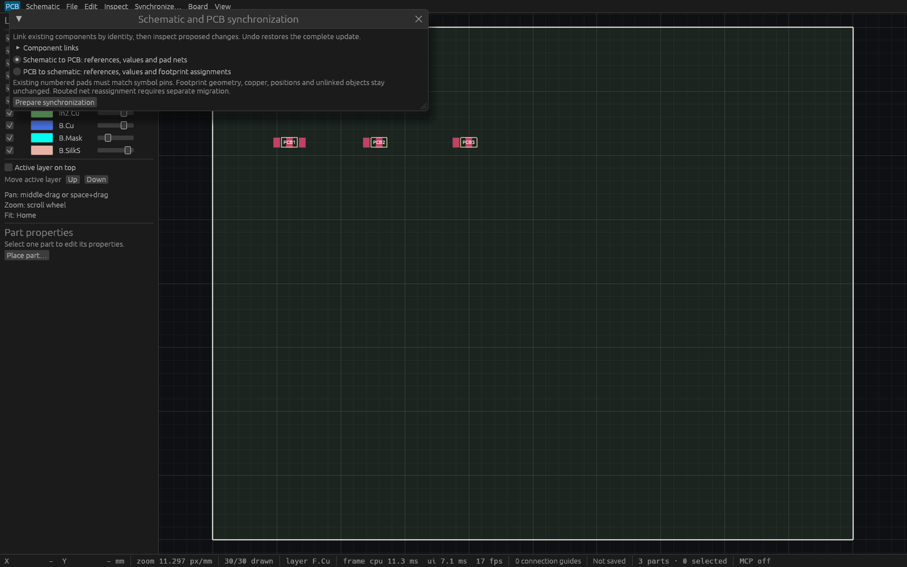

# Schematic and PCB synchronization verification

## Linux gates

Source `4ce0c3789d10efdb4bea2961b723f6e2f3164699`, based on merged schematic image exports, passed formatting, strict workspace all-target Clippy, all workspace tests/doctests and workspace build. **391 tests passed, zero failed, one pre-existing ignored**. The later integration rebase preserves the newly merged ERC menu/state alongside synchronization and requires fresh combined CI.

Eight engine tests cover exact identity links, native/log schema6, explicit unlink, no-op/stale guards, independent regulator net membership, two-sheet local labels versus shared power labels, backward property updates, renumbering, ambiguous mappings, routed-net rejection and batch rollback. Three actual egui input workflows cover explicit link-picker unlink/relink/duplicate rejection, preview/apply/undo, stale edits and same-UUID reopen. A deterministic actual-input test changes direction while a controlled worker is pending; completion from the previous direction is discarded without an Apply action or model mutation. A real two-client HTTP test covers discovery/object schemas, immutable previews, concurrent editing, one transaction, connection-scoped undo and persistence.

## Production native MCP

The copied production Linux binary SHA256 is `f8acec68bd9604be715fe64308dde87b61d9d62bba9dc3aa058d41069ea39ba5`. It passed sixteen [headless stdio checks](verification/t0066-native-stdio.json) without DISPLAY/WAYLAND_DISPLAY and sixteen [desktop HTTP checks](verification/t0066-native-http.json) through two independent agent sessions at port7893.

The original linked regulator fixture independently yields VIN=U1.1/C1.1, 3V3=U1.3/C2.1 and GND=U1.2/C1.2/C2.2. The native checks verify these groups, all unrelated model data, exact guards, one shared undo/redo, version6 save/reopen, reference-renamed back annotation and explicit unlink/undo. The production desktop stays open on its saved test file; older previews are preserved.

On this small debug-build fixture, stdio preview/apply took 5.73/7.24ms and desktop HTTP preview/apply took 6.06/4.88ms. These include transport/serialization and do not establish worst-case latency or frame cadence.

Reproduce with an absolute binary path:

```sh
python scripts/verify-pcb-sync-native.py --binary /absolute/path/to/viamind --report /tmp/sync-stdio.json
```

Optional `--url http://127.0.0.1:PORT/mcp` targets an owned test desktop process. It opens the original fixture, makes test edits, saves into a new temporary directory and leaves the process on that saved file. Dirty document replacement rejects. Use an isolated test application.

## Native visual evidence

Cua launched and inspected the exact production desktop, verified its PID/window identity and captured its [461×568 tiled frame](verification/t0066-production-native.png). AT-SPI is unavailable and the remaining canvas is narrow, so this is process/window evidence. Actual pointer/key behavior is established by the egui tests above; no native input success is claimed.

A separate fixed-size [inspection wrapper](verification/t0066-sync-inspection.rs) around the unchanged production ViamindApp provides readable controls. Cua captured the actual 1600×1000 frame (1568×980 returned pixels). The wrapper opens the real synchronization window on the original linked regulator fixture; it has no MCP endpoint and is distinct from the actual production MCP evidence above. It uses an unnamed in-memory document, so its Not saved status is expected. Pointer/key flows and the expanded link picker/change list are covered by the actual-input tests.



Final integrated source `f97c2e6161abf2dae092995fa8c1147e6b129e74` built with ERC and passed sixteen fresh [production stdio checks](verification/t0066-integrated-stdio.json), using SHA256 `807b1e9d26fd3e6e17df010aeedcf2bebd16ed5b0216d92ee0a702c6fee8ea34`. The wrapper binary SHA256 is `938da270fc6ba2e8b0cbffe9df36e463bcee0bae00610b477752f48568f1a89b`. Production and wrapper version/provenance remain separate.

## Scope

See [the user guide](schematic-pcb-sync.md) and [public behavior specification](specs/schematic-pcb-sync.md). Existing components/explicit pads only. Geometry replacement, component creation/removal, routed-net migration, hierarchy/buses and reverse electrical topology remain open. The atomic apply path recomputes bounded connectivity under the engine lock and can delay editing on large inputs.
