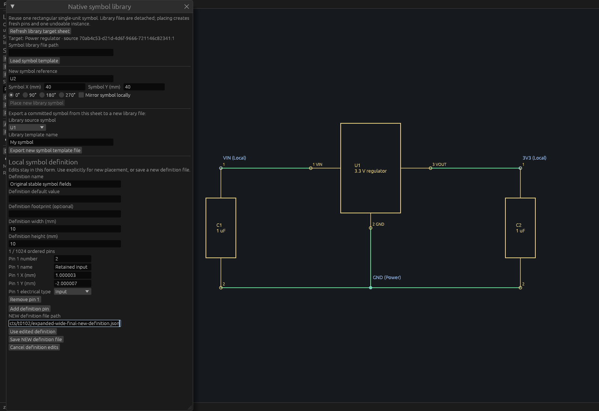
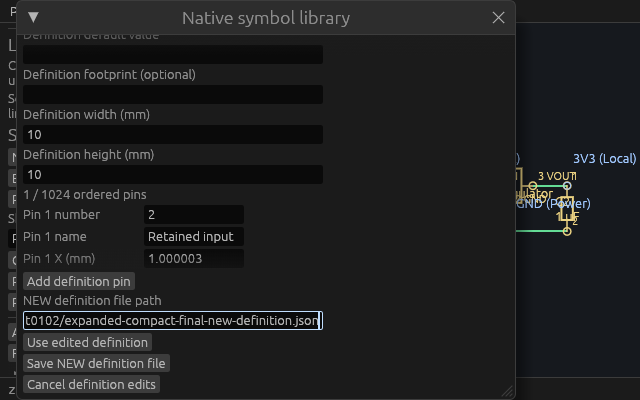
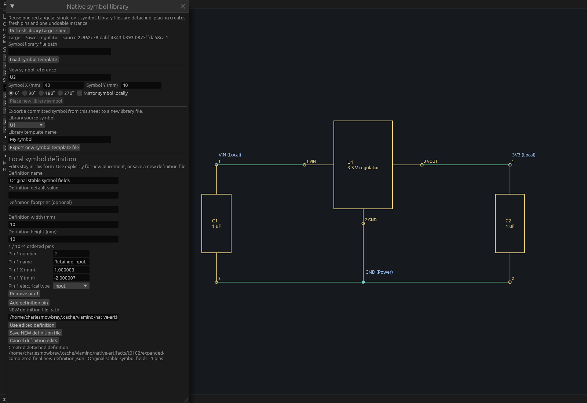

# Detached symbol editor identity and writer admission verification

The public-source [behavior spec](specs/symbol-editor-identity-bounds.md) was independently approved before implementation. This follow-up preserves actual metadata/pin/electrical control identity in the existing detached single-unit rectangular symbol editor and bounds secondary typed allocation in `save_symbol_template`.

## Identity and request limits

Each editor has a fresh root identity; each pin retains its own lifetime identity. Explicit field keys keep actual TextEdit and electrical popup IDs independent of row indices, surrounding metadata layout and virtualized placement. Removing an earlier row preserves surviving field IDs and stored keyboard cursor state. Clicking Remove changes focus normally. Starting another editor gets fresh identities.

Already-decoded MCP requests borrow pin count, known strings and path before constructing typed geometry. At most1024 pins,4096 UTF-8 bytes per known name/value/footprint/number field,256KiB known text aggregate and4096 path bytes are admitted. The1025-null-row oracle and oversized text paired with malformed geometry prove budget errors precede typed decode. Exactly-boundary borrowed values pass admission and remain subject to unchanged stricter native semantic validation. Transport JSON allocation is outside this boundary; the loader and unrelated expected-sheet decoding are not newly bounded here.

No model, native template format, tool schema or dependency changes. Geometry remains exact integer Nm; detached edits and NEW output do not update placed instances or the project's history/shared selection. Use and guarded placement remain separate.

## Existing file protection and remaining scope

Existing NEW publication never overwrites an existing destination and rejects the captured active native path. The symbol writer currently captures that path before I/O; publication does not yet recheck the latest document lifecycle under a shared guard. This inherited race hardening is a separate next ticket. No latest-path race guarantee is claimed here.

Single-unit rectangular body/pins only. Multi-unit symbols, arbitrary graphics and instance propagation remain open. Linux proof below does not claim OS input, compositor capture or frame cadence.

## Linux, real MCP and native renderer evidence

The [master](verification/t0102/master.json) indexes27 durable artifacts. Product source`87a940c23015c77eb0c5f6c53f2331e264115fda` on merged T99 passed the whole Linux gate50387: formatting, strict workspace/all-target Clippy, **716workspace tests,0failures,1existing ignored**, workspace build and inspection build. One additional identity-only prefilter test passed separately; it is not counted twice. The mutex remained held through doctests and unique binary copies, using refreshed workspace Rust mtimes, canonical shared target, two jobs and no incremental build.

All13 adversarial tooling tests,85-tool discovery, exact canonical catalog check and18 isolated workflow checks passed. The retained production executable SHA-256 is`c570aebf3e8d48562ce8e7004b2d325969aac9cc321d679c3681a07c9cd52cd6`. It passed **18stdio checks** in a fresh owned headless process and **18actual desktop HTTP checks** through two independent clients at7933, Cua-launched PID1785279. Both transports verify exact ordered odd-Nm pin geometry/type after detached NEW save/read, dirty full-session/status preservation, six borrowed count/text/aggregate/path refusals before malformed typed decoding, strict unknown/wrong types and collision/captured-native-file protection. Live `/proc` executable SHA and socket ownership were checked separately.

The new actual-input oracle retains all6 metadata and5 surviving pin/electrical AccessKit IDs, stored TextEdit cursor state and values after removing an earlier pin, virtualized wheel-away/back and metadata changes. It saves exact1.000003/-2.000007mm Input geometry without project changes and proves a replacement editor gets fresh IDs. Existing loaded-definition, guarded placement, stale/reopen, undo/redo and compact tests passed in the full suite. Earlier API/test-lint and overscan-target failures are retained in historical logs; none were claimed as runtime acceptance.

Inspection-only source`b6fc692dde6e` was refreshed under gate12587 with formatting, strict workspace/all-target lint and example build. Its executable SHA-256 is`395fb38d691493a41e6fdee74a978884d1dc7a16bcd52be3248835dea4d29345`. It independently parses the original native source, then follows the actual NEW two-pin editor workflow. The original source is not claimed UI-loaded in these captures. Actual pointer input expands the ordinary dialog before editing. The first row's complete Remove rectangle `[23,808,109.625,826]` fits its actual inner paint clip `[17,699,515,979]`; a fresh direct click must reduce2pins to1 before comparing field identities. Previous preparation attempts revealed a2px clipped inner viewport and stopped before native launch; their exact diagnostics/hashes are retained.

After local input, the host reflows to the final viewport and renders the real production ViamindApp through native WGPU. Each callback asserts full-session/document-status equality. An actual eframe Screenshot event writes exclusive opaque P6 pixels, fsyncs and closes the owned host. All3 hosts exited0 after11 UI passes. The callback count is not frame cadence. PNG encoding and an independent CRC/RGB decoder verify every native pixel.

- **Wide1600×1100:** all surviving pin fields, exact odd-Nm coordinates, Input type, NEW path, Use/Save/Cancel are readable. The unchanged regulator behind the dialog is committed project geometry, not a detached-symbol preview.
- **Compact640×400:** reachable NEW path and Use/Save/Cancel after scroll; some pin fields are clipped in the inner area and are not claimed simultaneously visible.
- **Completed1600×1100:** Created notice and wrapped NEW path are readable; the strict saved native symbol is retained and independently checked.

The exact Cua production snapshot was degraded AT-SPI discovery with223×135pixels; it provides process/window provenance only. Readable editor proof comes from the fixed native WGPU inspection hosts above. No desktop configuration, compositor input or old production/previews were changed.

Repeat `scripts/verify-symbol-definition-native.py --binary RETAINED_APP --report NEW_REPORT` for fresh isolated stdio; add `--url http://127.0.0.1:OWNED_PORT/mcp` only for an explicitly owned scratch desktop engine. The HTTP verifier starts a new scratch document. Native driver and encoder are retained in the artifact directory; all output destinations must be NEW. `verify-artifacts.py` checks the durable master and three complete PNG RGB readbacks.

Final integration and exact-head CI remain merge gates; historical product/helper identities above remain fixed.
