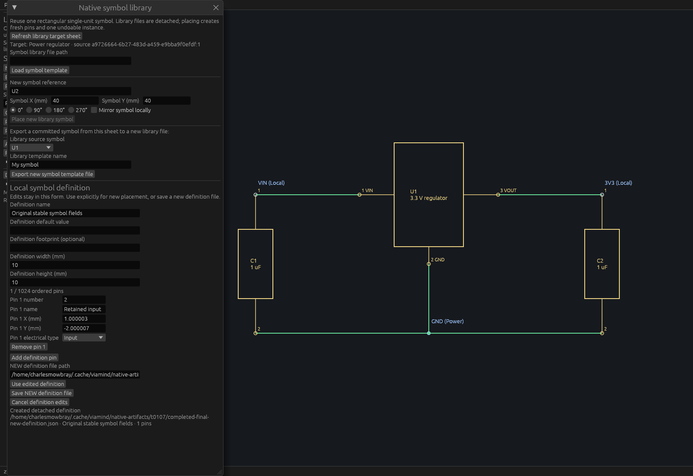

# Current-native guarded symbol publication verification

The public-source [spec](specs/symbol-publication-lifecycle.md) was independently approved before code. Both detached `save_symbol_template` and source `export_symbol_template` now prepare bounded synchronized private sibling files outside locks, then publish NEW under the shared current native-file lifecycle guard. Existing valid symbol bytes, schemas, source capture guards, separate placement and UI remain unchanged.

## Publication and capture semantics

The guard excludes native save/open/new/replacement through the final current-path check and no-clobber publication. It releases the design mutex before publication; ordinary design commands remain available. Existing or newly racing destinations and canonical native aliases are preserved. Staging owns its temporary file and cleans up ordinary failure/drop paths. Requested and resolved paths are limited to4096 encoded bytes; strict1024-pin/256KiB text/1MiB native serialization limits remain authoritative.

Source export checks its project UUID/full cursor and source sheet/symbol identity when capturing one bounded template. Its `exported_cursor` identifies that capture. Ordinary edits during staging do not invalidate already captured bytes. Detached save introduces no project cursor guard and changes no design/history/selection/status. No filesystem-wide atomicity, hostile parent-directory replacement protection or directory durability after power loss is claimed; the pinned no-clobber primitive's documented platform limitations apply.

## Deterministic and full Linux checks

The [master](verification/t0107/master.json) indexes23 durable artifacts. Focused gate58974 at source`bcc19a1c9310bc7d5a973e371d916d4145548b6a` passed formatting, strict workspace/all-target Clippy and11 tests:2doc-stage,3both-writer engine,1shared lifecycle-lock liveness and5existing symbol integration cases.

For **both** writers, hooks after staging complete a peer native save or guarded open before publication. The latest active-native error must precede a generic collision error, and the peer's resulting full session/status/native bytes remain exact. Separate racing-destination cases preserve bytes and clean stages. Ordinary peer edits remain live during staging, retain their complete state and leave exported bytes/capture cursor intact. Shared lifecycle tests prove publication waits for in-flight save, excludes native transitions and permits ordinary commands inside the publication section. These deterministic test hooks are not described as production MCP scheduling evidence.

After clean integration onto merged T102 main`adf2d9f`, full gate11007 passed on source`3921f3c797cd53250edf0dad1343026bba70d55c`: **747workspace tests,0failed,1existing ignored**, formatting, strict workspace/all-target Clippy, workspace build and reused inspection example build. The mutex remained held through doctests and unique executable copies; workspace source mtimes were refreshed with the canonical shared target, two jobs and incremental disabled. All13 tooling tests,88-tool full discovery/exact committed catalog comparison and18 isolated agent workflow checks passed. No tool catalog bytes changed.

## Actual production MCP and native output

Retained production executable SHA-256`ca3192d61a6ed77b01ca636660d60c914c49f14b6c3a4b8c3d7a384de69f50c6` passed18detached-writer plus17save/export checks over fresh stdio. Cua-launched PID1938478 at7937 passed the same **35actual desktop HTTP checks**, each verifier using two independent clients. Live `/proc` SHA and listener ownership matched the retained executable. Checks cover exact ordered source export and detached bytes, captured cursor, dirty full-session/status/shared selection preservation, native/collision/symlink refusal, stale export rejection, strict borrowed writer limits and original fixture protection. The earlier historical script preflight only validates the harness and is separately identified.

The exact Cua production snapshot returned readable1568×980pixels showing retained KEEP1/PEER2 and selected dirty work. AT-SPI was degraded; no OS input claim is made.

The unchanged T102 inspection example was built from the **new product source**; executable SHA-256`a34c0ff38b02613d020035ffbeef27ca1c992f085fee694ee137e1a7d88dc897`. Actual local egui input creates/edits a detached definition, removes an earlier pin with stable field IDs, selects Input, enters exact1.000003/-2.000007mm geometry and clicks Save NEW. Native WGPU renders the real production app and captures the readable Created/path notice at1600×1100. Each callback verifies full session/status invariants; the owned host PID1939965 fsyncs one opaque P6 readback and self-closes exit0 after11UI passes. The count is not frame cadence. Lossless PNG encoding and independent CRC/fullRGB readback verification preserve every pixel. No compositor input or old preview changes are claimed. The regulator behind the dialog is unchanged committed project geometry.

Repeat `scripts/verify-symbol-publication-native.py --binary RETAINED_APP --report NEW_REPORT` for isolated stdio. Add `--url` only for an explicitly owned scratch engine: the verifier opens a temporary project and makes deliberate peer edits. `verify-symbol-definition-native.py` repeats the bounded detached writer cases. All output paths must be NEW. `docs/verification/t0107/verify-artifacts.py` verifies23 durable hashes and the complete native PNG RGB image.

Final combined CI and independent final review remain merge gates. Multi-unit symbols and the inherited compact nested pin-layout clipping remain separate work.
