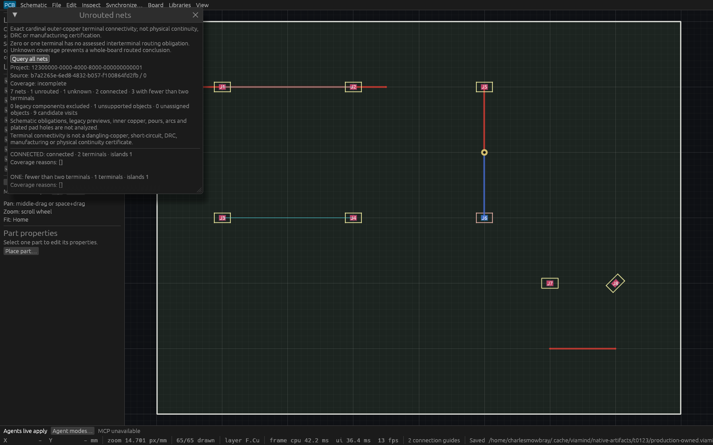

# One-call unrouted-net observation verification

`query_unrouted_nets` accepts exactly `{}` and returns one complete bounded net inventory, with the project UUID and full captured event cursor. The desktop action is **Inspect → Unrouted nets… → Query all nets**. Both use the same admitted engine capture, analysis and result limits. Existing paginated net queries and conservative connection guides remain compatible.

## Meaning and limits

The query analyzes explicit quarter-turn rectangular outer-layer pads, cardinal round-ended tracks and intact circular through-via annuli using doubled integer nanometres. Interior and boundary contacts count. Drill centres do not count as copper. Unsupported geometry and relevant drill uncertainty take precedence over a supported apparent connection. The result is a scoped model observation, not physical continuity, DRC or manufacturing acceptance.

| Status | Meaning | `unrouted` |
| --- | --- | --- |
| `connected` | At least two explicit pad terminals in one supported copper component | `false` |
| `disconnected` | At least two terminals in separate copper components | `true` |
| `insufficient_terminals` | Zero or one terminal; no assessed interterminal obligation | `false` |
| `unknown` | Assigned unsupported geometry or drill uncertainty prevents a conclusion | `null` |

Pad, track, via and document-rule names all appear, including definitions without pad terminals. Orphan copper islands do not create an interterminal obligation. Legacy components without explicit pads are counted as excluded; they make whole-board coverage incomplete. Check `complete` and every unknown row before drawing a whole-board conclusion. Schematic obligations, inner copper, pours, arcs, plated pad holes, shorts and dangling-copper acceptance are excluded.

The complete call refuses beyond100000 structural objects,10000 distinct names,2MiB aggregate relevant net text,1million contact/hole candidates or8MiB serialized result. Names are exact, trimmed, control-free and limited to128 Unicode characters/512UTF8bytes. Supported transformed coordinates are within±1000mm and positive dimensions within100mm. Counts and borrowed names are checked before secondary copies. Unrelated sourcing, artwork, labels and schematic contents are excluded from capture. Two nonwaiting process-wide slots remain owned by the actual worker through capture, analysis and bounded result serialization, including after caller cancellation. There is no truncation or pagination.

## Original exact-source verification

The original product and inspection source is `2d96cf0ba6ca226927245308eb4601ecfbaa62cc`, based on reviewed T117 `d4a4baa1be4e304e40c1001dc1e231e555292d98`. Earlier focused source `aa5cbe870b26c4cee884996238d1203a877e1723` passed19 tests:10 exact engine/contact/budget tests,2 actual MCP tests,2 controlled desktop worker tests,4 catalog parity tests and1 actual compact input test. The original full run passed **934 workspace tests, zero failed, one ignored**, format and strict workspace all-target Clippy, including the inspection example. Its subsequent normal-profile build reused a stale shared engine library and could not find the newly exported query. The failed build log is retained. A locked refresh touched this checkout's Rust inputs and successfully built the complete workspace and inspection example without source-content changes. All four Linux requirements are therefore recorded for this exact source; the initial full command's exit101 is disclosed separately.

The engine tests cover interior track/pad joins, perpendicular and width-only contacts, one-nanometre gaps, wrong side/net, asymmetric mirrored quarter-turn pads and odd half-nanometre extents, annulus radial intervals, two-layer via bridges, fully drilled terminals, foreign/unassigned/overlapping drills and extreme scalar rejection. They also cover full1201-net inventory, unsupported/legacy coverage, aggregate object/text/net/output/candidate limits, unchanged complete state and unused poisoned sourcing/schematic content. The cancelled actual registry awaiter retains admission until its blocked worker retires. Desktop tests cover controlled spawn failure, disconnected-worker recovery, disabled duplicate controls, hidden polling, compact scrolling and stale full-cursor notices. No test gate or assertion was weakened.

## Actual production evidence

[Production report](verification/t0123/production-report.json) records **58 passed checks**. Three initialized headless production processes use Live, Approval and startup ReadOnly modes. Each discovers the strict observation, returns the same seven fixture rows, repeats deterministically, rejects unsupported arguments and preserves complete session, document status, automatic DRC state and native bytes. A fourth initialized read-only production process answers **all1201 disconnected nets in one call**, beyond the previous1000-row page limit. The deterministic larger fixture is generated by the portable driver from the authored seed.

Two freshly initialized same-name HTTP clients observe the actual production desktop on port7955, with PID-owned listener and exact executable checks. They return identical full results and preserve the original full session/status/automatic DRC/native file. The retained production executable is `full-verified/viamind`, SHA256 `c716d3fe9e9dee6f80b43d59158512413dd74a4cf0b44de96e1ef6f13480d888`. Root independently reran all58 production checks; its report is retained unchanged. These are read-only probes of owned fixtures; no peer model edit or OS input is claimed.

## Native desktop evidence

The inspection-only example uses the production `ViamindApp` in a fixed1600×1000 native WGPU viewport. Four local egui pointer events click the actual Query control. Before capturing, the host checks that the Query button, incomplete coverage and exact7-net status summary are fully inside their painted ancestor clips. It asserts full session, native path and native bytes unchanged. Frame8 captures original P7 RGBA and matching P6 RGB channels, writes/fsyncs the invariant report, and requests Close. The host requested Close and was observed absent afterward, with an empty runtime log. The launcher returned after spawning, so no numeric host exit status is claimed. No kill or compositor operation was used.

The retained inspection binary SHA256 is `4d083742f084d260f5f333c11a7b76c92338456a9c6f354c6bf34e36d287057f`. [Native report](verification/t0123/native-report.json) and [channel comparison](verification/t0123/native-channels.json) identify the actual source, process, input count and capture facts. The raw channels are retained at the paths in the master. PNG encoding preserves them exactly: independent FFmpeg decoding compared all6.4million RGBA samples; every4.8million RGB sample also equals the P6. Alpha happened to be255 throughout this capture; no opacity assumption or flattening was used. The initial verification-only encoder wrote this exact PNG then stopped because Pillow was unavailable; the corrected script verified those existing bytes through installed FFmpeg. Product code, native capture and binary were unchanged. Root separately decoded the original captures and inspected the readable native image.



The pixels come from the actual application's WGPU Screenshot event. This is a local application input harness, not Cua or OS input evidence. No foreground automation, desktop configuration change or frame-cadence claim is involved.

## Reproduction

Use fresh owned paths and the actual verified application binary. The driver creates its output directory with no replacement, generates its fixtures, starts initialized headless sessions and optionally observes an already-running owned desktop:

```sh
VIAMIND_MCP_PORT=7955 /absolute/verified/viamind \
  --open "$PWD/fixtures/connectivity/one-call.viamind.json" --agent-read-only
python3 docs/verification/t0123/production-probe.py \
  --repo "$PWD" --binary /absolute/verified/viamind \
  --directory /absolute/NEW-production-proof \
  --url http://127.0.0.1:7955/mcp --pid ACTUAL_PID \
  --expected-native "$PWD/fixtures/connectivity/one-call.viamind.json"
/absolute/verified/unrouted-inspection \
  "$PWD/fixtures/connectivity/one-call.viamind.json" /absolute/NEW-native-proof
python3 docs/verification/t0123/verify-native.py /absolute/NEW-native-proof
```

The inspection binary is built with `cargo build -p viamind-ui-egui --example t0123_inspection`. Capture conversion uses installed FFmpeg. The [master index](verification/t0123/verification.json) separates original source, failed build scope, successful refresh, actual production, independent reviews and native channel identities. Executables and raw large captures are retained outside Git. Final combined integration and exact-head CI are recorded separately before merge.

## Final combined verification

Only the six original T123 commits were transplanted, followed by one integration regression commit, onto frozen T119 proof `9a28241450969f2cecc9068e15393e515b639b97`. Final verified product source is `6dbbbd6caaa160be0d114c97461ae7a7fbf89bf8`. The integration adds the optional absent artwork constructor and a regression with100001 invalid unused silkscreen segments: copper capture excludes that noncopper content and preserves the complete original session. All original proof above retains its original source and binary identities.

The [final combined gate](verification/t0123/final-combined.log) passed format, strict workspace all-target Clippy,19 focused engine/MCP/desktop/catalog tests, the complete workspace build and inspection example build. Own Rust inputs were forced fresh under the shared whole-workspace mutex before compilation. Unique retained binaries were copied before releasing it. Actual final application discovery and committed-reference drift verification pass **115 tools**, the isolated agent workflow passes18 checks, and13 reference-tooling tests pass. No second broad workspace test run was inferred: original934 tests and this scoped integration are recorded separately.

[Final production report](verification/t0123/final-production-report.json) passes all58 checks again against the retained combined binary: three startup modes, the complete1201-net call, and two initialized same-name HTTP observers on the actual read-only desktop **PID3075669 / port7957**. The original7955 process remains preserved. Final executable SHA256 is `5a2d2a81b202788436556cd4524fd9f4b1b27cea1123346625d5c8188d05142c`.

The fresh [final native report](verification/t0123/final-native-report.json) uses the same production application and four actual local egui input events. The exact combined inspection executable SHA256 is `bbc3551ff275ee5040d67d659cba6bcf805df062862002a4369d83044c0d9540`. Original P7 RGBA and P6 RGB were fsynced, then all6.4million RGBA and4.8million RGB samples independently matched FFmpeg PNG decoding and the P6. Full session/native invariants and ancestor-clip readability checks pass. Inspection PID3076404 requested Close and was observed absent afterward; its launcher did not retain numeric exit status. No OS/compositor/cadence claim is made.


The master separates original and combined binaries, raw capture paths and source IDs. Final exact-head CI is the remaining merge gate at packaging time.

### Current Rust compatibility correction

CI38180135385 on proof head42eadec found one compatibility failure: its newer Rust toolchain deprecates `AtomicUsize::fetch_update`, while local Rust1.98.1 accepts it. The [failed job log](verification/t0123/final-ci-clippy-failed.log) is retained. Product correction `4eec348b04cb2b3e40ab60d3a0a5f7bd7433ea34` uses the equivalent two-slot `compare_exchange_weak` retry loop with unchanged Acquire/AcqRel ordering. The [scoped correction gate](verification/t0123/ci-refresh.log) passed format, strict workspace/all-target Clippy,14 unchanged engine/MCP/desktop tests including actual cancelled awaiter and retained worker admission, workspace build, and the exact115-tool catalog check. Its unique retained application SHA256 is `d41410d2f088a077c55f9133fe71353ce70e8ba29abad8790524d50598e82e8b`.

Actual58-check HTTP/native proof remains explicitly tied to combined6dbbbd6 and its5a2d2a81/bbc3551f binaries; it is not relabeled as runtime proof of the API compatibility correction. No repeated broad tests or native capture were inferred. Fresh exact final-head CI remains required. The later T118 command-hook integration must refuse captured pre-hook query entry before reserving admission and refuse captured-work execution before taking the engine lock; this branch deliberately has no hook subsystem yet.

The exact115-tool combined catalog is also retained immutably in `docs/verification/t0123/catalog-final/`; the evidence index hashes these source-scoped snapshots rather than the evolving global generated reference. Later added tools therefore cannot invalidate this historical proof.

### Inherited desktop property test correction

The three reviewed T119 followups from `9a282414..1293b30d` are included after the T123 compatibility proof. Only the sidebar test input helper changes: it establishes scroll/layout and keyboard focus before entering the replacement designator, then asserts the typed value. Product source and the T123 runtime identities above are unchanged. T119 retains its reproduced CI failure and successful three-property-test/format/strict-lint receipts under `docs/verification/t0119/`; its historical114-tool catalog is now an immutable snapshot. T123's own115-tool reference is preserved. No additional broad gate or native rerun is inferred from this test-only integration. At integration time, previous T123 CI38180459745 had successful format/Clippy jobs and its Linux workspace job was still running; no failure conclusion is attributed to that unfinished job. Fresh exact-head CI remains the merge gate.
